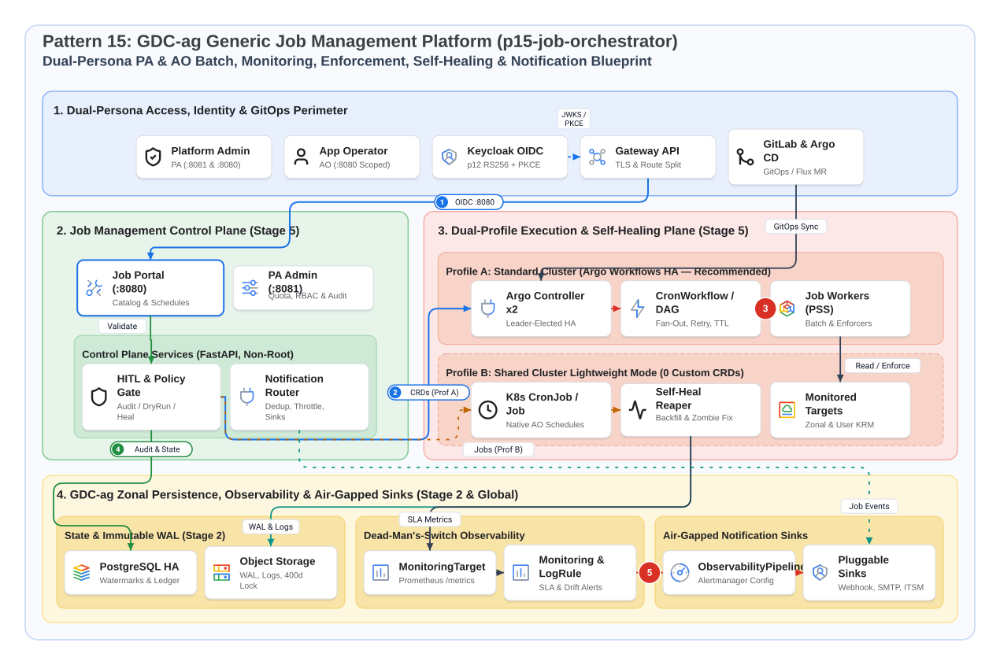

<!--
Copyright 2026 Google LLC

Licensed under the Apache License, Version 2.0 (the "License");
you may not use this file except in compliance with the License.
You may obtain a copy of the License at

    http://www.apache.org/licenses/LICENSE-2.0

Unless required by applicable law or agreed to in writing, software
distributed under the License is distributed on an "AS IS" BASIS,
WITHOUT WARRANTIES OR CONDITIONS OF ANY KIND, either express or implied.
See the License for the specific language governing permissions and
limitations under the License.
-->

Copyright 2026 Google. This software is provided as-is, without warranty or representation for any use or purpose. Your use of it is subject to your agreement with Google.

# **Solution Reference Implementation - Pattern 15: GDC-ag Generic Job Management & Orchestration Platform (`p15-job-orchestrator`)**

> **Version:** 1.3  
> **Specification ID:** `PRD-GDC-AG-P15-JOB-ORCHESTRATOR`  
> **Target Environment:** Google Distributed Cloud Air-Gapped (`GDC-ag` `v1.16.2+`)

---

## **1. Overview & GDC Air-Gapped Architecture**

Disconnected sovereign organisations operating on **Google Distributed Cloud Air-Gapped (`GDC-ag`)** lack public-cloud managed schedulers and workflow engines, yet must run continuous batch rollups, platform hygiene monitors, bounded compliance enforcement, and incident notifications without violating **Shared Cluster** zero-CRD constraints or fighting declarative GitOps controllers.

**Pattern 15 (`p15-job-orchestrator`)** resolves this tension with a **Dual-Profile Generic Job Management & Orchestration Platform** serving both **Platform Administrators (`PA`)** and **Application Operators (`AO`)**. A single hardened control plane (`p15-job-manager`) exposes an offline Web Portal and OpenAPI 3.1 REST API on Port `8080`, isolates PA governance controls on Port `8081`, compiles jobs to either **Argo Workflows (`Profile A`, Standard Clusters)** or **native Kubernetes `CronJob`/`Job` (`Profile B`, `0` CRDs on Shared Clusters)**, decouples execution from PostgreSQL switchovers via Object Storage Write-Ahead Logs (`WAL`), and pairs external Alertmanager dead-man's-switch rules with a signed transactional notification outbox.



### **1.1 GDC-ag Endpoint, Port & Persona Matrix**

> [!NOTE]
> Identity roles (`pa-job-admin`, `ao-job-operator-<project>`, and `job-viewer-<project>`) are provisioned in your organisation's production **Keycloak (`p12-keycloak`)** realm (`ALLOW_SIMULATED_OIDC: "false"` in [`p15-job-orchestrator/chart/values.yaml`](../../p15-job-orchestrator/chart/values.yaml)). See [`docs/operations/keycloak_integration_guide.md`](../operations/keycloak_integration_guide.md) for production realm configuration.

| GDC-ag Endpoint / Plane | Port | Target Service / API | Persona & Cookie Scope | Purpose |
| :--- | :---: | :--- | :--- | :--- |
| **`https://jobs.gdc.local`** | `8080` | `svc/p15-job-manager` | `AO` & `PA` (`jobs_user_session` HMAC cookie; `ao-job-operator-<ns>`, `job-viewer-<ns>`, `pa-job-admin`) | **Job Portal & OpenAPI REST API**: Offline SPA dashboard, schedule CRUD, Next-5 UTC/IANA cron preview + DST warnings, `Run Now` & historical backfill, redacted Object Storage log viewer, four-eyes HITL queue, and namespace notification sinks. |
| **`https://admin.jobs.gdc.local`** | `8081` | `svc/p15-job-manager` | `PA` Only (`jobs_admin_session` HMAC cookie; `pa-job-admin` required — `401`/`403` for `AO`) | **PA Platform Admin Console**: Cross-project job inventory, **Emergency Pause-All Kill-Switch**, `ALLOWED_NOTIFICATION_HOSTS` SSRF governance, approved worker template/Harbor prefix policy, namespace concurrency quotas, and immutable audit export. |
| **`svc/p15-job-manager:9091`** | `9091` | `/metrics` (`MonitoringTarget`) | GDC Cortex / Prometheus (`IO` / `PA`) | **Telemetry & Dead-Man's-Switch Scrape Port**: Exposes 7 Prometheus metric families (`gdc_job_last_success_timestamp_seconds`, `gdc_job_runs_total`, `gdc_job_duration_seconds`, `gdc_job_watermark_lag_seconds`, `gdc_job_enforcement_violations_total`, `gdc_job_self_heal_actions_total`, `gdc_job_circuit_breaker_open`) + outbox dead-letter counters. |
| **`https://keycloak.gdc.local`** | `443` | `svc/keycloak` (`p12-keycloak`) | `PA` / `IO` (`gdc-jobs-realm`) | **Keycloak OIDC Identity Provider**: Issues RS256 JWTs with PKCE (`S256`) and group RBAC claims for `:8080` and `:8081`. |
| **`https://objectstorage.gdc.goog`** | `443` | Zonal `Bucket` (`object.gdc.goog/v1`) | Projected K8s Secret (`s3v4` + `AWS_CA_BUNDLE`) | **400-Day Retention-Locked Ledger**: Stores secret-redacted job WALs, `result.json` artifacts, and pre-remediation KRM rollback snapshots. |

---

## **2. Key Solution Capabilities**

* **Dual-Profile Execution Engine (`argo` vs. `k8s-native`):**
  * **Profile A (`engine.mode: "argo"`, Standard Cluster Recommended):** Compiles multi-step DAGs and dynamic sharded fan-out (`maxShardsPerRun=50`) into `CronWorkflow`/`Workflow` backed by HA `workflow-controller` (`replicas: 2`, PDB, `podGC: OnWorkflowSuccess`, `archiveLogs: true`) and `ClusterWorkflowTemplate/gdc-standard-job-runner-v1`.
  * **Profile B (`engine.mode: "k8s-native"`, Shared Cluster Default):** Compiles directly to native `batch/v1` `CronJob` and `Job` (`ttlSecondsAfterFinished: 86400`) requiring **`0` CRDs** and **`0` `ClusterRole`s**, enabling seamless promotion from Profile B to Profile A with zero worker image changes.
* **Orchestrator-Agnostic Contract & GDC Object Storage Adapter:**
  * Unified `python3 -m p15_jobs.runner` CLI contract (`exit 0` success, `exit 2` non-retryable config failure, transient backoff otherwise) writing redacted WALs to GDC S3 (`boto3` `s3v4` + `AWS_CA_BUNDLE`) backed by a 400-day retention-locked Zonal `Bucket`.
* **Three Generic Reference Starter Workers (`p15-reference-worker`):**
  * `batch-watermarked-rollup` (UTC windowed shard aggregation + idempotent watermark progression), `monitor-platform-hygiene` (read-only TLS expiry, CrashLoop, unbound PVC, and quota checks), and `enforce-resource-policy` (governed compliance remediation).
* **Two-Layer Self-Healing & Anti-ClickOps GitOps Protection:**
  * **Layer 1 (Execution & Ledger):** K8s `Lease` singleton Zombie Reaper, `M=5` consecutive-failure circuit breaker, bounded PostgreSQL pools (`min=1, max=10`, `pool_pre_ping`, `15s/5s/3` keepalives), and Object Storage WAL replay surviving unplanned PostgreSQL `DBCluster` HA automatic failovers on GDC-ag `v1.16.2+` (`~90s` `3×30s` health-check detection + standby promotion, `~2+ min` typical total RTO; [Configure high availability](https://docs.cloud.google.com/distributed-cloud/hosted/docs/latest/gdcag/application/ao-user/db-configure-ha#about-high-availability)) and planned maintenance windows with zero lost runs.
  * **Layer 2 (Bounded Target Remediation):** `audit` (default) $\rightarrow$ `hitl-approval` (four-eyes + SHA-256/`resourceVersion` `409 Conflict` TOCTOU guard) $\rightarrow$ `auto-remediate` (`maxActionsPerRun=5`, `3600s` cooldown, `< 1h` GitOps tug-of-war downgrade, 1-click snapshot rollback), plus Argo CD / Flux read-only YAML/MR export.

---

## **3. Resource Requirements (T-Shirt Sizes) & Compute Profiles (`GDC-ag`)**

Pattern 15 is **100% CPU-based (`0 GPUs` required)** across all control-plane and starter worker tiers.

### **3.1 Component-Level Resource Footprint**

| Component | Replicas | CPU Request / Limit (Per Pod) | Memory Request / Limit (Per Pod) | GPU Required? | Notes |
| :--- | :---: | :--- | :--- | :---: | :--- |
| **`p15-job-manager` (Control Plane `:8080`/`:8081`/`:9091`)** | `2` (`PDB minAvailable: 1`) | `250m` / `1000m` | `512Mi` / `1Gi` | **No** | K8s `Lease` singleton coordinates Reaper, Watcher & Outbox Dispatcher. |
| **Argo `workflow-controller` & `argo-server` *(Profile A Only)*** | `2` + `2` | `250m` / `1000m` | `512Mi` / `1Gi` | **No** | Omitted completely in Profile B (`engine.mode: "k8s-native"`). |
| **`p15-reference-worker` (Per Ephemeral Shard / Run)** | Ephemeral (`1..50`) | `100m` / `500m` | `256Mi` / `512Mi` | **No** | Governed by `PriorityClass`, `ResourceQuota`, `LimitRange`, and `ttlSecondsAfterFinished: 86400`. |

### **3.2 Cluster & Stage 2 Persistence T-Shirt Sizing Tiers**

| Tier | Target Topology | Compute Pool (`0 GPUs`) | Stage 2 `DBCluster` (`postgresql.dbadmin.gdc.goog/v1`) | Stage 2 `Bucket` (`object.gdc.goog/v1`) |
| :--- | :--- | :--- | :--- | :--- |
| **Small — Shared Namespace (`Profile B`)** | Existing GDC-ag Shared Cluster | `~1–2 vCPU`, `2–4 GiB RAM` namespace quota | Shared/Project HA `db-custom-2-8` (`100Gi`) | `defaultObjectRetentionDays: 400` (`50Gi+`) |
| **Medium — Standard Pilot (`Profile A`, Default)** | Dedicated Standard Cluster | `2x n2-standard-4-gdc` (`8 vCPU`, `32 GiB RAM`) | Dedicated HA `db-custom-2-8` (`enableHighAvailability: true`, `enableAutoFailover: true`, `100Gi`) | `defaultObjectRetentionDays: 400` (`250Gi+`) |
| **Large — Enterprise Enclave (`50+` Jobs)** | Dedicated Standard Cluster | `3–4x n2-standard-8-gdc` (`24–32 vCPU`, `96–128 GiB RAM`) | Dedicated HA `db-custom-4-16` (`enableHighAvailability: true`, `enableAutoFailover: true`, `200Gi+`) | `defaultObjectRetentionDays: 400` (`1Ti+`) |

---

## **4. Stage 2 (`2-resources`) Zonal & Global Pre-Deployment Setup**

### **4.1 Summary of Manifests & Helm Parameters to Update**

| Subsystem | Stage 2 / Raw Manifests (`p15-job-orchestrator/manifests/`) | Stage 5 Helm Chart (`p15-job-orchestrator/chart/values.yaml`) | Required Target Cluster Customisation |
| :--- | :--- | :--- | :--- |
| **1. Global Network & DEP Ordering** | `gdc/network/pnp-intra-project-egress.yaml`, `gdc/network/pnp-cross-project.yaml`, `gdc/iam/permissions.yaml` | External to Stage 5 (`gdc.enabled: false`) | Apply `pnp-intra-project-egress.yaml` **FIRST** on `GLOBAL_KUBECONFIG` before disabling DEP; replace peer project labels in `pnp-cross-project.yaml` (zero `0.0.0.0/0` CIDRs). |
| **2. PostgreSQL 15 HA & Bucket** | `gdc/db/postgres.yaml`, `gdc/storage/bucket.yaml` | `database.host`, `storage.bucketName`, `storage.s3Endpoint`, `gdc.failover.enabled` (`false`) | Provision Stage 2 PostgreSQL HA `DBCluster` on GDC-ag `v1.16.2+` (explicitly setting `enableHighAvailability: true` & `enableAutoFailover: true` on RaaS HA `dbcluster.dbadmin.goog/raasEnabled: "true"`; [Configure high availability](https://docs.cloud.google.com/distributed-cloud/hosted/docs/latest/gdcag/application/ao-user/db-configure-ha#about-high-availability)) and 400-day retention `Bucket`; bind projected credentials (`p15-db-credentials`, `p15-s3-credentials`) into workload cluster. |
| **3. Execution Profile & Quotas** | `apps/argo-ha-workloads.yaml`, `apps/argo-workflow-templates.yaml`, `apps/job-manager.yaml`, `apps/starter-cronjobs-profile-b.yaml` | `engine.mode` (`argo` or `k8s-native`), `jobManager.maxShardsPerRun` | Choose `argo` on Standard Clusters (install Argo v3.6.2 **`manifests/base/crds/minimal`** CRDs first), or `k8s-native` on Shared Clusters (`0` CRDs and `0` `ClusterRole`s rendered automatically). |
| **4. Gateway TLS & Keycloak OIDC** | `apps/gateway-and-ingress.yaml`, `apps/configmaps.yaml` | `gateway.portalDomain`, `gateway.adminDomain`, `gateway.tlsSecretName`, `auth.allowSimulatedOidc` (`"false"`), `auth.oidcIssuer`, `auth.oidcJwksUrl` | Point `OIDC_ISSUER` / `OIDC_JWKS_URL` to `p12-keycloak`, verify `ALLOW_SIMULATED_OIDC="false"`, rotate `Secret/p15-session-and-webhook-secrets`, and bind `p15-jobs-tls-secret`. |

### **4.2 Step-by-Step Stage 2 Provisioning (`GLOBAL_KUBECONFIG` & `MANAGEMENT_KUBECONFIG`)**

> [!CAUTION]
> **Critical GDC-ag DEP Ordering Rule:** Disabling Data Exfiltration Protection (`DEP`) on a GDC-ag project deletes the implicit intra-project egress rule and immediately blackholes `ClusterIP` service traffic unless an explicit intra-project `ProjectNetworkPolicy` is already `Ready`. Always apply `pnp-intra-project-egress.yaml` **first**.

```bash
# 1. GLOBAL_KUBECONFIG: Apply intra-project egress FIRST, verify Ready, then apply cross-project PNP & IAM
kubectl --kubeconfig="${GLOBAL_KUBECONFIG}" apply -f p15-job-orchestrator/manifests/gdc/network/pnp-intra-project-egress.yaml
kubectl --kubeconfig="${GLOBAL_KUBECONFIG}" wait --for=condition=Ready \
  projectnetworkpolicy/allow-p15-intra-project-egress -n platform-jobs --timeout=120s
kubectl --kubeconfig="${GLOBAL_KUBECONFIG}" apply -f p15-job-orchestrator/manifests/gdc/network/pnp-cross-project.yaml
kubectl --kubeconfig="${GLOBAL_KUBECONFIG}" apply -f p15-job-orchestrator/manifests/gdc/iam/permissions.yaml

# 2. MANAGEMENT_KUBECONFIG: Provision HA PostgreSQL 15 DBCluster, 400d Bucket & Path 1 Observability CRDs
kubectl --kubeconfig="${MANAGEMENT_KUBECONFIG}" apply -f p15-job-orchestrator/manifests/gdc/db/postgres.yaml
kubectl --kubeconfig="${MANAGEMENT_KUBECONFIG}" apply -f p15-job-orchestrator/manifests/gdc/storage/bucket.yaml
kubectl --kubeconfig="${MANAGEMENT_KUBECONFIG}" apply -f p15-job-orchestrator/manifests/gdc/monitoring/monitoring-target.yaml
kubectl --kubeconfig="${MANAGEMENT_KUBECONFIG}" apply -f p15-job-orchestrator/manifests/gdc/monitoring/monitoring-rules.yaml
kubectl --kubeconfig="${MANAGEMENT_KUBECONFIG}" apply -f p15-job-orchestrator/manifests/gdc/monitoring/logging-rules.yaml
kubectl --kubeconfig="${MANAGEMENT_KUBECONFIG}" apply -f p15-job-orchestrator/manifests/gdc/monitoring/observability-pipeline.yaml
```

---

## **5. Air-Gapped Packaging, Harbor Mirroring & Stage 5 (`5-workload-factory`) Deployment**

### **5.1 Build, Scan & Export Air-Gap Bundle (Connected Build Host)**

```bash
# 1. Execute offline unit tests, schema/Rego validation, and Trivy supply-chain scans
./p15-job-orchestrator/test/verify.sh
./p15-job-orchestrator/test/validate.sh
trivy fs --scanners vuln,secret,misconfig --severity HIGH,CRITICAL ./p15-job-orchestrator

# 2. Build linux/amd64 images and export offline air-gap tarball
./p15-job-orchestrator/scripts/package-for-gdc.sh
```

### **5.2 Unpack to Sovereign Harbor & Deploy Stage 5 Workloads**

```bash
# 1. Inside GDC-ag enclave: push images to Managed Harbor
export TARGET_REGISTRY="harbor.gdc.local/blueprint-images"
export PROJECT_ID="platform-jobs"
./p15-job-orchestrator/scripts/unpack-for-gdc.sh

# 2A. Deploy Profile A (argo) onto a Standard Cluster via Issue #54 Helm Wrapper Chart
#     (Prerequisite: install mirrored Argo Workflows v3.6.2 `manifests/base/crds/minimal` CRDs first;
#      avoid v3.6.2 `crds/full` due to upstream recursive OpenAPI schema validation errors.)
helm upgrade --install p15-job-orchestrator ./p15-job-orchestrator/chart \
  --kubeconfig="${USER_CLUSTER_KUBECONFIG}" \
  --namespace platform-jobs \
  --create-namespace \
  --set global.projectId=platform-jobs \
  --set global.namespace=platform-jobs \
  --set global.registry=harbor.gdc.local/blueprint-images \
  --set gdc.enabled=false \
  --set gdc.failover.enabled=false \
  --set apps.enabled=true \
  --set engine.mode=argo \
  --set storage.s3Endpoint=https://objectstorage.gdc.goog \
  --set auth.allowSimulatedOidc=false \
  --set auth.oidcIssuer=https://keycloak.gdc.local/realms/gdc-jobs-realm \
  --set gateway.portalDomain=jobs.gdc.local \
  --set gateway.adminDomain=admin.jobs.gdc.local \
  --set gateway.tlsSecretName=p15-jobs-tls-secret

# 2B. Or deploy Profile B (k8s-native, 0 CRDs, 0 ClusterRoles rendered automatically) onto a Shared Cluster Namespace
helm upgrade --install p15-job-orchestrator ./p15-job-orchestrator/chart \
  --kubeconfig="${SHARED_CLUSTER_KUBECONFIG}" \
  --namespace tenant-analytics \
  --create-namespace \
  --set global.projectId=tenant-analytics \
  --set global.namespace=tenant-analytics \
  --set global.registry=harbor.gdc.local/blueprint-images \
  --set gdc.enabled=false \
  --set apps.enabled=true \
  --set engine.mode=k8s-native \
  --set storage.s3Endpoint=https://objectstorage.gdc.goog \
  --set auth.allowSimulatedOidc=false
```

*(If deploying via raw KRM / Argo CD / Flux instead of Helm, render target coordinates first via `./configure-blueprints.sh -p platform-jobs -r harbor.gdc.local/blueprint-images -n platform-jobs -d p15-job-orchestrator` and apply `p15-job-orchestrator/manifests/apps/`.)*

---

## **6. Dual-Port OIDC Operations, Bounded Enforcement & HITL Runbook**

1. **Dual-Port Session & RBAC Verification:**
   - Operators log into `https://jobs.gdc.local` (`:8080`) via Keycloak OIDC PKCE (`S256`) to manage schedules within their authorised namespace(s).
   - Platform Administrators log into `https://admin.jobs.gdc.local` (`:8081`) with `pa-job-admin` to manage `ALLOWED_NOTIFICATION_HOSTS`, approved Harbor prefixes, and global concurrency limits.
2. **Promoting Enforcement Safely (`audit` $\rightarrow$ `hitl-approval` $\rightarrow$ `auto-remediate`):**
   - **Step A (`audit`):** Run `enforce-resource-policy` in `audit` mode for at least one full operational cycle to baseline open findings without mutating cluster state.
   - **Step B (`hitl-approval`):** Promote the job to `hitl-approval`. Each violation captures a pre-action JSON snapshot to Object Storage and records `SHA-256(planned_patch + target_resourceVersion)`. A second authorised operator (`approver != requester`) reviews the diff in the **HITL Approval Queue** and approves; if the target mutated in the interim, execution aborts with `409 Conflict` (`TOCTOU` protection).
   - **Step C (`auto-remediate` & Rollback):** Promote deterministic, low-risk rules to `auto-remediate` bounded by `maxActionsPerRun: 5` and `cooldownSeconds: 3600`. If Argo CD or Flux reverts a change within `< 1h`, the **GitOps Tug-of-War Circuit Breaker** automatically downgrades the job back to `audit`. Any applied action can be reverted in 1 click from its Object Storage snapshot.
3. **Emergency Incident Response (`Pause-All Kill-Switch`):**
   - During enclave-wide maintenance or an operational incident, a PA can toggle **Emergency Pause-All** on `:8081` (`POST /admin/v1/kill-switch`), immediately suspending schedule dispatch and Layer 2 remediation across the cluster while preserving in-flight audit trails.

---

## **7. Air-Gapped Notification Summary & Post-Deployment Verification**

Pattern 15 combines two air-gap-native notification channels (documented end-to-end in [`p15-job-orchestrator/docs/notification-integrations.md`](../../p15-job-orchestrator/docs/notification-integrations.md)):
- **Path 1 (External Dead-Man's-Switch):** GDC `MonitoringRule` (`absent(gdc_job_last_success_timestamp_seconds)`) + `ObservabilityPipeline` (`alertmanager.yml` with internal PKI CA) fires even if `p15-job-manager` is completely down.
- **Path 2 (Transactional Outbox & `NotificationSinkAdapter` SDK):** Dispatches `X-P15-Signature-256` HMAC-signed `JobNotificationEvent` payloads with `15m` deduplication, token-bucket burst limits, and quiet hours to PA-allowlisted `generic-webhook`, `smtp-relay`, `chat-webhook`, and `itsm-webhook` receivers (where ServiceNow is supported as one illustrative ITSM webhook example alongside Jira Service Management, BMC Remedy, or custom ticketing webhooks via declarative JSON `fieldMap`).

### **Post-Deployment Smoke Check**

```bash
# 1. Verify control-plane health on both ports and Prometheus metrics on :9091
curl -sk https://jobs.gdc.local/healthz | jq .
curl -sk https://admin.jobs.gdc.local/healthz | jq .

# 2. Verify AO token is rejected on PA Admin Console (:8081 -> HTTP 403)
curl -sk -o /dev/null -w "%{http_code}\n" \
  -H "Authorization: Bearer ${AO_OIDC_TOKEN}" \
  https://admin.jobs.gdc.local/admin/v1/overview

# 3. Trigger a signed test notification through a PA-allowlisted sink (auto-signed via WEBHOOK_HMAC_SECRET)
curl -sk -X POST https://jobs.gdc.local/api/v1/notifications/sinks/ops-generic-webhook/test \
  -H "Authorization: Bearer ${PA_OIDC_TOKEN}" | jq .
```
