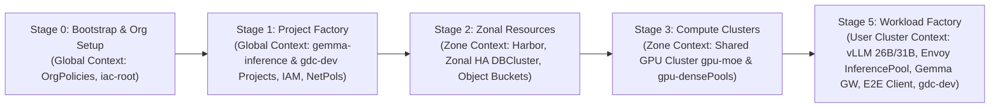

Copyright 2026 Google. This software is provided as-is, without warranty or representation for any use or purpose. Your use of it is subject to your agreement with Google.

# AI-Enabled Blueprint End-to-End Deployment & Verification Guide (GDC-ag Production IaC)

> **Document ID:** `GUIDE-GDC-AI-BLUEPRINT-E2E-IAC`  
> **Target Environment:** Google Distributed Cloud Air-Gapped (**GDC-ag**) Production Organization  
> **Companion Guides:**  
> - [GUI Functional Walkthrough & Live Demo Playbook](./gui_demo_walkthrough_and_prompts.md)  
> - [Zero-Tweak E2E Validation Runbook & IO/AO Upgrade Verification Suite](./e2e_zero_tweak_validation_runbook.md)  
> **Orchestration Framework:** `gdc-iac-org` Multi-Stage Helmfile Foundations (`0-bootstrap` $\rightarrow$ `5-workload-factory`)  
> **Integrated Blueprints:**  
> - **Stage 2 Zonal Managed Infrastructure:** GDC Managed Harbor (`charts/gdc-harbors`), Zonal HA PostgreSQL + `pgvector` (`charts/gdc-dbs`), and GDC Native Object Storage Buckets (`charts/gdc-buckets`)  
> - **Stage 3 Compute Clusters:** Shared GPU Cluster (`gpu-moe` & `gpu-dense` NVIDIA H100 node pools) & Standard/User Clusters (`charts/gdc-clusters`)  
> - **Stage 5 Workload Factory (`5-workload-factory`):** Keycloak OIDC (`p12-keycloak`), Vault Secrets (`p11-vault`), Apache Kafka KRaft (`p4-event-driven-kafka`), vLLM Dual-Model Serving (`vllm-26b` + `vllm-31b`), Envoy `InferencePool` + `epp` (`gemma-envoy-pool`), Gemma 4 Gateway (`gemma-gateway`), Joint Intelligence E2E Tutorial + Integrated Chat Client (`gemma-client`), and Sovereign Developer Platform (`p13-gdc-dev`)

---

## 1. Alignment with `gdc-iac-org` Architectural & IaC Principles

In a production **GDC-ag** environment, imperative `kubectl apply` and ad-hoc shell mutations are replaced by the declarative **Infrastructure-as-Code (IaC)** principles enforced by `gdc-iac-org`:

| `gdc-iac-org` IaC Principle | How This Production AI-Enabled E2E Guide Implements It |
| :--- | :--- |
| **1. No In-Tree Environment State** | Zero environment secrets or mutable cluster states are committed to Git. Environment parameters live strictly in `foundations/bases/environments/<env>/` (`globals.yaml`, `contexts.yaml`, `charts.yaml`, `zone1/tenant-1.yaml`), while credentials are injected via **HashiCorp Vault (`p11-vault`)** / Kubernetes Secrets managed in the `iac-root` and tenant namespaces. |
| **2. Artifact Publishing & Turnkey Air-Gap OCI Mirroring** | All container images (including `epp:v1.3.0`, `vllm-openai`, `gemma-proxy`, `gemma-client`, and `gdc-dev`) and Helm charts are verified via **SHA-256 BOM + Sigstore Cosign** and ingested into **GDC Managed Harbor** using `./scripts/ingest-airgap-bundle.sh` and `tools/mirror-images/mirror_images.py`. |
| **3. Strictly Layered 6-Stage Execution Order** | Respects GDC custom resource dependencies by executing sequentially across Global, Zonal, and User Cluster kubecontexts: `0-bootstrap` $\rightarrow$ `0-org-setup` $\rightarrow$ `1-project-factory` $\rightarrow$ `2-resources` $\rightarrow$ `3-clusters` $\rightarrow$ `5-workload-factory`. |
| **4. Separation of Zonal Managed Services vs. User Cluster Workloads** | **Stage 2 (`2-resources`)** provisions Zonal GDC Custom Resources (`DBCluster`, `Bucket`, `HarborInstance`) on the Org Admin / Zone cluster, whereas **Stage 5 (`5-workload-factory`)** deploys application charts to the User/Shared Cluster with `deploy_gdc_resources: false` and `deploy_apps: true`. |
| **5. 4-Layer Offline Pre-Flight Validation** | Before any `helmfile apply`, all charts pass `helm lint` + `values.schema.json`, `helm-unittest`, `kubeconform`, and `conftest` (`policy/security.rego`) via `./scripts/test-charts.sh` and `./foundations/scripts/validate.sh <env>`. |



---

## 2. Production Reference Tables: Endpoints, Ingress & OIDC Governance

### 2.1. Table 1: Service Architecture, Exposure Layer & Telemetry (GCP Staging vs. GDC-ag Production)

> [!NOTE]
> **Single Client Deployment (`gemma-client`) Covers Both E2E Intelligence & Standard Chat:**  
> Just like in the GCP staging environment, deploying the `gemma-client` chart in Stage 5 (`5-workload-factory`) deploys **both** the **Joint Intelligence E2E Synthesis Console** and the **Standard Gemma Chat & RAG Workspace** inside a single frontend/backend release. Operators toggle between the two views via the top navigation bar without deploying a second chat client.

| Functional Surface | GCP Staging Port-Forward | GDC-ag Production Hostname / Route | Production Data Plane & Telemetry Source |
| :--- | :--- | :--- | :--- |
| **Gemma 4 Gateway Control Plane & OpenAI API (`/v1`)** | **Port `8080`** (`svc/gemma-gateway`) | `https://ai-gateway.gdc.local` (`HTTPRoute` + `AIGatewayRoute` in `gemma-inference`) | **Gemma Gateway + Envoy `InferencePool` (`epp`).** Scrapes **live** vLLM Prometheus metrics (`vllm:num_requests_waiting`, `vllm:gpu_cache_usage_perc`), enforces Envoy `BackendTrafficPolicy` per-user token budgets (`x-user-id`), and routes Tier 1 (`26B MoE`) vs. Tier 2 (`31B Dense`). |
| **Joint Intelligence E2E Console + Chat Client (Gateway API Path)** | **Port `8081`** (`svc/gdc-gateway-tunnel`) | `https://intel.gdc.local` (`Gateway/gdc-platform-gateway` + `HTTPRoute/gemma-unified-routes`) | **Kubernetes Gateway API (`gateway.networking.k8s.io/v1`).** Primary GDC-ag hardware load balancer path terminating TLS via GDC Platform PKI (`cert-manager`) and routing `/`, `/api/`, `/v1/`, and `/auth/` on a single origin. |
| **Joint Intelligence E2E Console + Chat Client (Ingress Path)** | **Port `8082`** (`svc/gemma-ingress-gateway`) | `https://intel-ingress.gdc.local` (GDC Internal LB `Ingress` with `networking.gdc.goog/internal-loadbalancer: "true"`) | **Kubernetes Ingress Controller.** Optional secondary ingress path exposing the exact same `gemma-client` service for organizations standardizing on `networking.k8s.io/v1` `Ingress`. |
| **`gdc-dev` Sovereign Admin & Telemetry Console** | **Port `8083`** (`deploy/gdc-dev-landing-page:8081`) | `https://admin.dev.gdc.local` (Dedicated Admin `HTTPRoute` $\rightarrow$ `:8081` in `gdc-dev`) | **Port-Isolated Admin Listener (`:8081`).** **Hybrid Telemetry:** Seeds `5` baseline verification events at startup, then tracks **live** GDC block PVC storage (`/home/dev/workspace`), **live** IDE AI Swarm latencies/invocations, and session eviction/hibernation controls. |
| **`gdc-dev` Developer IDE & Multi-Agent Swarm** | **Port `8084`** (`deploy/gdc-dev-landing-page:8080`) | `https://dev.gdc.local` (`Gateway/gdc-dev-gateway` + `HTTPRoute` $\rightarrow$ `:8080` / `:3000` in `gdc-dev`) | **Port-Isolated Developer Listener (`:8080`).** Allocates per-developer `standard-rwo` PVCs (`workspace-pvc-<user>`) and connects the in-IDE AI Swarm (`Architect`, `Coder`, `Reviewer`, `Swarm`) to `http://gemma-gateway.gemma-inference.svc.cluster.local/v1`. |

---

### 2.2. Table 2: OIDC Authentication Behavior Across Interfaces (GCP Staging vs. GDC-ag Production)

In production GDC-ag, simulated OIDC backdoors are disabled (`ALLOW_SIMULATED_OIDC: "false"`) so all three interfaces enforce cryptographic Keycloak OIDC verification (`p12-keycloak` federated with Enterprise AD/LDAP):

| Interface | OIDC Flow & Token Verification | GCP Staging Behavior | GDC-ag Production Behavior (`ALLOW_SIMULATED_OIDC="false"`) |
| :--- | :--- | :--- | :--- |
| **Gemma 4 Gateway (`8080` / `ai-gateway.gdc.local`)** | **Server-Side Keycloak ROPC / Redirect SSO + Bearer JWT Validation** (`gateway/proxy/main.py`). Validates RS256 signatures against Keycloak JWKS (`http://keycloak-svc:8080/auth/realms/gdc-rag-realm/protocol/openid-connect/certs`) and propagates verified `preferred_username` into `x-user-id` for Envoy `BackendTrafficPolicy` token rate limiting. | Accepts Keycloak users (`charlie` / `password`, `alice` / `password`) via `/login/oidc` (`source: keycloak-jwt`). | Identical cryptographic JWKS validation; simulated fallback is hard-disabled (`ALLOW_SIMULATED_OIDC="false"`), rejecting any unverified token with `401 Unauthorized`. |
| **E2E Intelligence & Chat Client (`8081`/`8082` / `intel.gdc.local`)** | **Browser OIDC Authorization Code Flow + PKCE (`S256`)** (`gemma-client/src/frontend/src/oidc.js`). Redirects browser to `/auth/realms/gdc-rag-realm/protocol/openid-connect/auth`, exchanges code for RS256 JWT, and sends `Authorization: Bearer <jwt>` to `/api/*` and `/v1/*`. | Authenticates against Keycloak (`charlie` / `password` = `admin`, `alice` / `password` = `user`). | Authenticates against HA Keycloak (`p12-keycloak`) federated with Enterprise AD/LDAP and DoD/Enterprise PKI client certificates. |
| **`gdc-dev` Admin (`8083`) & Developer IDE (`8084` / `dev.gdc.local`)** | **Strict Port-Separated Cookie & Header Enforcement** (`p13-gdc-dev/example-app/landing-page/app.py`). Uses separate HMAC-signed cookies (`admin_auth_user` on `:8081` vs. `dev_auth_user` on `:8080`) so developer sessions can never escalate to `/admin`. | Uses `ALLOW_SIMULATED_OIDC="true"` for 1-click standalone persona testing (`cluster-admin@gdc.local` and `oidc-developer@gdc.local`). | Sets `AUTH_MODE="oidc"` and `ALLOW_SIMULATED_OIDC="false"` in `oidc-auth-configmap`, requiring verified OIDC identity headers (`X-Forwarded-User` / `X-User-Roles: gdc-admin`) from the Keycloak OIDC proxy. |

---

## 3. Stage 0 (Connected System): Air-Gap Bundle Creation & Offline Validation

Perform this step on your connected build workstation before transferring artifacts into the disconnected GDC-ag facility.

```bash
cd ~/GitHub/gdc-iac-org

# 1. Run the 4-layer offline chart validation suite (helm lint + schema, helm-unittest, kubeconform, OPA conftest)
./scripts/test-charts.sh

# 2. Mirror all external container images (including vLLM, Envoy epp:v1.3.0, Kafka, Postgres, Keycloak)
python3 ./tools/mirror-images/mirror_images.py \
  --images-file ./blueprints/gdc_gemma_gw/bulk_external_images.txt \
  --save-dir ./packages/external-images

# 3. Package the Gemma Gateway + vLLM + Envoy InferencePool + E2E Client bundles
cd blueprints/gdc_gemma_gw
export REGISTRY_HOST="harbor.infra.gdc.local/gdc-iac"
export TAG="v1.0.0"

INFERENCE_ENGINE=vllm REGISTRY_HOST="${REGISTRY_HOST}" TAG="${TAG}" ./scripts/package-for-gdc.sh
INFERENCE_ENGINE=client REGISTRY_HOST="${REGISTRY_HOST}" TAG="${TAG}" ./scripts/package-for-gdc.sh

# 4. Package Pattern 13 (gdc-dev) and Pattern 4 (Kafka Telemetry Consumer)
cd ~/GitHub/gdc-iac-org/blueprints
./common-scripts/configure-blueprints.sh -p gdc-ai-prod -n gdc-dev -r "${REGISTRY_HOST}" -d patterns/p13-gdc-dev
./common-scripts/package-for-gdc.sh patterns/p13-gdc-dev

# 5. Verify SHA-256 Bill of Materials (BOM) before crossing the air gap
cat gdc_gemma_gw/packages/gemma-gateway-gdc/gemma-gateway-BOM.txt
```

---

## 4. Stage 1 (Air-Gapped Workstation): Harbor OCI Ingestion & Chart Registration

On your **GDC-ag Operator Workstation** inside the air-gapped enclave, verify checksums and ingest all container images and OCI Helm charts into your GDC Managed Harbor registry:

```bash
cd ~/GitHub/gdc-iac-org

# 1. Authenticate to GDC and internal Harbor registry
gdcloud auth login
export HARBOR_REGISTRY="harbor.infra.gdc.local"
export HARBOR_PROJECT="gdc-iac"
docker login "${HARBOR_REGISTRY}"
helm registry login "${HARBOR_REGISTRY}"

# 2. Ingest official GDC IaC air-gap release bundle (charts + Cosign attestations)
./scripts/ingest-airgap-bundle.sh \
  --registry "${HARBOR_REGISTRY}" \
  --project "${HARBOR_PROJECT}"

# 3. Push mirrored 3P images (vLLM, Envoy epp:v1.3.0, Kafka, Keycloak) into Harbor
python3 ./tools/mirror-images/mirror_images.py \
  --load-dir ./packages/external-images \
  --registry "${HARBOR_REGISTRY}/${HARBOR_PROJECT}"

# 4. Unpack and push custom Gemma Gateway, E2E Client, and p13-gdc-dev application images
cd blueprints
./common-scripts/unpack-for-gdc.sh patterns/p13-gdc-dev
./common-scripts/push-images.sh "${HARBOR_REGISTRY}/${HARBOR_PROJECT}"
```

---

## 5. Stage 2: Declarative Environment Configuration (`foundations/bases/environments/prd/`)

Following the **Strict Code/Values Separation** principle of `gdc-iac-org`, configure the production environment purely via static YAML files under `foundations/bases/environments/prd/`.

### 5.1. Configure Contexts & Global Parameters (`globals.yaml` & `charts.yaml`)

1. **`foundations/bases/environments/prd/globals.yaml`**:
   ```yaml
   gdc_context_global: "global-api-gdch_console-org-1-zone1_global-api"
   gdc_context_zone: "org-1-admin-zone1-gdch_console-org-1-zone1_org-1-admin"
   gdc_release_namespace: "iac-root"
   iac_sa: "system:serviceaccount:iac-root:iac001-sa"
   gdc_default_registry: "harbor.infra.gdc.local/gdc-iac"
   ```

2. **`foundations/bases/environments/prd/charts.yaml`** (Dual-Mode Chart Resolution):
    verify the GDC Gemma and Pattern chart paths are registered (already present in `charts.yaml`):
   ```yaml
   # GDC Blueprint Pattern Chart Paths (Stage 5: 5-workload-factory)
   gdc_patterns_base_path: "../../../blueprints/patterns"
   gdc_pattern_p4_chart_path: "../../../blueprints/patterns/p4-event-driven-kafka/chart"
   gdc_pattern_p11_chart_path: "../../../blueprints/patterns/p11-vault/chart"
   gdc_pattern_p12_chart_path: "../../../blueprints/patterns/p12-keycloak/chart"
   gdc_pattern_p13_chart_path: "../../../blueprints/patterns/p13-gdc-dev/chart"

   # GDC Gemma 4 Dedicated Inference Gateway Chart Paths (Stage 5: 5-workload-factory)
   gdc_gemma_vllm_chart_path: "../../../blueprints/gdc_gemma_gw/blueprints/vllm-gke"
   gdc_gemma_envoy_inference_pool_chart_path: "../../../blueprints/gdc_gemma_gw/blueprints/envoy-inference-pool"
   gdc_gemma_gateway_chart_path: "../../../blueprints/gdc_gemma_gw/standalone/chart"
   gdc_gemma_client_chart_path: "../../../blueprints/gdc_gemma_gw/gemma-client/chart"
   ```

### 5.2. Declare Global Projects, IAM & Cross-Project NetworkPolicies (`global/tenant-1.yaml`)

Define the `gemma-inference` (Shared AI & E2E Intelligence Project) and `gdc-dev` (Sovereign Developer Platform Project) namespaces and allow cross-project traffic from `gdc-dev` to `gemma-inference`:

```yaml
# foundations/bases/environments/prd/global/tenant-1.yaml
prd:
  gdc_tenants:
    tenant-1:
      global:
        admin_subject_name: "fop-iac@example.com"
        projects:
          - name: "gemma-inference"
            iamrolebindings:
              - role: "project-iam-admin"
              - role: "project-bucket-admin"
              - role: "project-bucket-object-admin"
              - role: "project-bucket-object-admin"
                subject_name: "gemma-client-sa"
                subject_kind: "ServiceAccount"
            serviceaccounts:
              - name: "gemma-gateway-ksa"
                namespace: "gemma-inference"
              - name: "gemma-client-sa"
                namespace: "gemma-inference"
          - name: "gdc-dev"
            iamrolebindings:
              - role: "project-iam-admin"
            serviceaccounts:
              - name: "gdc-dev-operator-sa"
                namespace: "gdc-dev"
```

### 5.3. Declare Zonal Managed Resources, GPU Clusters & Stage 5 AI Workloads (`zone1/tenant-1.yaml`)

In `foundations/bases/environments/prd/zone1/tenant-1.yaml`, declare:
- **Stage 2 (`resources`)**: Managed Harbor, Object Storage Buckets (`gemma-rag-bucket`), Zonal HA PostgreSQL (`gemma-readiness-db`), and cross-project `project_network_policies`.
- **Stage 3 (`clusters`)**: The Shared GPU Cluster with dedicated `gpu-moe` (`gemma4:26b`) and `gpu-dense` (`gemma4:31b`) H100 node pools.
- **Stage 5 (`resources.patterns`)**: The complete AI-enabled workload stack (`p12-keycloak`, `vllm-26b`, `vllm-31b`, `gemma-envoy-pool`, `gemma-gateway`, `p4-event-driven-kafka`, `gemma-e2e-client`, and `p13-gdc-dev`):

```yaml
# foundations/bases/environments/prd/zone1/tenant-1.yaml
prd:
  gdc_tenants:
    tenant-1:
      admin_subject_name: &admin_subject_name "fop-iac@example.com"
      shared_infra_project_names: &shared_infra_project_names ["gemma-inference", "gdc-dev"]

      projects:
        # ====================================================================
        # Project 1: gemma-inference (Serving, Envoy Pool, Gateway & E2E App)
        # ====================================================================
        - name: "gemma-inference"
          resources:
            buckets:
              - name: "gemma-rag-bucket"
                description: "Sovereign RAG Document & SITREP Storage"
                storage_class: "Standard"
                location: "zone1"
            dbs:
              - name: "gemma-readiness-db"
                engine: "PostgreSQL"
                version: "15"
                highAvailability: true
                storageSize: "100Gi"
                extensions: ["vector"]
            project_network_policies:
              - name: "allow-gdc-dev-to-gemma-gateway"
                ingress:
                  - from:
                      - project_selector:
                          projects:
                            match_names:
                              - "gdc-dev"
            patterns:
              # 1. Enterprise Keycloak OIDC Identity Provider (P12)
              - name: "keycloak-sso"
                pattern: "p12-keycloak"
                namespace: "gemma-inference"
                registry: "harbor.infra.gdc.local/gdc-iac"
                deploy_gdc_resources: false
                deploy_apps: true

              # 2. Tier 1 vLLM Serving: Gemma 4 26B MoE (Fast Conversational & Tool Loop)
              - name: "vllm-26b"
                pattern: "gdc-gemma-vllm-26b"
                chart_path: "../../../blueprints/gdc_gemma_gw/blueprints/vllm-gke"
                namespace: "gemma-inference"
                registry: "harbor.infra.gdc.local/gdc-iac"
                deploy_gdc_resources: false
                deploy_apps: true
                values_files:
                  - "../../../blueprints/gdc_gemma_gw/blueprints/vllm-gke/values-gdc.yaml"
                values:
                  model:
                    name: "/models/gemma-4-26B-A4B-it-weights"
                    servedModelName: "gemma4:26b"
                    maxModelLen: 32768
                  persistence:
                    existingClaim: "gemma-weights-rwx-pvc"
                  nodeSelector:
                    pool: "gpu-moe"

              # 3. Tier 2 vLLM Serving: Gemma 4 31B Dense (Complex Code & Tactical Synthesis)
              - name: "vllm-31b"
                pattern: "gdc-gemma-vllm-31b"
                chart_path: "../../../blueprints/gdc_gemma_gw/blueprints/vllm-gke"
                namespace: "gemma-inference"
                registry: "harbor.infra.gdc.local/gdc-iac"
                deploy_gdc_resources: false
                deploy_apps: true
                values_files:
                  - "../../../blueprints/gdc_gemma_gw/blueprints/vllm-gke/values-gdc.yaml"
                values:
                  model:
                    name: "/models/gemma-4-31B-it-weights"
                    servedModelName: "gemma4:31b"
                    maxModelLen: 32768
                  persistence:
                    existingClaim: "gemma-weights-rwx-pvc"
                  nodeSelector:
                    pool: "gpu-dense"

              # 4. Envoy Gateway InferencePool + epp + Per-User Token Rate Limiting
              - name: "gemma-envoy-pool"
                pattern: "gdc-gemma-envoy-inference-pool"
                chart_path: "../../../blueprints/gdc_gemma_gw/blueprints/envoy-inference-pool"
                namespace: "gemma-inference"
                registry: "harbor.infra.gdc.local/gdc-iac"
                deploy_gdc_resources: false
                deploy_apps: true
                values:
                  tokenRateLimit:
                    enabled: true
                    limit: 50000
                    unit: "Hour"

              # 5. Gemma 4 Gateway Control Plane & Complexity Classifier
              - name: "gemma-gateway"
                pattern: "gdc-gemma-gateway"
                chart_path: "../../../blueprints/gdc_gemma_gw/standalone/chart"
                namespace: "gemma-inference"
                registry: "harbor.infra.gdc.local/gdc-iac"
                deploy_gdc_resources: false
                deploy_apps: true
                values:
                  apps:
                    activeFramework: "vllm"
                    enableOidc: "true"
                    adminRequireOidc: "true"
                    keycloakUrl: "http://keycloak-svc:8080/auth/realms/gdc-rag-realm"
                    envoyInferencePool:
                      enabled: true
                      serviceUrl: "http://gemma-envoy-inference-pool:80"

              # 6. Pattern 4 Apache Kafka KRaft Broker & Multi-Domain Telemetry Stream
              - name: "kafka-telemetry"
                pattern: "p4-event-driven-kafka"
                namespace: "gemma-inference"
                registry: "harbor.infra.gdc.local/gdc-iac"
                deploy_gdc_resources: false
                deploy_apps: true

              # 7. Joint Intelligence E2E Tutorial + Standard Gemma Chat Client (Single Release)
              - name: "gemma-e2e-client"
                pattern: "gdc-gemma-client"
                chart_path: "../../../blueprints/gdc_gemma_gw/gemma-client/chart"
                namespace: "gemma-inference"
                registry: "harbor.infra.gdc.local/gdc-iac"
                deploy_gdc_resources: false
                deploy_apps: true
                values:
                  apps:
                    enableOidc: "true"
                    enableGcsUpload: "true"
                    s3Endpoint: "https://objectstorage.gdc.goog"
                    keycloakUrl: "http://keycloak-svc:8080/auth/realms/gdc-rag-realm"
                    gatewayUrl: "http://gemma-gateway/v1"
                    inputBucket: "gs://gemma-rag-bucket"
                    hostnames:
                      - "intel.gdc.local"

        # ====================================================================
        # Project 2: gdc-dev (Sovereign Developer IDE & Admin Telemetry)
        # ====================================================================
        - name: "gdc-dev"
          resources:
            patterns:
              # 8. Pattern 13: Sovereign Developer Platform + AI Swarm Co-Pilot
              - name: "gdc-dev-platform"
                pattern: "p13-gdc-dev"
                namespace: "gdc-dev"
                registry: "harbor.infra.gdc.local/gdc-iac"
                deploy_gdc_resources: false
                deploy_apps: true
                values:
                  phase: 3
                  auth:
                    mode: "oidc"
                    allowSimulatedOidc: "false"
                    headerUserKey: "X-Forwarded-User"
                  ai:
                    enabled: true

      # ======================================================================
      # Stage 3: Shared GPU & Standard Compute Clusters
      # ======================================================================
      clusters:
        - name: "shared-gpu-cluster"
          namespace: "platform"
          clusterNetwork:
            podCIDRSize: 21
            serviceCIDRSize: 23
          initialVersion:
            kubernetesVersion: "1.35.3-gke.400"
          loadBalancer:
            ingressServiceIPSize: 21
          nodePools:
            - name: "gpu-moe"
              machineTypeName: "hgx-h100-1g"
              nodeCount: 1
            - name: "gpu-dense"
              machineTypeName: "hgx-h100-1g"
              nodeCount: 1
            - name: "client-worker-pool"
              machineTypeName: "n3-standard-8-gdc"
              nodeCount: 3
          projectBindings: *shared_infra_project_names
```

---

## 6. Stage 3: Execute the Phased Helmfile Pipeline (`0-bootstrap` $\rightarrow$ `5-workload-factory`)

All Helmfile commands **must** be executed from the `foundations/` directory (`cd ~/GitHub/gdc-iac-org/foundations`):

```bash
cd ~/GitHub/gdc-iac-org
# Stash any local file-mode or manifest edits before syncing the repository
git stash 2>/dev/null || true
git pull

cd ~/GitHub/gdc-iac-org/foundations

# 1. Pre-flight schema and template validation for the 'prd' environment
./scripts/validate.sh prd

# 2. Stage 0: Bootstrap & Organization Policies (Global API Context)
helmfile -e prd -l stage=0-bootstrap diff
helmfile -e prd -l stage=0-bootstrap apply
helmfile -e prd -l stage=0-org-setup diff
helmfile -e prd -l stage=0-org-setup apply

# 3. Stage 1: Project Factory — Creates 'gemma-inference' & 'gdc-dev' Projects, SAs, IAM (Global API Context)
helmfile -e prd -l stage=1-project-factory diff
helmfile -e prd -l stage=1-project-factory apply

# 4. Stage 2: Zonal Managed Resources — Harbor, Zonal HA DBCluster, Buckets, ProjectNetworkPolicies (Zone Context)
helmfile -e prd -l stage=2-resources diff
helmfile -e prd -l stage=2-resources apply

# 5. Stage 3: Compute Clusters — Provisions 'shared-gpu-cluster' with gpu-moe & gpu-dense pools (Zone Context)
helmfile -e prd -l stage=3-clusters diff
helmfile -e prd -l stage=3-clusters apply

# 6. Stage 5: Workload Factory — Deploys vLLM 26B/31B, Envoy InferencePool, Gemma GW, E2E Client, and gdc-dev
helmfile -e prd -l stage=5-workload-factory diff
helmfile -e prd -l stage=5-workload-factory apply
```

### 6.1. Post-Deploy Production Object Storage Verification & Initial Database Seeding

Once Stage 5 completes, verify that the declarative GDC Object Storage `Bucket` (`gemma-rag-bucket`), `gemma-gateway`, and `gdc-dev` deployments are healthy, and seed the operational readiness and SITREP dataset into the Zonal HA PostgreSQL instance (note: `gemma-client` also initializes all 9 core tables automatically on startup via `gen_random_uuid()`):

```bash
# 1. Verify GDC Object Storage bucket ('gemma-rag-bucket') exists in the Zonal/Project plane (reconcile Stage 2 if missing)
kubectl get bucket gemma-rag-bucket -n gemma-inference >/dev/null 2>&1 || \
  helmfile -e prd -l stage=2-resources apply

# 2. Verify rollout status across gemma-gateway, gemma-client backend, and gdc-dev
kubectl rollout status deployment/gemma-gateway deployment/backend -n gemma-inference --timeout=90s
kubectl rollout status deployment/gdc-dev-landing-page deployment/gdc-dev-operator -n gdc-dev --timeout=90s

# 3. Seed initial tactical readiness & SITREP dataset into PostgreSQL (supports both in-cluster postgres pod and managed GDC DBCluster)
DB_POD=$(kubectl get pods -n gemma-inference -l app=postgres -o jsonpath='{.items[0].metadata.name}' 2>/dev/null || true)
if [ -n "${DB_POD}" ]; then
  kubectl exec -i "${DB_POD}" -n gemma-inference -- psql -U postgres -d postgres < ../blueprints/gdc_gemma_gw/test-data/seed_readiness_db.sql
else
  DB_URL=$(kubectl get secret gemma-client-db-credentials -n gemma-inference -o jsonpath='{.data.connection_string}' | base64 -d)
  psql "${DB_URL}" < ../blueprints/gdc_gemma_gw/test-data/seed_readiness_db.sql
fi
```

> **Note for Direct `kubectl port-forward` Operator Testing (Bypassing Upstream OIDC Proxy):** In production, `gdc-dev` sets `auth.allowSimulatedOidc: "false"` and `auth.headerUserKey: "X-Forwarded-User"` because the upstream GDC OIDC Reverse Proxy injects `X-Forwarded-User`. If you access `gdc-dev` directly over `kubectl port-forward` without an upstream OIDC proxy, set `auth.allowSimulatedOidc: "true"` and `auth.headerUserKey: "X-User-ID"` under `gdc-dev-platform.values` in `zone1/tenant-1.yaml` and re-run `helmfile -e prd -l stage=5-workload-factory apply`.

---

## 7. Stage 4: Production GDC-ag End-to-End Verification Runbook

### 7.1. Verify Kubernetes Resources, vLLM Engine Labels & Envoy `InferencePool` CRDs

```bash
# 1. Verify vLLM 26B & 31B pods carry the Gateway API Inference Extension discovery labels
kubectl get pods -n gemma-inference -l inference.networking.k8s.io/engine-type=vllm --show-labels

# 2. Verify InferencePool, InferenceObjective, AIGatewayRoute, and BackendTrafficPolicy CRDs
kubectl get inferencepool,inferenceobjective,aigatewayroute,backendtrafficpolicy -n gemma-inference

# 3. Verify Gateway API VIPs allocated by the GDC Platform Load Balancer
kubectl get gateway -n gemma-inference
kubectl get gateway -n gdc-dev
```

### 7.2. Automated 20-Check IO / AO Upgrade & Functional Verification Suite (`scripts/verify-e2e-gdc-ag.py`)

Infrastructure Operators (**IOs**) and Application Operators (**AOs**) can execute `scripts/verify-e2e-gdc-ag.py` (100% Python 3 standard library; zero third-party packages required) before and after GDC-ag platform upgrades or Helmfile rollouts to validate all 20 infrastructure, zero-trust OIDC, Envoy `InferencePool` routing, Kafka, pgvector RAG, Agentic SQL, GDC Object Storage, and `gdc-dev` Swarm checks with `[PASS]` / `[FAIL]` flags:

```bash
cd ~/GitHub/gdc-iac-org
chmod +x scripts/verify-e2e-gdc-ag.py

# Option A: Run full 20-check IO + AO suite against GDC-ag production FQDNs
./scripts/verify-e2e-gdc-ag.py --insecure --json-report /tmp/gdc-ag-upgrade-report.json

# Option B: Run only Infrastructure Operator (IO) checks or only Application Operator (AO) checks
./scripts/verify-e2e-gdc-ag.py --persona io
./scripts/verify-e2e-gdc-ag.py --persona ao --insecure

# Option C: Run against local Operator Workstation port-forwards (Ports 8080-8084)
./scripts/verify-e2e-gdc-ag.py --port-forward --json-report /tmp/gdc-ag-upgrade-report.json

# Inspect filtered gateway + epp routing logs
kubectl logs -n gemma-inference deploy/gemma-gateway --tail=200 | grep -E "Classifier|Routing|envoy-inference-pool|completions"
```

### 7.3. Interactive Browser Verification Matrix Across All Production Endpoints

> [!TIP]
> **Full Demo Script & Copy-Paste Prompts:**  
> For a complete click-by-click walkthrough with copy-pasteable prompts, sample RAG upload files, and expected UI badges for live demonstrations, see [GUI Functional Walkthrough & Live Demo Playbook](./gui_demo_walkthrough_and_prompts.md).

1. **`https://ai-gateway.gdc.local` (or Port `8080` — `🧠 Gemma 4 Gateway Control Plane`)**:
   * **OIDC Authentication Bar (Top Strip)**: Click **`🔑 Keycloak SSO Login (/auth)`** (`charlie` / `password`) or **`🛡️ One-Click Admin (charlie)`** to sign in (`Role: ADMIN`).
   * **Card 1 — `⚡ Live System Performance & Telemetry`**: Verify live `CPU Load` and `GPU Core Load` gauges, `Tokens Out/Sec`, `Active DB Pools`, and the `VRAM Consumption` progress bar.
   * **Card 2 — `🎛️ Gateway Parameters Override` (True Gateway-Enforced Overrides)**:
     * All parameters saved in this card (`Temperature`, `Top-P`, `Max Vision Tokens`, and `Model Variant Hot-Swap`) are persisted across Gateway workers in `/tmp/gemma_gateway_state.json` and **unconditionally enforced** on every `/v1/chat/completions` call across `intel.gdc.local`, `intel-ingress.gdc.local`, and `dev.gdc.local` (overriding any client-supplied defaults) and echoed in `X-Gemma-Temperature`, `X-Gemma-Top-P`, and `X-Gemma-Vision-Budget` response headers.
     * **Interactive Override Check**: Set **`Sampling Temperature`** to `0.2` and **`Model Variant Hot-Swap`** to **`Gemma 4 31B (Dense)`**, click **`Save Gateway Configuration`**, send a simple conversational prompt on `https://intel.gdc.local` (`Tactical Chat` with **`Gemma 4 Gateway (Auto)`** selected), and verify the navbar routing badge updates to **`→ gemma4:31b`**. Then click **`↺ Reset to Auto`** on `https://ai-gateway.gdc.local` to restore **`Gemma 4 Gateway (Auto: 26B MoE → 31B Dense)`** and **`Temperature`** `0.7`.
   * **Card 3 — `🕵️ Active User Session Oversight & Kill-Switch`**: Displays `User ID`, `Client IP`, `Status`, `Last Active`, and the **`Kill Session`** button.
     > **Note on When Users Appear in `Active User Session Oversight & Kill-Switch`:** Logging into Keycloak on `https://intel.gdc.local` (`alice`) or `https://intel-ingress.gdc.local` (`charlie`) authenticates the browser with the frontend, but `gemma-gateway` records a session in this table **only when that user submits an AI inference request** (`/v1/chat/completions`) via **Tactical Chat**, **All-Source Intel (RAG)**, **Operational Readiness (SQL)**, or the **GDC Dev AI Swarm**.
   * **Card 4 — `👥 User Access Blocklist Management`**: Enter a `User ID` (e.g., `alice`) and click **`Block User`** to test instant `403 Forbidden` revocation, then click **`Unblock`** to restore access.

2. **`https://intel.gdc.local` (Gateway API / Port `8081`) & `https://intel-ingress.gdc.local` (Ingress / Port `8082`) — `Joint Intelligence & Readiness Console` / `Gemma Client`**:
   * Open `https://intel.gdc.local` (log in via **Sign In with Keycloak SSO** as `alice` / `password`) and `https://intel-ingress.gdc.local` (log in as `charlie` / `password`) to verify identical behavior across **Kubernetes Gateway API** (`HTTPRoute`) and **Kubernetes Ingress**.
   * **Top Navigation Bar Controls**:
     * **Mode Switcher (`🛡️ Intel Console` | `💬 Gemma Client`)**: Click **`🛡️ Intel Console`** for the 4-tab Joint Intelligence Console, or click **`💬 Gemma Client`** to switch to the standard multi-turn chat and document RAG upload view (`Upload File` $\rightarrow$ `gs://gemma-rag-bucket`) without redeploying any pods.
     * **Model Routing Dropdown**: Select **`Gemma 4 Gateway (Auto)`** (automatic Tier 1 / Tier 2 complexity routing), **`Gemma 4 26B A4B (MoE)`** (manual Tier 1 pin), or **`Gemma 4 31B (Dense)`** (manual Tier 2 pin). When **`Gemma 4 Gateway (Auto)`** is active, after a response completes, a routing badge (`→ gemma4:26b` or `→ gemma4:31b`) appears next to the dropdown showing which model tier executed the prompt.
     * **`🧠 CoT` Checkbox**: Toggle Chain-of-Thought reasoning traces on or off.
   * **The 4 Tabs in `🛡️ Intel Console`**:
     * **Tab 1 — `Tactical Feeds (Kafka)` (`Live Stream`)**: Inspect multi-domain telemetry (`LAND`, `AIR`, `SEA`, `SPACE`, `CYBER`) and click **`⚡ Ingest Sensor Pings`** to inject fresh Kafka sensor frames.
     * **Tab 2 — `All-Source Intel (RAG)` (`SITREPs`)**: Click one of the **`Suggested Inquiries`** pills (or type a custom query) and click **`Synthesize`** to execute pgvector semantic retrieval and generate a **`Tactical Intelligence Synthesis`** with `[SITREP-...]` citations and a `Model: ...` badge.
     * **Tab 3 — `Operational Readiness (SQL)` (`Agentic`)**: Click a **`Command Questions`** pill (or enter a readiness question) and click **`Audit`** to generate and execute a read-only PostgreSQL query and executive readiness summary. Verify SQL guardrails by submitting `DROP TABLE military_units;` and confirming it returns **`Rejected by Security Gate`**.
     * **Tab 4 — `Tactical Chat` (`Gemma 4`)**: Submit a chat prompt as `alice` on `intel.gdc.local` and a chat prompt as `charlie` on `intel-ingress.gdc.local`. Then return to **`https://ai-gateway.gdc.local`** and confirm that **both `alice` and `charlie` now appear** in the **`🕵️ Active User Session Oversight & Kill-Switch`** table.

3. **`https://admin.dev.gdc.local` (or Port `8083` — `gdc-dev` Sovereign Admin & Telemetry Console)**:
   * Sign in with an `admin` / `gdc-admin` Keycloak OIDC identity (`cluster-admin@gdc.local`), inspect live PVC storage (`gdc-block-storage`), observe the initial 5 seeded baseline events, publish a real-time **Cluster Broadcast Banner**, and monitor live AI Swarm telemetry.

4. **`https://dev.gdc.local` (or Port `8084` — `gdc-dev` Developer IDE & Multi-Agent Swarm)**:
   * Open `https://dev.gdc.local/instances/default-workspace`, verify that the broadcast banner published on the Admin Console appears at the top of the IDE, and test the 4 personas in **`🤖 GDC Dev AI Swarm`**:
     * **`📐 Architect`** (`gemma4:26b` Tier 1): Generates Markdown architecture specifications (`💾 Save as File` $\rightarrow$ `architecture.md`).
     * **`💻 Coder`** (`gemma4:31b` Tier 2): Generates implementation code with **`📥 Insert into Editor`**, **`💾 Save as File`**, and **`↩ Rollback Changes`**.
     * **`🔍 Reviewer`** (`gemma4:26b` Tier 1): Synthesizes `pytest` / `unittest` suites (`💾 Save as File` $\rightarrow$ `test_main.py`).
     * **`🐝 Swarm`** (`Architect` $\rightarrow$ `Coder` $\rightarrow$ `Reviewer`): Renders all 3 stages with per-stage **`💾 Save as...`** buttons on each persona header, **`💾 Save As...`** on every code block, and a 1-click **`⚡ Auto-Create All Swarm Files (3)`** button in the **`🐝 Swarm Persona Deliverables (3 Agents)`** bar that creates `<module>_architecture.md`, `<module>.py`, and `test_<module>.py` directly in the workspace.
   * Execute the automated 10-stage CLI swarm verification harness:
     ```bash
     ./blueprints/patterns/p13-gdc-dev/scripts/test-swarm.py \
       --endpoint "https://dev.gdc.local/instances/default-workspace/ai-chat" \
       --host-header dev.gdc.local
     ```

### 7.4. Final Pre-Cleanup Test: Serving Framework Flip (`vLLM` $\leftrightarrow$ `Ollama` Edge Fallback) & Verification

In GDC-ag deployments that stage both `vLLM` (`blueprints/vllm-gke`) and tactical-edge `Ollama` (`blueprints/ollama-gke`) in Harbor, verify that `gemma-gateway` can declaratively switch `activeFramework` between `vllm` and `ollama`, pass OIDC-authenticated completion verification, and switch back to the primary engine before running cleanup:

```bash
cd ~/GitHub/gdc-iac-org/foundations

# 1. Flip gemma-gateway to Ollama tactical-edge serving (or toggle Envoy InferencePool routing)
helm upgrade --install gemma-gateway ../blueprints/gdc_gemma_gw/standalone/chart \
  --namespace gemma-inference \
  --set global.projectId="gemma-inference" \
  --set global.namespace="gemma-inference" \
  --set global.registry="harbor.infra.gdc.local/gdc-iac" \
  --set apps.activeFramework="ollama" \
  --set apps.enableOidc="true" \
  --set apps.envoyInferencePool.enabled=false

kubectl rollout status deployment/gemma-gateway -n gemma-inference --timeout=90s

# 2. Verify active framework and completion response
python3 -c '
import urllib.request, http.cookiejar, json, ssl
ctx = ssl.create_default_context()
cj = http.cookiejar.CookieJar()
opener = urllib.request.build_opener(urllib.request.HTTPSHandler(context=ctx), urllib.request.HTTPCookieProcessor(cj))

with opener.open("https://ai-gateway.gdc.local/api/metrics", timeout=15) as r:
    m = json.loads(r.read().decode("utf-8"))
    print("Swapped Framework:", m.get("framework"))
    assert m.get("framework") == "ollama"
'

# 3. Restore primary production vLLM + Envoy InferencePool configuration via Stage 5 Helmfile apply
helmfile -e prd -l stage=5-workload-factory apply
kubectl rollout status deployment/gemma-gateway -n gemma-inference --timeout=90s

python3 -c '
import urllib.request, json, ssl
ctx = ssl.create_default_context()
with urllib.request.urlopen("https://ai-gateway.gdc.local/api/metrics", context=ctx, timeout=15) as r:
    m = json.loads(r.read().decode("utf-8"))
    print("Restored Production Framework:", m.get("framework"))
    assert m.get("framework") == "vllm"
'
```

---

## 8. Stage 5: Declarative IaC Cleanup Script & Staged Teardown Guidance

In accordance with `gdc-iac-org` principles, **never run imperative `kubectl delete namespace` against Global or Zonal GDC management planes**. Instead, use `helmfile destroy` scoped by stage labels so that User Cluster application workloads (`stage=5-workload-factory`) can be torn down and re-tested without destroying the underlying Shared GPU Cluster (`stage=3-clusters`), Harbor Registry / SAN PVCs (`stage=2-resources`), or Tenant Projects (`stage=1-project-factory`).

### 8.1. What `scripts/cleanup-e2e-gdc-iac.sh` Tears Down vs. Preserves

| Stage / Resource Layer | Default Action (`cleanup-e2e-gdc-iac.sh`) | Optional Flags (`--empty-bucket`, `--delete-bucket`, `--include-zonal-resources`) |
| :--- | :--- | :--- |
| **Stage 5 (`5-workload-factory`)**: `vllm-26b`, `vllm-31b`, `gemma-envoy-pool`, `gemma-gateway`, `gemma-e2e-client`, `kafka-telemetry`, `keycloak-sso`, `gdc-dev-platform` | **Destroyed (`helmfile -e <env> -l stage=5-workload-factory destroy`)** | Destroyed |
| **Ephemeral Workspace PVCs in `gdc-dev`** | **Cleaned up** (releases dynamic `workspace-pvc-*` claims) | Cleaned up |
| **GDC Object Storage Bucket (`gemma-rag-bucket`)** | **PRESERVED** | `--empty-bucket` deletes objects inside `s3://gemma-rag-bucket`; `--delete-bucket` empties and deletes the `Bucket` resource |
| **Stage 3 (`3-clusters`)**: `shared-gpu-cluster` (`gpu-moe` & `gpu-dense` H100 pools) | **PRESERVED (Never Deleted)** | **PRESERVED (Never Deleted)** |
| **Stage 2 (`2-resources`)**: Harbor Registry, `gemma-weights-rwx-pvc` (150Gi SAN weights), `DBCluster`, `Buckets` | **PRESERVED** (keeps 120 GB of model weights and Harbor images warm) | `--include-zonal-resources` destroys Stage 2 via `helmfile -e <env> -l stage=2-resources destroy` |
| **Stages 0 & 1 (`0-org-setup`, `1-project-factory`)**: `gemma-inference` & `gdc-dev` Projects, IAM, ServiceAccounts | **PRESERVED** | Preserved |

### 8.2. Run the Declarative GDC-ag IaC Cleanup Script

Execute `scripts/cleanup-e2e-gdc-iac.sh` from your **GDC-ag Operator Workstation**:

```bash
cat << 'EOF' > ~/GitHub/gdc-iac-org/scripts/cleanup-e2e-gdc-iac.sh
#!/usr/bin/env bash
# Declarative IaC E2E Workload Cleanup Script for Google Distributed Cloud Air-Gapped (GDC-ag)
# Tears down Stage 5 (5-workload-factory) AI-enabled blueprint releases via Helmfile
# while strictly PRESERVING Stage 3 GPU Clusters, Stage 2 Harbor/SAN Model Weights, and Stage 1 Projects.
#
# Optional Flags:
#   --empty-bucket             Deletes all objects inside s3://gemma-rag-bucket while keeping the Bucket CR
#   --delete-bucket            Empties and completely removes the gemma-rag-bucket Bucket CR
#   --include-zonal-resources  Also destroys Stage 2 Zonal Resources (stage=2-resources)

set -euo pipefail

ENV="${ENV:-prd}"
NAMESPACE="${NAMESPACE:-gemma-inference}"
GDC_DEV_NAMESPACE="${GDC_DEV_NAMESPACE:-gdc-dev}"
BUCKET_NAME="${BUCKET_NAME:-gemma-rag-bucket}"
S3_ENDPOINT="${S3_ENDPOINT:-https://objectstorage.gdc.goog}"
BUCKET_ACTION="${BUCKET_ACTION:-preserve}"
INCLUDE_ZONAL_RESOURCES="false"

for arg in "$@"; do
  case "${arg}" in
    --empty-bucket)
      BUCKET_ACTION="empty"
      ;;
    --delete-bucket)
      BUCKET_ACTION="delete"
      ;;
    --include-zonal-resources)
      INCLUDE_ZONAL_RESOURCES="true"
      ;;
    -h|--help)
      echo "Usage: $0 [--empty-bucket | --delete-bucket] [--include-zonal-resources]"
      echo "  (default)                  Preserves ${BUCKET_NAME} and Stage 2/3 resources"
      echo "  --empty-bucket             Deletes all objects inside s3://${BUCKET_NAME} but keeps the bucket"
      echo "  --delete-bucket            Empties and completely deletes the ${BUCKET_NAME} Bucket resource"
      echo "  --include-zonal-resources  Destroys all Stage 2 Zonal Resources (stage=2-resources)"
      exit 0
      ;;
    *)
      echo "Unknown option: ${arg}" >&2
      echo "Usage: $0 [--empty-bucket | --delete-bucket] [--include-zonal-resources]" >&2
      exit 1
      ;;
  esac
done

REPO_ROOT="$(cd "$(dirname "${BASH_SOURCE[0]}")/.." && pwd)"
cd "${REPO_ROOT}/foundations"

echo "=================================================================="
echo "🧹 Starting Declarative GDC-ag IaC Cleanup (Environment: ${ENV})"
echo "   Stage 5 Workloads (AI Gateway, vLLM, E2E, gdc-dev) : DESTROY"
echo "   GDC Object Storage Bucket (${BUCKET_NAME})         : ${BUCKET_ACTION}"
echo "   Stage 3 Shared GPU Cluster (gpu-moe / gpu-dense)   : PRESERVED"
echo "   Stage 2 Harbor Registry & SAN Model Weight PVCs    : PRESERVED"
echo "=================================================================="

# 1. Destroy all Stage 5 (5-workload-factory) Helmfile releases across gemma-inference & gdc-dev
echo "[1/5] Running helmfile destroy for stage=5-workload-factory..."
helmfile -e "${ENV}" -l stage=5-workload-factory destroy

# 2. Clean up dynamic per-developer IDE workspace PVCs in gdc-dev (preserving shared SAN model weights in gemma-inference)
echo "[2/5] Cleaning up dynamic developer workspace PVCs in ${GDC_DEV_NAMESPACE}..."
for pvc in $(kubectl get pvc -n "${GDC_DEV_NAMESPACE}" -o jsonpath='{.items[*].metadata.name}' 2>/dev/null || true); do
  kubectl patch pvc "${pvc}" -n "${GDC_DEV_NAMESPACE}" -p '{"metadata":{"finalizers":null}}' --type=merge 2>/dev/null || true
  kubectl delete pvc "${pvc}" -n "${GDC_DEV_NAMESPACE}" --ignore-not-found
done

# 3. Clean up cluster-scoped RBAC & GatewayClass created by p13-gdc-dev
echo "[3/5] Removing cluster-scoped p13-gdc-dev RBAC & GatewayClass..."
kubectl delete clusterrolebinding gdc-dev-operator-binding --ignore-not-found
kubectl delete clusterrole gdc-dev-operator-role --ignore-not-found
kubectl delete gatewayclass gdc-dev-gateway-class --ignore-not-found

# 4. Optional GDC Object Storage bucket cleanup (--empty-bucket or --delete-bucket)
if [ "${BUCKET_ACTION}" = "empty" ]; then
  echo "[4/5] Emptying all objects from s3://${BUCKET_NAME} (keeping Bucket CR)..."
  aws --endpoint-url="${S3_ENDPOINT}" s3 rm "s3://${BUCKET_NAME}" --recursive 2>/dev/null || \
    gcloud storage rm "gs://${BUCKET_NAME}/**" 2>/dev/null || \
    echo "   Bucket ${BUCKET_NAME} is already empty or endpoint unreachable."
elif [ "${BUCKET_ACTION}" = "delete" ]; then
  echo "[4/5] Emptying and completely removing Bucket '${BUCKET_NAME}' in namespace '${NAMESPACE}'..."
  aws --endpoint-url="${S3_ENDPOINT}" s3 rm "s3://${BUCKET_NAME}" --recursive 2>/dev/null || \
    gcloud storage rm --recursive "gs://${BUCKET_NAME}" 2>/dev/null || true
  kubectl delete buckets.object.gdc.goog "${BUCKET_NAME}" -n "${NAMESPACE}" --ignore-not-found 2>/dev/null || true
  helm uninstall "${NAMESPACE}-buckets" -n "${NAMESPACE}" 2>/dev/null || true
else
  echo "[4/5] Preserving GDC Object Storage bucket '${BUCKET_NAME}' (pass --empty-bucket or --delete-bucket to clean up)."
fi

# 5. Optional: Tear down Stage 2 Zonal Resources only if '--include-zonal-resources' flag is explicitly passed
if [ "${INCLUDE_ZONAL_RESOURCES}" = "true" ]; then
  echo "[5/5] Flag --include-zonal-resources detected: destroying stage=2-resources..."
  helmfile -e "${ENV}" -l stage=2-resources destroy
else
  echo "[5/5] Skipping Stage 2 (Harbor, DBCluster, Buckets) & Stage 3 (GPU Clusters) to preserve air-gap assets."
fi

echo "=================================================================="
echo "✅ GDC-ag Stage 5 workload cleanup complete!"
echo "   To re-deploy the full AI-enabled E2E stack, run:"
echo "   cd ${REPO_ROOT}/foundations && helmfile -e ${ENV} -l stage=5-workload-factory apply"
echo "=================================================================="
EOF

chmod +x ~/GitHub/gdc-iac-org/scripts/cleanup-e2e-gdc-iac.sh

# Option A (Default): Clean up Stage 5 workloads while preserving gemma-rag-bucket and its objects
~/GitHub/gdc-iac-org/scripts/cleanup-e2e-gdc-iac.sh

# Option B: Clean up Stage 5 workloads AND delete all objects inside s3://gemma-rag-bucket (keeping the Bucket CR)
# ~/GitHub/gdc-iac-org/scripts/cleanup-e2e-gdc-iac.sh --empty-bucket

# Option C: Clean up Stage 5 workloads AND completely remove the gemma-rag-bucket Bucket CR
# ~/GitHub/gdc-iac-org/scripts/cleanup-e2e-gdc-iac.sh --delete-bucket
```
