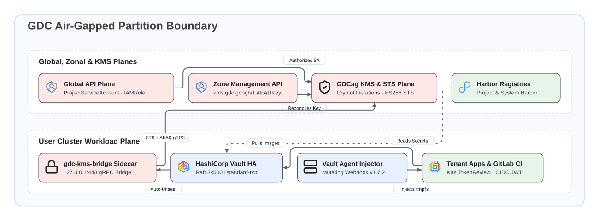

Copyright 2026 Google. This software is provided as-is, without warranty or representation for any use or purpose. Your use of it is subject to your agreement with Google.

# Pattern 11: Resilient Secret Management with HashiCorp Vault & GDCag KMS Auto-Unseal

**Use Case:** Provides a centralized, highly available, hardware-KMS-backed enclave for managing application and CI/CD secrets on **Google Distributed Cloud air-gapped (`GDCag v1.15+` / `v1.16.2`)**, eliminating plaintext environment variables and static Kubernetes Secrets.

> **Companion Operational Guide:** For a complete live-verified walkthrough of **GitLab 17.11 + HashiCorp Vault 1.15.0 + GDCag KMS Auto-Unseal** (including OIDC `id_tokens` CI authentication and Vault Agent Injector workloads), see `docs/operations/gitlab_vault_kms_installation_guide.md`.

---

## Architecture



### Design & Resilience Highlights

1. **Multi-Plane GDCag Control-Plane Separation**:
   * **Global API (`GLOBAL_API_KUBECONFIG` / `global-api`)**: Provisions the dedicated `ProjectServiceAccount` (`vault-kms-sa`) and binds `iam.global.gdc.goog/v1` `IAMRoleBinding`s to `kms-developer` and `kms-viewer` (`manifests/gdc/kms/global-iam.yaml`).
   * **Zone Management API (`ZONE_KUBECONFIG` / `<org>-admin`)**: Provisions the declarative `kms.gdc.goog/v1` `AEADKey` (`vault-unseal-key`, `AES_256_GCM`) (`manifests/gdc/kms/zonal-aeadkey.yaml`), addressed on the KMS data plane via camelCase `namespaces/<project>/aeadKeys/vault-unseal-key`.
   * **User Cluster (`USER_CLUSTER_KUBECONFIG`)**: Runs the 3-replica Vault Raft HA `StatefulSet` (`vault-0`, `vault-1`, `vault-2`), `vault-agent-injector`, and zero-trust `NetworkPolicy`.
2. **Hardware-Backed Auto-Unseal via `gdc-kms-bridge` (`src/gdc-kms-bridge/`)**:
   * Runs as a Kubernetes native sidecar (`restartPolicy: Always`) listening on loopback `127.0.0.1:443` with `hostAliases` mapping `cloudkms.googleapis.com` and `oauth2.googleapis.com` to `127.0.0.1` (plus a local `/healthz:18080` `startupProbe`).
   * Exchanges the mounted `vault-kms-sa.json` ES256 key (`Secret/gdc-kms-sa`) at the GDCag STS `/authenticate` endpoint (`urn:k8s:params:oauth:token-type:serviceaccount`) and translates Vault's `seal "gcpckms"` gRPC calls into `/goog.gdc.kms.v1.CryptoOperationsService/{Encrypt,Decrypt}` requests on `namespaces/<project>/aeadKeys/vault-unseal-key`.
3. **3-Node Raft Consensus & Storage (`standard-rwo`)**:
   * Uses `storageClass: "standard-rwo"` (`csi.kubevirt.io`), `setNodeId: true`, explicit `retry_join` stanzas, `service_registration "kubernetes" {}`, and an initialization-safe `livenessProbe` (`uninitok=true&sealedcode=204`).
4. **Air-Gapped Harbor Compliance**:
   * Pulls chart `vault-0.32.0` from System Harbor (`gpc-system-helm-packages/vault`) while mirroring OSS `vault:1.15.0`, `vault-k8s:1.7.2`, and `gdc-kms-bridge:1.0.0` into **Project Managed Harbor** (`harbor001-<project>.<org>.<zone>.google.gdch.test/iac/...`) with `imagePullSecrets: [{name: harbor-creds}]`—avoiding System Harbor `library/` Cosign `412` rejections and `vault-enterprise` license failures.

---

## Resource Requirements (T-Shirt Sizes)

| Component | Recommended GDCag Machine Type | Replicas | vCPU (Req/Lim) | RAM (Req/Lim) | Storage (PVC) | GPU? |
| :--- | :--- | :---: | :--- | :--- | :--- | :--- |
| **Vault Server (`vault`)** | `n2-standard-8-gdc` (3-node pool) | 3 | `4` / `4` | `16Gi` / `16Gi` | `3 x 50Gi` (`standard-rwo`) | No |
| **`gdc-kms-bridge` Sidecar** | Co-located in Vault pod | 3 | `50m` / `200m` | `64Mi` / `128Mi` | `emptyDir` (`Memory`) | No |
| **Vault Agent Injector** | Shared CPU pool | 1 | `100m` / `250m` | `128Mi` / `256Mi` | Stateless | No |
| **GDCag KMS (`AEADKey`)** | Platform Managed | N/A | N/A | N/A | N/A | No |

*(Note: Each `n2-standard-8-gdc` node provides 8 vCPUs and 32Gi RAM so each `4 vCPU / 16Gi` Vault replica schedules onto a distinct hypervisor via `podAntiAffinity`. For compact lab clusters using `n2-standard-4-gdc`, lower `server.resources` to `250m–500m` CPU and `256Mi–512Mi` RAM with `10Gi` `standard-rwo` PVCs.)*

---

## Required GDCag IAM Roles

Grant the following project-scoped `IAMRole`s via `iam.global.gdc.goog/v1` `IAMRoleBinding` on `GLOBAL_API_KUBECONFIG`:

* **Operator / IaC ServiceAccount (`iac001-sa`)**:
  * `kms-admin`, `kms-developer`, `kms-viewer` (to provision and test `AEADKey` resources)
  * `project-iam-admin` (to create `vault-kms-sa` and bind KMS roles)
  * `namespace-admin` / `cluster-developer` (to deploy Vault on the User Cluster)
* **Vault KMS Unseal ServiceAccount (`vault-kms-sa`)**:
  * `kms-developer` (Encrypt / Decrypt via `CryptoOperationsService`)
  * `kms-viewer` (Inspect `AEADKey` metadata)

---

## Step-by-Step GDCag Deployment

### Step 1: Configure CLI TLS (`GODEBUG=tlsmlkem=0`) & 3-Plane Kubeconfigs

Prepend the `gdcloud`-bundled BoringCrypto `kubectl` binary and set `GODEBUG=tlsmlkem=0` so Go `1.27+` CLIs do not stall on the GDCag Envoy gateway TLS handshake:

```bash
export GDCLOUD_CLI_PATH="${GDCLOUD_CLI_PATH:-/google/gdcloud}"
mkdir -p "${HOME}/bin"
if [ -f "${GDCLOUD_CLI_PATH}/bin/component_bundles/kubectl_linux_amd64_1.23.5.tar.gz" ]; then
  tar -xzf "${GDCLOUD_CLI_PATH}/bin/component_bundles/kubectl_linux_amd64_1.23.5.tar.gz" \
    -C "${HOME}/bin" --strip-components=1 bin/kubectl
fi
export PATH="${HOME}/bin:${GDCLOUD_CLI_PATH}/bin:${PATH}"
export GODEBUG=tlsmlkem=0

export ORG_NAME="org-12345"
export GDCH_ZONE="zone1"
export GDCH_DOMAIN="google.gdch.test"
export PROJECT_ID="my-gdc-project"
export NAMESPACE="vault"
export USER_CLUSTER="my-user-cluster"
export WORK_DIR="/tmp/p11-vault"
mkdir -p "${WORK_DIR}"

# Generate Global, Zonal, and User Cluster kubeconfigs
gdcloud config set core/organization_console_url "https://console.${ORG_NAME}.${GDCH_ZONE}.${GDCH_DOMAIN}"
gdcloud config set core/project "${PROJECT_ID}"
gdcloud config set core/zone ""
KUBECONFIG="${WORK_DIR}/global-api.kubeconfig" gdcloud clusters get-credentials global-api

gdcloud config set core/zone "${GDCH_ZONE}"
KUBECONFIG="${WORK_DIR}/zone-admin.kubeconfig" gdcloud clusters get-credentials "${ORG_NAME}-admin" --zone "${GDCH_ZONE}"
KUBECONFIG="${WORK_DIR}/user-cluster.kubeconfig" gdcloud clusters get-credentials "${USER_CLUSTER}" --zone "${GDCH_ZONE}"

export GLOBAL_API_KUBECONFIG="${WORK_DIR}/global-api.kubeconfig"
export ZONE_KUBECONFIG="${WORK_DIR}/zone-admin.kubeconfig"
export USER_CLUSTER_KUBECONFIG="${WORK_DIR}/user-cluster.kubeconfig"
export KUBECONFIG="${USER_CLUSTER_KUBECONFIG}"
```

### Step 2: Mirror Images & Build `gdc-kms-bridge` to Project Managed Harbor

Use `tools/mirror-images/mirror_images.py` (in `gdc-iac-org`) or `common-scripts/mirror_images.py` (in standalone `deploy-to-production/` bundles) to mirror `external_images.txt` into **Project Managed Harbor** (`harbor001-${PROJECT_ID}.../iac`), and build `src/gdc-kms-bridge/`:

```bash
export SYSTEM_HARBOR="harbor.${ORG_NAME}.${GDCH_ZONE}.${GDCH_DOMAIN}"
export PROJECT_HARBOR="harbor001-${PROJECT_ID}.${ORG_NAME}.${GDCH_ZONE}.${GDCH_DOMAIN}"

docker login "${PROJECT_HARBOR}" -u "${HARBOR_USER}" -p "${HARBOR_SECRET}"

# Option A: Direct Mirroring (bastion with access to source registry & Managed Harbor)
python3 ../../common-scripts/mirror_images.py \
  --images-file ./external_images.txt \
  --registry "${PROJECT_HARBOR}/iac"

# Option B: Two-Step Air-Gap Transfer (Low-Side --save-dir -> High-Side --load-dir)
# Low-Side:  python3 ./common-scripts/mirror_images.py --images-file patterns/p11-vault/external_images.txt --save-dir ./artifacts/mirrored-images
# High-Side: python3 ./common-scripts/mirror_images.py --load-dir ./artifacts/mirrored-images --registry "${PROJECT_HARBOR}/iac"

# Build & push gdc-kms-bridge:1.0.0 from src/gdc-kms-bridge/
REGISTRY_HOST="${PROJECT_HARBOR}/iac" PUSH_IMAGES=true ./scripts/build.sh

# Parameterize manifests with target Project ID, Namespace, and Project Harbor URL
../../common-scripts/configure-blueprints.sh \
  -p "${PROJECT_ID}" -n "${NAMESPACE}" -r "${PROJECT_HARBOR}" -d .
```
*(If running from the upstream `GDC-blueprints` repository root before staging, invoke `./configure-blueprints.sh -p "${PROJECT_ID}" -n "${NAMESPACE}" -r "${PROJECT_HARBOR}" -d p11-vault` and `python3 ./scripts/mirror_images.py ...`.)*

### Step 3: Provision Global `vault-kms-sa` & Zonal `AEADKey`

```bash
# 1. Apply Global ProjectServiceAccount & KMS IAMRoleBindings
kubectl --kubeconfig="${GLOBAL_API_KUBECONFIG}" apply -f ./manifests/gdc/kms/global-iam.yaml

# 2. Export ES256 key JSON for vault-kms-sa
kubectl --kubeconfig="${ZONE_KUBECONFIG}" get secret -n gpc-system TrustStore-root-ext \
  -o jsonpath='{.data.ca\.crt}' | base64 -d > "${WORK_DIR}/gdc-login-ca.crt" 2>/dev/null || \
  cp /etc/ssl/certs/ca-certificates.crt "${WORK_DIR}/gdc-login-ca.crt"

gdcloud iam service-accounts keys create "${WORK_DIR}/vault-kms-sa.json" \
  --iam-account=vault-kms-sa \
  --project="${PROJECT_ID}" \
  --ca-cert-path="${WORK_DIR}/gdc-login-ca.crt"

# 3. Apply Zonal AEADKey & verify camelCase KMS resource URI
kubectl --kubeconfig="${ZONE_KUBECONFIG}" apply -f ./manifests/gdc/kms/zonal-aeadkey.yaml
kubectl --kubeconfig="${ZONE_KUBECONFIG}" wait --for=condition=Ready \
  aeadkey/vault-unseal-key -n "${PROJECT_ID}" --timeout=60s
```

### Step 4: Deploy Vault & `NetworkPolicy` on the User Cluster

```bash
export KUBECONFIG="${USER_CLUSTER_KUBECONFIG}"

kubectl create namespace "${NAMESPACE}" --dry-run=client -o yaml | kubectl apply -f -

kubectl -n "${NAMESPACE}" create secret generic gdc-kms-sa \
  --from-file=vault-kms-sa.json="${WORK_DIR}/vault-kms-sa.json" \
  --dry-run=client -o yaml | kubectl apply -f -

kubectl -n "${NAMESPACE}" create secret generic harbor-creds \
  --from-file=.dockerconfigjson="${HOME}/.docker/config.json" \
  --type=kubernetes.io/dockerconfigjson \
  --dry-run=client -o yaml | kubectl apply -f -

# Pull chart vault-0.32.0 from System Harbor and install with GDCag values
GODEBUG=tlsmlkem=0 helm pull "oci://${SYSTEM_HARBOR}/gpc-system-helm-packages/vault" \
  --version 0.32.0 --untar -d "${WORK_DIR}/charts"

GODEBUG=tlsmlkem=0 helm upgrade --install vault "${WORK_DIR}/charts/vault" \
  --namespace "${NAMESPACE}" \
  -f ./manifests/helm/values.yaml

kubectl -n "${NAMESPACE}" apply -f ./manifests/security/network-policy.yaml
```

### Step 5: Initialize Vault & Verify KMS Auto-Unseal

```bash
kubectl -n "${NAMESPACE}" wait --for=condition=Initialized pod/vault-0 --timeout=120s

# Initialize inside `-c vault` with JSON output (-recovery-shares / -recovery-threshold apply when KMS seal is active)
kubectl -n "${NAMESPACE}" exec vault-0 -c vault -- \
  vault operator init -recovery-shares=5 -recovery-threshold=3 -format=json > "${WORK_DIR}/vault-init.json"
chmod 600 "${WORK_DIR}/vault-init.json"

# Verify Sealed=false and inspect gdc-kms-bridge Encrypt/Decrypt translation logs
kubectl -n "${NAMESPACE}" exec vault-0 -c vault -- vault status
kubectl -n "${NAMESPACE}" logs vault-0 -c gdc-kms-bridge

# Ephemeral pod health check using mirrored Vault image (verifies HTTP status & "sealed":false before printing PASS)
kubectl run p11-verify --rm -i --restart=Never -n "${NAMESPACE}" \
  --overrides='{"spec":{"imagePullSecrets":[{"name":"harbor-creds"}]}}' \
  --image="${PROJECT_HARBOR}/iac/vault:1.15.0" --command -- sh -ec '
    sleep 2
    HEALTH=$(wget -qO- "http://vault-0.vault-internal:8200/v1/sys/health?standbyok=true")
    echo "${HEALTH}" | grep -q "\"sealed\":false"
    echo "✅ PASS: Vault cluster reachable and auto-unsealed via GDCag KMS!"
    echo "${HEALTH}"
  '
```
> **CRITICAL SECURITY NOTE:** Store `${WORK_DIR}/vault-init.json` (`recovery_keys_b64` and `root_token`) in your offline break-glass vault and delete the local file immediately after recording.

---

## Consuming Vault Secrets in Tenant Workloads

### Option A: Vault Agent Sidecar Injector (Zero Application Code Changes)

1. Enable Kubernetes Auth inside `vault-0`:
   ```bash
   export VAULT_ROOT_TOKEN=$(jq -r '.root_token' "${WORK_DIR}/vault-init.json")
   kubectl -n "${NAMESPACE}" exec -i vault-0 -c vault -- env VAULT_TOKEN="${VAULT_ROOT_TOKEN}" sh -c '
     vault secrets enable -path=secret kv-v2 || true
     vault auth enable kubernetes || true
     vault write auth/kubernetes/config kubernetes_host="https://${KUBERNETES_PORT_443_TCP_ADDR}:443"
   '
   ```
2. Create a least-privilege policy and bind the application's Kubernetes `ServiceAccount` (`bound_service_account_names` / `bound_service_account_namespaces`).
3. Annotate application `Deployment` pods (`vault.hashicorp.com/agent-inject: "true"`, `vault.hashicorp.com/role: "<app-role>"`, `vault.hashicorp.com/agent-inject-secret-config.env: "secret/data/..."`) so secrets render onto `/vault/secrets/config.env` (`tmpfs`).

### Option B: Direct HTTP API / Zero-Dependency Python Client (No Sidecar)

Workloads can exchange `/var/run/secrets/kubernetes.io/serviceaccount/token` directly at `POST http://vault.vault.svc.cluster.local:8200/v1/auth/kubernetes/login` using Python's standard-library `urllib.request` (see `docs/operations/gitlab_vault_kms_installation_guide.md` Section 8.3 and `docs/operations/vault_integration_guide.md`).

### Option C: Integrating Vault with GDCag Managed PostgreSQL (`DBCluster` / `database/` Dynamic Secrets Engine)

When configuring Vault's Dynamic Database Secrets Engine (`database/`) or a PostgreSQL backend against a Zonal GDCag Managed PostgreSQL `DBCluster` (`postgresql.dbadmin.gdc.goog/v1`), Vault server pods require `5432/TCP` egress to the Zonal database subnet and the `DBCluster` server TLS CA certificate (`Secret/dbs-certificates` extracted from `ZONE_KUBECONFIG`) mounted for `sslmode=verify-ca`:

* **Standalone Manifest (`manifests/security/network-policy.yaml`)**: Egress rule `# 5` (`5432/TCP`) is commented out by default (matching `allowPostgresEgress: false` in the Helm chart). Uncomment rule `# 5` and replace `<POSTGRES_SUBNET_CIDR>/32` with your Zonal `DBCluster` VIP/subnet CIDR before applying.
* **Helm Wrapper Chart (`chart/`)**: Enable PostgreSQL egress via `vault.networkPolicy.allowPostgresEgress=true` with `vault.networkPolicy.postgresCidrs`, and mount your User Cluster TLS CA Secret (`db-tls-ca`) into the Vault server container via `vault.extraVolumes` and `vault.extraVolumeMounts`:
  ```yaml
  # values-postgres.yaml
  vault:
    extraVolumes:
      - name: db-tls-ca
        secret:
          secretName: db-tls-ca
    extraVolumeMounts:
      - name: db-tls-ca
        mountPath: /vault/userconfig/db-tls-ca
        readOnly: true
    networkPolicy:
      allowPostgresEgress: true
      postgresCidrs:
        - "10.200.16.0/24"
  ```
  ```bash
  GODEBUG=tlsmlkem=0 helm upgrade --install p11-vault ./chart \
    --namespace "${NAMESPACE}" \
    -f values-postgres.yaml \
    --set global.projectId="${PROJECT_ID}" \
    --set global.namespace="${NAMESPACE}" \
    --set global.registry="${PROJECT_HARBOR}/iac" \
    --set vault.bridge.kmsEndpoint="https://kms.${ORG_NAME}.${GDCH_ZONE}.${GDCH_DOMAIN}"
  ```

---

## Helm & IaC Orchestrated Deployment (`chart/`)

Pattern 11 includes a self-contained Helm chart in [`chart/`](./chart/) (`0.2.0`) integrated with `foundations/releases/5-workload-factory`:

* **User Cluster Workloads (`apps.enabled: true`, `gdc.enabled: false` — Default for Stage 5)**: Renders `ServiceAccount`, RBAC (`vault-discovery-role` & `system:auth-delegator`), Raft `ConfigMap` (`vault-config`), `vault` & `vault-internal` `Service`s, the 3-replica `vault` `StatefulSet` with `gdc-kms-bridge` native sidecar and `standard-rwo` PVCs, and `NetworkPolicy` (`vault-internal-policy`, with optional `5432/TCP` egress via `vault.networkPolicy.allowPostgresEgress`).
* **Control-Plane KMS & IAM (`gdc.enabled: true`)**: Renders Global `ProjectServiceAccount` + `IAMRoleBinding`s (`gdc.globalIam.enabled: true`) and Zonal `kms.gdc.goog/v1` `AEADKey` (`gdc.zonalKms.enabled: true`).

### Direct Helm CLI Deployment
```bash
# 1. Deploy User Cluster Vault HA + gdc-kms-bridge + NetworkPolicy (Stage 5 default)
GODEBUG=tlsmlkem=0 helm upgrade --install p11-vault ./chart \
  --namespace "${NAMESPACE}" \
  --set global.projectId="${PROJECT_ID}" \
  --set global.namespace="${NAMESPACE}" \
  --set global.registry="${PROJECT_HARBOR}/iac" \
  --set vault.bridge.kmsEndpoint="https://kms.${ORG_NAME}.${GDCH_ZONE}.${GDCH_DOMAIN}"

# 2. Optional: Render Global IAM & Zonal AEADKey manifests separately per plane
helm template p11-vault-iam ./chart \
  --set apps.enabled=false,gdc.enabled=true,gdc.zonalKms.enabled=false \
  --set global.projectId="${PROJECT_ID}" | kubectl --kubeconfig="${GLOBAL_API_KUBECONFIG}" apply -f -

helm template p11-vault-kms ./chart \
  --set apps.enabled=false,gdc.enabled=true,gdc.globalIam.enabled=false \
  --set global.projectId="${PROJECT_ID}" | kubectl --kubeconfig="${ZONE_KUBECONFIG}" apply -f -
```

---

## Pre-Deployment Chart & Manifest Validation

* **In `gdc-iac-org` (`./scripts/test-charts.sh`)**: Runs `helm lint`, `helm unittest` (`chart/tests/pattern_test.yaml`), `kubeconform -strict`, and `conftest` OPA policy checks across `blueprints/patterns/p11-vault/chart`.
* **In standalone `deploy-to-production/` bundles**: Run `../../common-scripts/validate-manifests.sh`.
* *(Upstream `GDC-blueprints` development repository only)*: `src/gdc-kms-bridge` unit tests (`cd p11-vault/src/gdc-kms-bridge && go test -v ./...`) and mocked CLI suite (`bash tests/run-local.sh` / `p11-vault/test/verify.sh`; note that `test/` is excluded from staged production bundles).
