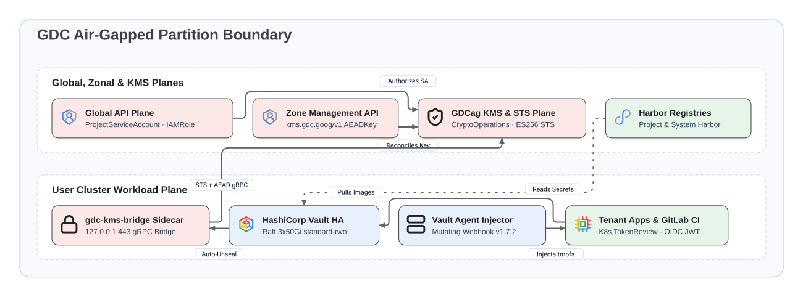
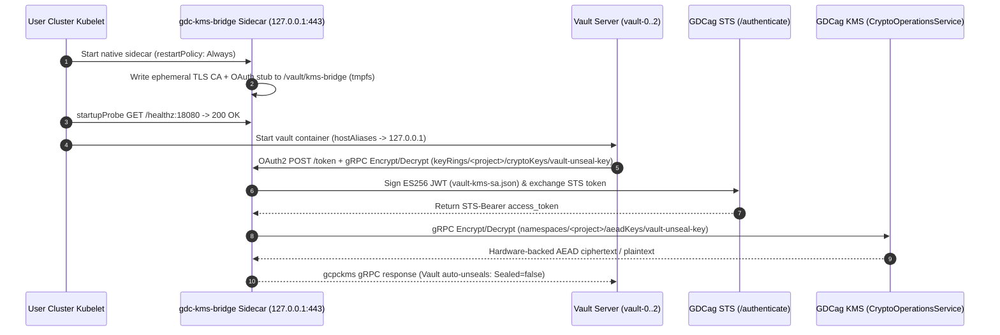

Copyright 2026 Google. This software is provided as-is, without warranty or representation for any use or purpose. Your use of it is subject to your agreement with Google.

# **Solution Reference Implementation - Pattern 11: Resilient Secret Management with HashiCorp Vault on GDC air-gapped**

> **Version:** 1.3  
> **Validated Platform:** Google Distributed Cloud air-gapped (`GDCag v1.15+` / `v1.16.2`)  
> **Companion Operational Runbook:** For full GitLab 17.11 + HashiCorp Vault + GDCag KMS live-verified installation and OIDC CI integration, see `docs/operations/gitlab_vault_kms_installation_guide.md`.

## **Overview**

This document provides step-by-step production instructions for deploying and configuring **HashiCorp Vault OSS (`1.15.0`, chart `0.32.0`)** as a centralized, highly available enclave for secrets management on **Google Distributed Cloud air-gapped (`GDCag`)** environments. This pattern deploys a 3-node High-Availability (HA) Vault `StatefulSet` backed by GDCag block storage (`standard-rwo`) using Integrated Raft consensus, automatically unsealed via a hardware-backed Zonal **GDCag Key Management Service (`kms.gdc.goog/v1` `AEADKey`)** and the zero-dependency **`gdc-kms-bridge`** native sidecar.

---

## **Architecture**

On GDCag, control-plane and data-plane operations span **three distinct Kubernetes API planes** plus the **GDCag KMS & STS data-plane endpoints**:

1. **Global API Server (`GLOBAL_API_KUBECONFIG` / `global-api`)**: Hosts project-scoped `ProjectServiceAccount` (`vault-kms-sa`) and `iam.global.gdc.goog/v1` `IAMRoleBinding` resources (`kms-admin`, `kms-developer`, `kms-viewer`).
2. **Zone Management API Server (`ZONE_KUBECONFIG` / `<org>-admin`)**: Reconciles declarative `kms.gdc.goog/v1` `AEADKey` (`vault-unseal-key`, `AES_256_GCM`) and `HarborInstance` (`harbor001`) resources inside the tenant project namespace.
3. **GDCag KMS & STS Data Plane**: `gdc-kms-bridge` exchanges the `vault-kms-sa` ES256 key at `https://service-accounts.<org>.<domain>/authenticate` (`urn:k8s:params:oauth:token-type:serviceaccount`) for an `STS-Bearer` token and translates Vault's `seal "gcpckms"` gRPC calls into `/goog.gdc.kms.v1.CryptoOperationsService/{Encrypt,Decrypt}` operations on camelCase `namespaces/<project>/aeadKeys/vault-unseal-key`.
4. **User Cluster (`USER_CLUSTER_KUBECONFIG`)**: Runs the 3-pod `vault` `StatefulSet` (`vault-0`, `vault-1`, `vault-2`) with `gdc-kms-bridge` on `127.0.0.1:443` (`hostAliases` for `cloudkms.googleapis.com` & `oauth2.googleapis.com`), the `vault-agent-injector` (`vault-k8s:1.7.2`) mutating webhook, and `standard-rwo` Raft PVCs.





### **Key Solution Capabilities**

* **Hardware-Backed GDCag KMS Auto-Unseal**: Wraps Vault's master key with an `AES_256_GCM` `AEADKey` on the GDCag KMS enclave via the zero-dependency `gdc-kms-bridge` native sidecar—eliminating manual Shamir key entry across pod restarts and node maintenance.
* **3-Node Raft Consensus Persistence**: Deploys a 3-replica `StatefulSet` (`setNodeId: true`, `retry_join`, `service_registration "kubernetes" {}`) backed by `50Gi` `standard-rwo` (`csi.kubevirt.io`) PVCs and an initialization-safe `livenessProbe` (`uninitok=true&sealedcode=204`).
* **Air-Gapped Harbor Compliance**: Pulls OCI charts (`gpc-system-helm-packages/vault` `0.32.0`) and signed webhook images (`library/hashicorp/vault-k8s:1.7.2`) from System Harbor while pulling OSS `vault:1.15.0` and `gdc-kms-bridge:1.0.0` from **Project Managed Harbor** (`harbor001-<project>.../iac/...`) using `harbor-creds`—avoiding System Harbor `library/` Cosign `412 Precondition Failed` rejections and `vault-enterprise` license exits.
* **Zero-Trust Network Isolation**: Scopes `8201/TCP` Raft replication strictly to `vault` pods while permitting cross-namespace client ingress on `8200/TCP` (`namespaceSelector: {}`), cluster DNS (`53/UDP+TCP`), K8s API `TokenReview` (`443/6443` TCP), KMS/STS (`443/TCP`), and in-cluster OIDC JWKS endpoints.

---

## **Before you Begin**

Ensure the following prerequisites are met:

* **GDC air-gapped (`GDCag`) version `1.15.1` or higher** (live-validated on `v1.16.2`).
* **`gdcloud`, `kubectl`, `helm`, and `docker` CLIs** installed on your operator workstation.
* **Project-level GDCag `IAMRole` bindings** (provisioned via `iam.global.gdc.goog/v1` `IAMRoleBinding` on `GLOBAL_API_KUBECONFIG`):
  * **KMS Admin (`kms-admin`)**: Bound to the operator / IaC `ProjectServiceAccount` to create and inspect `AEADKey` resources.
  * **KMS Developer (`kms-developer`) & KMS Viewer (`kms-viewer`)**: Bound to `vault-kms-sa` to authorize `Encrypt`/`Decrypt` and key metadata operations on the KMS data plane.
  * **Namespace Admin (`namespace-admin`) / Cluster Developer (`cluster-developer`)**: To deploy Helm releases, RBAC, and `NetworkPolicy` resources on the target User Cluster.
  * **Harbor Instance Admin (`harbor-instance-admin`) & Project Creator (`harbor-project-creator`)**: To provision Project Managed Harbor (`harbor001`) if not already created in Stage 2 (`charts/gdc-harbors`).

---

## **Section 1: Multi-Plane CLI Authentication & Base Cluster Setup**

### 1.1 Workstation Binary Path & Envoy TLS Handshake Configuration (`GODEBUG=tlsmlkem=0`)

On operator workstations with newer system `kubectl` or `helm` binaries compiled with Go `1.27+`, TLS handshakes through the GDCag Envoy ingress gateway can time out due to oversized post-quantum `X25519MLKEM768` `ClientHello` frames. Always prepend the `gdcloud`-bundled BoringCrypto `kubectl` binary and export `GODEBUG=tlsmlkem=0`:

```bash
export GDCLOUD_CLI_PATH="${GDCLOUD_CLI_PATH:-/google/gdcloud}"
mkdir -p "${HOME}/bin"
if [ -f "${GDCLOUD_CLI_PATH}/bin/component_bundles/kubectl_linux_amd64_1.23.5.tar.gz" ]; then
  tar -xzf "${GDCLOUD_CLI_PATH}/bin/component_bundles/kubectl_linux_amd64_1.23.5.tar.gz" \
    -C "${HOME}/bin" --strip-components=1 bin/kubectl
fi

export PATH="${HOME}/bin:${GDCLOUD_CLI_PATH}/bin:${PATH}"
export GODEBUG=tlsmlkem=0
```

### 1.2 Generate the 3 Official GDCag IAM Kubeconfigs

Authenticate with `gdcloud` and generate separate kubeconfigs for the **Global API**, **Zone Management API**, and **User Cluster**:

```bash
export ORG_NAME="org-12345"
export GDCH_ZONE="zone1"
export GDCH_DOMAIN="google.gdch.test"
export PROJECT_ID="my-gdc-project"
export NAMESPACE="vault"
export IAC_SA="iac001-sa"
export USER_CLUSTER="my-user-cluster"
export WORK_DIR="/tmp/p11-vault-artifacts"

export KUBECONFIG_DIR="${WORK_DIR}/kubeconfigs"
export GLOBAL_API_KUBECONFIG="${KUBECONFIG_DIR}/global-api.kubeconfig"
export ZONE_KUBECONFIG="${KUBECONFIG_DIR}/${ORG_NAME}-admin.kubeconfig"
export USER_CLUSTER_KUBECONFIG="${KUBECONFIG_DIR}/${USER_CLUSTER}.kubeconfig"
mkdir -p "${KUBECONFIG_DIR}"

# 1. Configure gdcloud organization & activate IAM ServiceAccount (or run `gdcloud auth login`)
gdcloud config set core/organization_console_url "https://console.${ORG_NAME}.${GDCH_ZONE}.${GDCH_DOMAIN}"
gdcloud config set core/project "${PROJECT_ID}"
gdcloud config set core/zone "${GDCH_ZONE}"
gdcloud auth activate-service-account --key-file="/path/to/${IAC_SA}.json"

# 2. Global API Kubeconfig (ProjectServiceAccounts, IAMRoleBindings)
gdcloud config set core/zone ""
KUBECONFIG="${GLOBAL_API_KUBECONFIG}" gdcloud clusters get-credentials global-api
kubectl --kubeconfig="${GLOBAL_API_KUBECONFIG}" auth whoami

# 3. Zone Management API Kubeconfig (AEADKeys, HarborInstances, Clusters)
gdcloud config set core/zone "${GDCH_ZONE}"
KUBECONFIG="${ZONE_KUBECONFIG}" gdcloud clusters get-credentials "${ORG_NAME}-admin" --zone "${GDCH_ZONE}"
kubectl --kubeconfig="${ZONE_KUBECONFIG}" auth whoami

# 4. User Cluster Kubeconfig (Vault StatefulSet, Sidecar, NetworkPolicy)
KUBECONFIG="${USER_CLUSTER_KUBECONFIG}" gdcloud clusters get-credentials "${USER_CLUSTER}" --zone "${GDCH_ZONE}"
kubectl --kubeconfig="${USER_CLUSTER_KUBECONFIG}" auth whoami

export KUBECONFIG="${USER_CLUSTER_KUBECONFIG}"
```

### 1.3 Base Cluster Resource & Node Pool Requirements

#### Component Resource Allocation Breakdown

| Component | Replicas | CPU Request (Limit) | Memory Request (Limit) | Storage / PVC |
| :--- | :---: | :--- | :--- | :--- |
| **Vault Server (`vault`)** | 3 (`StatefulSet`) | `4` (`4`) | `16Gi` (`16Gi`) | `3 x 50Gi` Raft PVC (`standard-rwo`) |
| **`gdc-kms-bridge` Sidecar** | 3 (`1` per Vault pod) | `50m` (`200m`) | `64Mi` (`128Mi`) | In-memory `emptyDir` (`medium: Memory`) |
| **Vault Agent Injector** | 1 (`Deployment`) | `100m` (`250m`) | `128Mi` (`256Mi`) | Stateless |
| **GDCag KMS (`AEADKey`)** | Platform Managed | N/A | N/A | Hardware-backed KMS enclave |

#### Recommended Node Pool Configuration

* **Production 3-Node HA Pool**: 3 nodes of predefined GDCag machine type **`n2-standard-8-gdc`** (8 vCPUs, 32Gi RAM per node; 24 vCPUs, 96Gi RAM total) labeled `pool: cpu` so each `4 vCPU / 16Gi` Vault replica schedules onto a dedicated hypervisor via `podAntiAffinity` with ample headroom for Raft compaction, `gdc-kms-bridge`, and system daemons.
* *(Compact Lab / Shared Cluster Profile)*: For non-production validation on smaller `n2-standard-4-gdc` pools, reduce `server.resources` to `250m–500m` CPU / `256Mi–512Mi` RAM and `dataStorage.size` to `10Gi` (`standard-rwo`).

#### Declarative Standard Cluster Provisioning (Optional — If Creating a Dedicated Cluster)

```yaml
apiVersion: cluster.gdc.goog/v1
kind: Cluster
metadata:
  name: p11-standard-cluster
  namespace: my-gdc-project
spec:
  clusterNetwork:
    podCIDRSize: 21
    serviceCIDRSize: 23
  nodePools:
    - name: cpu-node-pool
      machineTypeName: n2-standard-8-gdc
      nodeCount: 3
      labels:
        pool: cpu
  releaseChannel:
    channel: UNSPECIFIED
```

Apply against the **Zone Management API** (`ZONE_KUBECONFIG`):
```bash
kubectl --kubeconfig="${ZONE_KUBECONFIG}" apply -f standard-cluster.yaml
```

---

## **Section 2: Declarative GDCag KMS & IAM Provisioning**

> **Important GDCag KMS Architecture Note (`AEADKey` vs. Public GCP `KeyRing`):**
> GDCag has **no `KeyRing` CRD** and no `gdcloud kms key-rings` subcommand, and does not use GKE Workload Identity (`*.svc.id.goog`) or `roles/cloudkms.*`. Instead:
> 1. Provision a Global **`ProjectServiceAccount`** (`vault-kms-sa`) and bind `iam.global.gdc.goog/v1` `IAMRoleBinding`s to **`kms-developer`** and **`kms-viewer`** on `GLOBAL_API_KUBECONFIG`.
> 2. Apply a declarative `kms.gdc.goog/v1` **`AEADKey`** (`AES_256_GCM`) in the project namespace on `ZONE_KUBECONFIG`.
> 3. Address the key on the KMS data plane using camelCase **`namespaces/<project>/aeadKeys/vault-unseal-key`** (lowercase `aeadkeys` fails with `InvalidArgument`).

### 2.1 Create `ProjectServiceAccount`, Bind `IAMRole`s & Export ES256 Key (`GLOBAL_API_KUBECONFIG`)

Apply `manifests/gdc/kms/global-iam.yaml` (after running `configure-blueprints.sh` or substituting `${PROJECT_ID}`):

```yaml
apiVersion: resourcemanager.global.gdc.goog/v1
kind: ProjectServiceAccount
metadata:
  name: vault-kms-sa
  namespace: my-gdc-project
---
apiVersion: iam.global.gdc.goog/v1
kind: IAMRoleBinding
metadata:
  name: vault-kms-sa--kms-developer
  namespace: my-gdc-project
  labels:
    iam.global.gdc.goog/iam-role-name: kms-developer
spec:
  roleRef:
    apiGroup: iam.global.gdc.goog/v1
    kind: IAMRole
    name: kms-developer
  subjects:
    - kind: ServiceAccount
      name: vault-kms-sa
      namespace: my-gdc-project
---
apiVersion: iam.global.gdc.goog/v1
kind: IAMRoleBinding
metadata:
  name: vault-kms-sa--kms-viewer
  namespace: my-gdc-project
  labels:
    iam.global.gdc.goog/iam-role-name: kms-viewer
spec:
  roleRef:
    apiGroup: iam.global.gdc.goog/v1
    kind: IAMRole
    name: kms-viewer
  subjects:
    - kind: ServiceAccount
      name: vault-kms-sa
      namespace: my-gdc-project
```

Apply and export the `vault-kms-sa.json` ES256 credential file:

```bash
kubectl --kubeconfig="${GLOBAL_API_KUBECONFIG}" apply -f manifests/gdc/kms/global-iam.yaml

# Export login CA bundle and generate ES256 JSON key for vault-kms-sa
kubectl --kubeconfig="${ZONE_KUBECONFIG}" get secret -n gpc-system TrustStore-root-ext \
  -o jsonpath='{.data.ca\.crt}' | base64 -d > "${WORK_DIR}/gdc-login-ca.crt" 2>/dev/null || \
  cp /etc/ssl/certs/ca-certificates.crt "${WORK_DIR}/gdc-login-ca.crt"

gdcloud iam service-accounts keys create "${WORK_DIR}/vault-kms-sa.json" \
  --iam-account=vault-kms-sa \
  --project="${PROJECT_ID}" \
  --ca-cert-path="${WORK_DIR}/gdc-login-ca.crt"
```

### 2.2 Provision & Verify the Zonal `AEADKey` (`ZONE_KUBECONFIG`)

Apply `manifests/gdc/kms/zonal-aeadkey.yaml` against `ZONE_KUBECONFIG`:

```yaml
apiVersion: kms.gdc.goog/v1
kind: AEADKey
metadata:
  name: vault-unseal-key
  namespace: my-gdc-project
spec:
  algorithm: AES_256_GCM
```

```bash
kubectl --kubeconfig="${ZONE_KUBECONFIG}" apply -f manifests/gdc/kms/zonal-aeadkey.yaml
kubectl --kubeconfig="${ZONE_KUBECONFIG}" get aeadkey vault-unseal-key -n "${PROJECT_ID}" -o yaml

# Verify live KMS round-trip encryption/decryption using camelCase `aeadKeys`
gdcloud config set auth/login_config_cert_path "${WORK_DIR}/gdc-login-ca.crt"
echo -n "gdc-vault-kms-test" > "${WORK_DIR}/plain.txt"

gdcloud kms keys encrypt "namespaces/${PROJECT_ID}/aeadKeys/vault-unseal-key" \
  --plaintext-file="${WORK_DIR}/plain.txt" \
  --ciphertext-file="${WORK_DIR}/cipher.enc"

gdcloud kms keys decrypt "namespaces/${PROJECT_ID}/aeadKeys/vault-unseal-key" \
  --ciphertext-file="${WORK_DIR}/cipher.enc" \
  --plaintext-file="${WORK_DIR}/decrypted.txt"

cat "${WORK_DIR}/decrypted.txt" && echo ""
```

---

## **Section 3: Air-Gapped Harbor Mirroring & Deploying HashiCorp Vault**

### 3.1 Mirror OSS Vault & Build `gdc-kms-bridge` into Project Managed Harbor

> **Harbor Registry & Cosign `412` Gotcha:**
> * **Never push unsigned or re-tagged images to System Harbor `library/`** (`harbor.<org>.<zone>.google.gdch.test/library/`), which enforces Cosign signature verification and rejects pushes with `412 Precondition Failed`.
> * **Do not use `library/hashicorp/vault-enterprise`** unless mounting a valid Enterprise license secret (otherwise `vault-0` exits on startup with `license check failed`).
> * Instead, push OSS `vault:1.15.0`, `vault-k8s:1.7.2` (or reference System Harbor's signed `library/hashicorp/vault-k8s:1.7.2`), and `gdc-kms-bridge:1.0.0` to **Project Managed Harbor** (`harbor001-${PROJECT_ID}.${ORG_NAME}.${GDCH_ZONE}.${GDCH_DOMAIN}/iac/...`) using `tools/mirror-images/mirror_images.py` (or `common-scripts/mirror_images.py`).

```bash
export SYSTEM_HARBOR="harbor.${ORG_NAME}.${GDCH_ZONE}.${GDCH_DOMAIN}"
export PROJECT_HARBOR="harbor001-${PROJECT_ID}.${ORG_NAME}.${GDCH_ZONE}.${GDCH_DOMAIN}"

# 1. Authenticate Docker with Project Managed Harbor robot credentials
docker login "${PROJECT_HARBOR}" -u "${HARBOR_USER}" -p "${HARBOR_SECRET}"

# 2. Mirror 3P images (hashicorp/vault:1.15.0, hashicorp/vault-k8s:1.7.2) via mirror_images.py
# (Supports --save-dir / --load-dir for two-step disconnected air-gap transfer)
python3 ./tools/mirror-images/mirror_images.py \
  --images-file ./blueprints/patterns/p11-vault/external_images.txt \
  --registry "${PROJECT_HARBOR}/iac"

# 3. Build and push the zero-dependency gdc-kms-bridge sidecar image
REGISTRY_HOST="${PROJECT_HARBOR}/iac" PUSH_IMAGES=true \
  ./blueprints/patterns/p11-vault/scripts/build.sh

# 4. Pull the upstream Vault 0.32.0 Helm chart from System Harbor
GODEBUG=tlsmlkem=0 helm pull "oci://${SYSTEM_HARBOR}/gpc-system-helm-packages/vault" \
  --version 0.32.0 --untar -d "${WORK_DIR}/charts"
```

### 3.2 Create User Cluster Namespace, `gdc-kms-sa` Secret & `harbor-creds` Pull Secret

```bash
export KUBECONFIG="${USER_CLUSTER_KUBECONFIG}"

kubectl create namespace "${NAMESPACE}" --dry-run=client -o yaml | kubectl apply -f -

# Mount the exported ProjectServiceAccount ES256 key for gdc-kms-bridge STS exchange
kubectl -n "${NAMESPACE}" create secret generic gdc-kms-sa \
  --from-file=vault-kms-sa.json="${WORK_DIR}/vault-kms-sa.json" \
  --dry-run=client -o yaml | kubectl apply -f -

# Create imagePullSecret for Project Managed Harbor
kubectl -n "${NAMESPACE}" create secret generic harbor-creds \
  --from-file=.dockerconfigjson="${HOME}/.docker/config.json" \
  --type=kubernetes.io/dockerconfigjson \
  --dry-run=client -o yaml | kubectl apply -f -
```

### 3.3 Configure & Install Vault (`manifests/helm/values.yaml`)

Configure target parameters (replace `harbor.gdc.local` with `${PROJECT_HARBOR}` and `my-gdc-project` with `${PROJECT_ID}` via `common-scripts/configure-blueprints.sh`), and verify `GDC_KMS_ENDPOINT` in `manifests/helm/values.yaml` matches `https://kms.${ORG_NAME}.${GDCH_ZONE}.${GDCH_DOMAIN}`:

Key GDCag settings in `manifests/helm/values.yaml`:
* `global.imagePullSecrets: [{name: harbor-creds}]`
* `server.image.repository: "${PROJECT_HARBOR}/iac/vault"` (`1.15.0`)
* `injector.image.repository: "${PROJECT_HARBOR}/iac/vault-k8s"` (`1.7.2`, or `${SYSTEM_HARBOR}/library/hashicorp/vault-k8s`) and `injector.agentImage.repository: "${PROJECT_HARBOR}/iac/vault"` (`1.15.0`)
* `server.dataStorage.storageClass: "standard-rwo"` (`50Gi`)
* `server.livenessProbe.path: "/v1/sys/health?standbyok=true&uninitok=true&sealedcode=204"` (prevents kubelet restarts while `vault-0` awaits initialization)
* `server.hostAliases`: maps `cloudkms.googleapis.com` and `oauth2.googleapis.com` to `127.0.0.1`
* `server.extraInitContainers`: runs `gdc-kms-bridge:1.0.0` with `restartPolicy: Always`, loopback listener `127.0.0.1:443`, and `startupProbe` `GET /healthz:18080`
* `server.ha`: `replicas: 3`, `raft.setNodeId: true`, `retry_join` across `vault-0..2.vault-internal:8200`, `seal "gcpckms"` with `project = "${PROJECT_ID}"` and `key_ring = "${PROJECT_ID}"`, and `service_registration "kubernetes" {}`

Install Vault via Helm:
```bash
GODEBUG=tlsmlkem=0 helm upgrade --install vault "${WORK_DIR}/charts/vault" \
  --namespace "${NAMESPACE}" \
  -f ./blueprints/patterns/p11-vault/manifests/helm/values.yaml
```

---

## **Section 4: Initializing & Auto-Unsealing the Vault Cluster**

Wait for `vault-0` to finish starting `gdc-kms-bridge`, then initialize Vault inside `-c vault` using JSON output:

```bash
kubectl -n "${NAMESPACE}" wait --for=condition=Initialized pod/vault-0 --timeout=120s

# Note: With KMS auto-unseal enabled, Vault generates recovery keys rather than unseal keys.
# Customize recovery quorum if needed via `-recovery-shares=5 -recovery-threshold=3` (not `-key-shares`).
kubectl -n "${NAMESPACE}" exec vault-0 -c vault -- \
  vault operator init -recovery-shares=5 -recovery-threshold=3 -format=json > "${WORK_DIR}/vault-init.json"
chmod 600 "${WORK_DIR}/vault-init.json"
```

Securely store `${WORK_DIR}/vault-init.json` (`recovery_keys_b64` and `root_token`) in your organization's offline break-glass vault, then remove the file from the workstation. `vault-0` automatically wraps its master key via `gdc-kms-bridge` -> GDCag KMS (`Sealed: false`), and `vault-1` / `vault-2` join the Raft cluster via `retry_join` and auto-unseal automatically.

---

## **Section 5: Network Policy Hardening**

Apply `manifests/security/network-policy.yaml` (`vault-internal-policy`) so:
* Cross-namespace application pods and `vault-agent` sidecars can reach Vault API port `8200/TCP` (`namespaceSelector: {}`).
* Raft replication port `8201/TCP` (and peer `8200/TCP`) is restricted strictly to `app.kubernetes.io/name: vault` pods on both ingress and egress.
* Egress permits `kube-system` DNS (`53/UDP` and `53/TCP`), in-cluster OIDC JWKS providers (`80/443/8080` TCP for GitLab/Keycloak JWT auth), and GDCag KMS/STS (`443/TCP`) plus Kubernetes API `TokenReview` (`443/TCP` and post-DNAT `6443/TCP`).
* **PostgreSQL `5432/TCP` Egress & TLS Root CA Mount (Rule 5 / Optional Managed `DBCluster` Connectivity)**: When Vault connects to GDCag Managed PostgreSQL (`postgresql.dbadmin.gdc.goog/v1` `DBCluster`) to issue dynamic database credentials via the **Database Secrets Engine (`database/`)** or use a PostgreSQL storage backend, egress on port `5432/TCP` and the `DBCluster` TLS CA certificate (`Secret/dbs-certificates` copied from `ZONE_KUBECONFIG` into a User Cluster Secret) must be configured:
  * **Raw Manifest (`manifests/security/network-policy.yaml`)**: Rule `# 5` (`5432/TCP`) is commented out by default so standalone `kubectl apply` does not open `0.0.0.0/0:5432`. Uncomment Rule `# 5` and replace `<POSTGRES_SUBNET_CIDR>/32` with your Zonal `DBCluster` VIP/subnet CIDR.
  * **Helm Wrapper Chart (`chart/values.yaml`)**: Enable `vault.networkPolicy.allowPostgresEgress: true` (defaults to `false`), restrict `vault.networkPolicy.postgresCidrs` to your Zonal `DBCluster` VIP/subnet CIDR(s) (e.g., `["10.200.16.0/24"]`), and mount the TLS CA Secret via `vault.extraVolumes` (`[{name: db-tls-ca, secret: {secretName: db-tls-ca}}]`) and `vault.extraVolumeMounts` (`[{name: db-tls-ca, mountPath: /vault/userconfig/db-tls-ca, readOnly: true}]`).

```bash
kubectl -n "${NAMESPACE}" apply -f ./blueprints/patterns/p11-vault/manifests/security/network-policy.yaml
```

---

## **Section 6: Validation & Troubleshooting**

### 6.1 Exec Status & `gdc-kms-bridge` Audit Log Check

```bash
kubectl -n "${NAMESPACE}" exec vault-0 -c vault -- vault status
kubectl -n "${NAMESPACE}" logs vault-0 -c gdc-kms-bridge
```

**Expected `vault status` Output:**
* `Recovery Seal Type`: `shamir`
* `Initialized`: `true`
* `Sealed`: `false`
* `Storage Type`: `raft`
* `HA Mode`: `active`

### 6.2 Ephemeral Pod Health Verification (Using Mirrored Image & Exit-Code Assertions)

```bash
kubectl run p11-verify --rm -i --restart=Never -n "${NAMESPACE}" \
  --overrides='{"spec":{"imagePullSecrets":[{"name":"harbor-creds"}]}}' \
  --image="${PROJECT_HARBOR}/iac/vault:1.15.0" --command -- sh -ec '
    sleep 2
    HEALTH=$(wget -qO- "http://vault-0.vault-internal:8200/v1/sys/health?standbyok=true")
    echo "${HEALTH}" | grep -q "\"sealed\":false"
    echo "==============================================="
    echo "✅ PASS: Pattern 11 Vault Cluster status verified!"
    echo "✅ SUCCESS: Vault pod reached cleanly and unsealed"
    echo "==============================================="
    echo "${HEALTH}"
  '
```

### 6.3 Common GDCag Troubleshooting Reference

| Symptom | Root Cause | Remediation |
| :--- | :--- | :--- |
| `Unable to connect to the server: net/http: TLS handshake timeout` | Go `1.27+` `kubectl`/`helm` sends post-quantum `X25519MLKEM768` `ClientHello` to GDCag Envoy gateway. | Prepend `gdcloud`-bundled `kubectl` to `PATH` and set `GODEBUG=tlsmlkem=0`. |
| `412 Precondition Failed: The image doesn't pass Cosign signature verification` | Pushing unsigned images to System Harbor `library/`. | Mirror `vault:1.15.0` and `gdc-kms-bridge:1.0.0` to Project Managed Harbor (`harbor001-<project>.../iac/`) with `imagePullSecrets: [{name: harbor-creds}]`. |
| `license check failed: no autoloaded license provided` | Pulling `vault-enterprise` without an Enterprise license. | Use OSS `${PROJECT_HARBOR}/iac/vault:1.15.0` for `server.image` and `injector.agentImage`. |
| `storageclass.storage.k8s.io "standard" not found` | Default `standard` StorageClass does not exist on GDCag user clusters. | Set `storageClass: "standard-rwo"`. |
| `InvalidArgument: ... expected format namespaces/<namespace>/aeadKeys/<name>` | Using lowercase `aeadkeys` or GCP `projects/.../keyRings/...` URI directly against GDCag KMS. | Use camelCase `namespaces/<project>/aeadKeys/vault-unseal-key` in `gdcloud kms keys` and run `gdc-kms-bridge` for Vault `seal "gcpckms"`. |
| `error creating database object: dial tcp <db-vip>:5432: i/o timeout` | `vault-internal-policy` blocks outbound `5432/TCP` when enabling the Dynamic Database Secrets Engine (`database/`) against GDCag Managed PostgreSQL (`DBCluster`). | Set `vault.networkPolicy.allowPostgresEgress: true` and `vault.networkPolicy.postgresCidrs` (plus `vault.extraVolumes` / `vault.extraVolumeMounts` for the `DBCluster` TLS CA) in `chart/values.yaml`, or uncomment Rule `# 5` with `<POSTGRES_SUBNET_CIDR>/32` in `manifests/security/network-policy.yaml`. |

---

## **Section 7: Operations & Disaster Recovery**

### 7.1 Raft Snapshots
```bash
kubectl -n "${NAMESPACE}" exec vault-0 -c vault -- \
  vault operator raft snapshot save /vault/data/backup.snapshot
kubectl cp "${NAMESPACE}/vault-0:/vault/data/backup.snapshot" ./backup.snapshot -c vault
```

### 7.2 Snapshot Restoration
```bash
kubectl cp ./backup.snapshot "${NAMESPACE}/vault-0:/vault/data/restore.snapshot" -c vault
kubectl -n "${NAMESPACE}" exec vault-0 -c vault -- \
  vault operator raft snapshot restore /vault/data/restore.snapshot
```
After restoration, Vault restarts, unwraps its master key via `gdc-kms-bridge` -> GDCag KMS, and auto-unseals automatically.

---

## **IaC Framework Integration (Helm & Helmfile)**

This pattern ships a production Helm chart (`chart/`, version `0.2.0`) supporting dual-mode deployment:
1. **Upstream HashiCorp Chart + Overlay (`manifests/`)**: Apply `manifests/gdc/kms/` across `GLOBAL_API_KUBECONFIG` and `ZONE_KUBECONFIG`, install upstream `vault-0.32.0` with `manifests/helm/values.yaml`, and apply `manifests/security/network-policy.yaml` (uncommenting Rule `# 5` `5432/TCP` egress with `<POSTGRES_SUBNET_CIDR>/32` if connecting Vault to GDCag Managed PostgreSQL).
2. **Self-Contained Stage 5 Wrapper Chart (`chart/` & `foundations/releases/5-workload-factory`)**: Directly renders the Vault HA `StatefulSet`, `gdc-kms-bridge` native sidecar, RBAC, headless/client `Service`s, Raft `ConfigMap`, and `NetworkPolicy` (`apps.enabled=true`, `gdc.enabled=false`), while optionally rendering Global `ProjectServiceAccount`/`IAMRoleBinding` and Zonal `AEADKey` manifests when `gdc.enabled=true` (`gdc.globalIam.enabled` / `gdc.zonalKms.enabled`). Key storage, TLS mount, and `NetworkPolicy` Helm values:
   * `vault.extraVolumes` / `vault.extraVolumeMounts`: Optional Kubernetes `Volume` and `VolumeMount` lists on the `vault` StatefulSet (e.g., mounting a GDCag `DBCluster` TLS CA secret for `sslmode=verify-ca`).
   * `vault.networkPolicy.controlPlaneCidrs`: CIDR list for GDCag KMS/STS (`443/TCP`) and Kubernetes API `TokenReview` (`443/6443` TCP).
   * `vault.networkPolicy.allowPostgresEgress`: Boolean (`true`/`false`, defaults to `false`) enabling outbound `5432/TCP` egress from Vault pods to GDCag Managed PostgreSQL (`DBCluster`) for the Dynamic Database Secrets Engine (`database/`) or PostgreSQL storage backend.
   * `vault.networkPolicy.postgresCidrs`: CIDR list scoping `5432/TCP` PostgreSQL egress to your Zonal `DBCluster` subnet(s).
