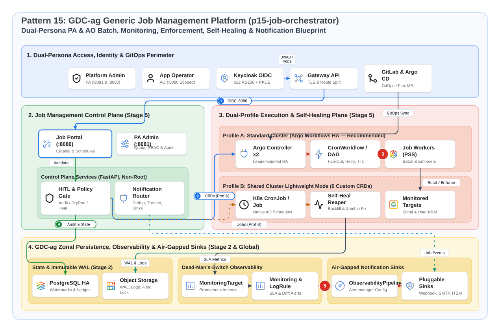

<!--
Copyright 2026 Google LLC

Licensed under the Apache License, Version 2.0 (the "License");
you may not use this file except in compliance with the License.
You may obtain a copy of the License at

    http://www.apache.org/licenses/LICENSE-2.0

Unless required by applicable law or agreed to in writing, software
distributed under the License is distributed on an "AS IS" BASIS,
WITHOUT WARRANTIES OR CONDITIONS OF ANY KIND, either express or implied.
See the License for the specific language governing permissions and
limitations under the License.
-->

Copyright 2026 Google. This software is provided as-is, without warranty or representation for any use or purpose. Your use of it is subject to your agreement with Google.

# Pattern 15 (`p15-job-orchestrator`): GDC Air-Gapped Generic Job Management & Orchestration Platform

Disconnected sovereign organisations running on **Google Distributed Cloud Air-Gapped (`GDC-ag`)** do not have managed public-cloud equivalents to Cloud Scheduler, Cloud Workflows, Cloud Tasks, or Cloud Batch. Teams forced to improvise operational automation quickly hit a hard architectural false choice: either install heavy DAG Custom Resource Definitions (`CRDs`) that are outright prohibited on multi-tenant **Shared Clusters**, or string together unmonitored `CronJob` scripts that drift against GitOps, drop data slices during database maintenance, and fail silently when air-gapped alerting is unavailable.

**Pattern 15 (`p15-job-orchestrator`)** resolves this tension with a single, hardened **Dual-Profile Generic Job Management & Orchestration Platform** serving both **Platform Administrators (`PA`)** and **Application Operators (`AO`)**. Every workload implements one orchestrator-agnostic container contract (`gdc-standard-job-runner-v1`), runs unchanged across **Profile B (`k8s-native`, 0 CRDs on Shared Clusters)** and **Profile A (`argo`, full DAGs on Standard Clusters)**, persists redacted Write-Ahead Logs (`WAL`) to 400-day retention-locked Object Storage before touching PostgreSQL, enforces bounded human-in-the-loop (`HITL`) compliance guardrails, and dispatches dual-path air-gapped notifications.



> **Target Platform:** Google Distributed Cloud Air-Gapped (`GDC-ag` `v1.16.2+`)  
> **Companion Documentation:**
> - **Operator User Guide (`PA` & `AO` Day-2 Playbook + E2E Custom Job Walkthrough):** [`docs/user-guide.md`](./docs/user-guide.md)
> - **Runnable Custom Job Example (`inventory-audit-report` Code-to-Run):** [`examples/custom-job-inventory/README.md`](./examples/custom-job-inventory/README.md)
> - **Air-Gapped Notification & Incident Integration Guide:** [`docs/notification-integrations.md`](./docs/notification-integrations.md)

---

## 1. Persona Ownership Matrix (`IO` / `PA` / `AO`)

Pattern 15 enforces strict Separation of Duties (`SoD`) across GDC-ag infrastructure, platform governance (**of the platform**), and tenant workload operations (**on the platform**):

| Persona | Scope & Kubeconfig | Responsibilities in `p15-job-orchestrator` | Security & RBAC Boundary |
| :--- | :--- | :--- | :--- |
| **Infrastructure Operator (`IO`)** | Appliance, Zonal/Global APIs | Maintains physical rack capacity, base Managed Harbor registry, Cortex/Alertmanager infrastructure, and internal routing to enterprise SMTP, chat, and ITSM webhook endpoints. | Zero access to tenant job parameters, artifacts, or application namespaces. |
| **Platform Administrator (`PA`)** | `GLOBAL_KUBECONFIG` & `MANAGEMENT_KUBECONFIG` (Stage 2) + `:8081` Admin Console | Provisions Stage 2 `DBCluster`, 400-day retention-locked `Bucket`, `ProjectNetworkPolicy` (applying intra-project egress **before** disabling DEP), and `ObservabilityPipeline`; governs `ALLOWED_NOTIFICATION_HOSTS`, approved worker templates/registries, namespace shard quotas, global Emergency Kill-Switch, and cross-project hygiene/enforcement jobs. | Authenticated via Keycloak OIDC (`pa-job-admin`) on `:8081` (`jobs_admin_session`); cross-project watchers use **metadata-only** `ClusterRole`s with zero access to tenant `Secret`s, `ConfigMap`s, or `pods/exec`. |
| **Application Operator (`AO`)** | `USER_CLUSTER_KUBECONFIG` (Stage 5) + `:8080` Job Portal & OpenAPI REST API | Registers, schedules, triggers (`Run Now`), pauses, and backfills project-scoped batch rollups, SLA monitors, compliance audits, HITL approvals, and namespace notification sinks on Shared (Profile B) or Standard (Profile A) clusters. | Authenticated via Keycloak OIDC (`ao-job-operator-<ns>`, `job-viewer-<ns>`) on `:8080` (`jobs_user_session`); confined strictly to authorised namespaces (`Role`/`RoleBinding`), receiving `401`/`403` on `:8081`. |

---

## 2. Dual-Profile Execution Engine (`argo` vs. `k8s-native`)

Default to **Profile A (`argo`)** when deploying onto a dedicated **Standard Cluster** requiring multi-step DAG dependencies, dynamic shard fan-out/fan-in, and centralized artifact archival. Default to **Profile B (`k8s-native`)** when onboarding into a **Shared Cluster** namespace where tenant CRDs and `ClusterRole`s are prohibited:

| Capability | Profile A: `engine.mode: "argo"` (Standard Cluster Default) | Profile B: `engine.mode: "k8s-native"` (Shared Cluster Default) |
| :--- | :--- | :--- |
| **Target GDC-ag Topology** | Dedicated Standard Cluster (`cluster.gdc.goog/v1`) | Multi-tenant Shared Cluster (`0` CRDs, `0` `ClusterRole`s required) |
| **Underlying Kubernetes Primitives** | `CronWorkflow`, `Workflow`, `ClusterWorkflowTemplate/gdc-standard-job-runner-v1` | Native `batch/v1` `CronJob` and `Job` |
| **Orchestration Topology** | Multi-step DAGs, `withParam` shard fan-out (`maxShardsPerRun=50`), conditional steps | Single-step scheduled, manual (`Run Now`), and indexed/sharded `Job` runs |
| **Controller High Availability & GC** | `workflow-controller` (`replicas: 2`, leader-elected, PDB) + `podGC: OnWorkflowSuccess` + `ttlStrategy` | Native K8s `CronJobController` + `ttlSecondsAfterFinished: 86400` + leader-elected Profile B status/log harvester |
| **Workload Portability** | **100% identical worker image and CLI contract** — promote from Profile B to Profile A via `--set engine.mode=argo` with zero code changes | **100% identical worker image and CLI contract** |

---

## 3. Orchestrator-Agnostic Contract & Dual-Mode Storage Adapter

### 3.1 Container Contract (`gdc-standard-job-runner-v1`)

Every worker container executes as non-root UID/GID `65532:65532` with a read-only root filesystem, accepts deterministic UTC window flags, and writes structured execution metadata to `/tmp/job-out/result.json`:

```bash
python3 -m p15_jobs.runner \
  --mode {batch-watermarked-rollup|monitor-platform-hygiene|enforce-resource-policy} \
  --job-id <job_id> --run-id <run_id> \
  --window-start 2026-11-26T11:45:00Z --window-end 2026-11-26T12:00:00Z \
  --shard-key shard-00 --sink-uri s3://p15-jobs-ledger/jobs \
  --enforcement-mode audit
```

Exit code semantics are standardized across both profiles:
- **`0` (`Succeeded`):** Execution completed; redacted WAL and `result.json` archived to Object Storage and indexed in PostgreSQL (or queued in Object Storage WAL if PostgreSQL is undergoing failover).
- **`2` (`Non-Retryable Configuration / Validation Failure`):** Halts retries immediately to avoid burning cluster quota on deterministic schema or policy errors.
- **Any other non-zero code (`Transient Failure`):** Retried with exponential backoff + jitter up to the configured `backoffLimit`.

### 3.2 GDC Object Storage Adapter (`example-app/common/storage.py`)

Workers and `p15-job-manager` use a unified storage abstraction with automatic pre-archive secret scrubbing and internal PKI TLS verification:
- **GDC-ag Production (`S3_ENDPOINT="https://objectstorage.gdc.goog"`):** Uses `boto3` S3 Signature v4 verifying TLS against `AWS_CA_BUNDLE=/etc/gdc-certs/ca.crt` against a Zonal `Bucket` (`object.gdc.goog/v1`, `defaultObjectRetentionDays: 400`).
- **Phase 2 Event-Driven Seam (`example-app/common/events.py`):** Exposes a clean `EventSink` / `TriggerAdapter` interface (`ObjectStorageWALSink` active today; pluggable `KafkaKRaftSink` stub ready for Pattern 4 event-driven pipelines).

---

## 4. Three Generic Reference Starter Workers (`example-app/jobs/`)

| Starter Mode | Job Class | Default Persona | Purpose & Behaviour |
| :--- | :--- | :--- | :--- |
| **`batch-watermarked-rollup`** | `batch` | `AO` / `PA` | Reads windowed input records (`[window_start, window_end)` in strict `UTC`), performs deterministic per-shard aggregation, writes redacted WAL + rollup artifacts to Object Storage, and advances `(job_id, shard_key)` watermarks idempotently (`ON CONFLICT DO UPDATE`) with historical backfill support. |
| **`monitor-platform-hygiene`** | `monitor` | `PA` / `AO` | Audits namespace/cluster operational health—detecting expiring TLS secrets, `CrashLoopBackOff` workloads, unbound PVCs, stale stuck jobs, and quota saturation—emitting Prometheus metrics (`:9091`) and structured violation events without mutating any resource. |
| **`enforce-resource-policy`** | `enforce` | `PA` | Evaluates target KRM resources against mandatory governance rules (required cost/owner labels, expired sandbox TTLs, prohibited `:latest` image tags) across the 3-tier enforcement ladder (`audit` $\rightarrow$ `hitl-approval` $\rightarrow$ `auto-remediate`). |

### 4.1 Onboarding a Custom Job (Code-to-Run Example: `examples/custom-job-inventory/`)

Operators never upload raw scripts into the `:8080` Portal UI or inject custom `PodSpec`s. Instead, custom workloads enter Pattern 15 by packaging a `python3 -m p15_jobs.runner` module into a non-root (`USER 65532:65532`) container image, scanning and pushing an immutable tag to the allowlisted registry, and binding that **Pinned Worker Image** + **Worker Mode** into `gdc-standard-job-runner-v1`.

See [`examples/custom-job-inventory/README.md`](./examples/custom-job-inventory/README.md) and **Section 4.1** of [`docs/user-guide.md`](./docs/user-guide.md) for the complete air-gapped GDC-ag end-to-end walkthrough implementing mode `inventory-audit-report` (`ao-inventory-audit-15m`).

---

## 5. Two-Layer Self-Healing & Bounded Enforcement Guardrails

Conflating *orchestrator recovery* with *autonomous cluster mutation* is one of the fastest ways to cause cascading outages in an air-gapped enclave. Pattern 15 separates self-healing into two distinct, bounded layers:

### Layer 1: Execution & Ledger Self-Healing (`Always Enabled`)
- **Transient Retries & Deadlines:** Exponential backoff retries for transient exit codes (`!= 2`), strict `activeDeadlineSeconds`, and a K8s `Lease`-elected **Zombie Reaper** cleaning up orphaned/stalled runs.
- **Zero-Loss `DBCluster` Failover Catch-Up (`REQ-HEAL-002`):** Workers write redacted WAL bundles to Object Storage **before** attempting PostgreSQL indexing. On GDC-ag `v1.16.2+` (RaaS HA, `dbcluster.dbadmin.goog/raasEnabled: "true"`), a PostgreSQL `DBCluster` with **high availability explicitly enabled** (`spec.availability.enableHighAvailability: true`, `false`/`zonal` by default) enables automatic failover by default (`enableAutoFailover: true`; [Configure high availability](https://docs.cloud.google.com/distributed-cloud/hosted/docs/latest/gdcag/application/ao-user/db-configure-ha#about-high-availability)), triggering after 3 consecutive failed health checks spaced 30 seconds apart (`~90s` detection) followed by standby promotion and traffic rerouting (`~2+ minutes` typical end-to-end RTO). During an unplanned failover or planned maintenance window, active client connections drop while scheduled runs keep firing from Kubernetes `etcd`; once PostgreSQL recovers (`< 15s` stale socket recycling via `pool_pre_ping` and `15s/5s/3` TCP keepalives), subsequent ticks replay unindexed WAL objects with zero lost windows.
- **Consecutive-Failure Circuit Breaker:** Automatically suspends a runaway schedule after `M=5` consecutive failures (`circuit_breaker_open = true`) and dispatches an `OnCircuitBreakerOpen` alert.

### Layer 2: Bounded Target-Resource Remediation (`Explicit Opt-In Ladder`)
1. **`audit` *(Default)*:** Read-only inspection; records findings in `platform_jobs.enforcement_findings` and increments `gdc_job_enforcement_violations_total`.
2. **`hitl-approval` *(Cryptographic TOCTOU + Four-Eyes)*:** Archives a pre-action JSON snapshot to Object Storage, computes `SHA-256(planned_patch + target_resourceVersion)`, and halts in `AwaitingApproval`. Under `REQUIRE_FOUR_EYES_APPROVAL=true`, a **second** operator (`approver != requester`) must approve on `:8080`/`:8081`. Before applying, `p15-job-manager` re-fetches live `resourceVersion` and aborts with **`409 Conflict`** if the resource changed since planning (`TOCTOU` protection).
3. **`auto-remediate` *(Strictly Bounded)*:** Enforces `maxActionsPerRun` (default `5`), per-resource `cooldownSeconds` (`3600s`), a **GitOps Tug-of-War Circuit Breaker** (auto-downgrading to `audit` if a target reverts within `< 1h` or carries Argo CD / Flux management annotations), and **1-Click Rollback** from the pre-action Object Storage snapshot.

---

## 6. Security Baseline & DEP `ProjectNetworkPolicy` Ordering

- **Data Exfiltration Protection (`DEP`) Ordering (`CRITICAL`):** On GDC-ag, disabling DEP on a project removes the implicit intra-project egress rule. Always apply **`manifests/gdc/network/pnp-intra-project-egress.yaml` FIRST** on `GLOBAL_KUBECONFIG`, verify `Ready`, and only then apply explicit `projectSelector`-based cross-project rules (`manifests/gdc/network/pnp-cross-project.yaml` — zero `0.0.0.0/0` CIDRs, enforced by `policy/security.rego`).
- **Pod Security `Restricted` & Zero Arbitrary `PodSpec` (`REQ-SEC-001`, `REQ-SEC-005`):** All control-plane and worker pods enforce `runAsNonRoot: true`, `runAsUser: 65532`, `readOnlyRootFilesystem: true`, `allowPrivilegeEscalation: false`, `capabilities.drop: ["ALL"]`, and `seccompProfile: RuntimeDefault`. `:8080` rejects raw `podSpec`, `command`, `volumes`, or `:latest` tags—callers select only PA-approved templates and Harbor-allowlisted images.
- **Dual-Port Keycloak OIDC (`p12-keycloak`):** RS256 JWKS validation + Authorization Code with PKCE (`S256`), separate HMAC-signed `HttpOnly`/`Secure` cookies (`jobs_user_session` on `:8080` vs. `jobs_admin_session` on `:8081`), CSRF tokens, and `ALLOW_SIMULATED_OIDC="false"` in all GDC-ag manifests and Helm defaults.
- **Anti-ClickOps GitOps Guard (`REQ-SCH-003`):** Automatically detects Argo CD (`argocd.argoproj.io/tracking-id`) and Flux (`kustomize.toolkit.fluxcd.io/name`, `helm.toolkit.fluxcd.io/name`) annotations, locking UI mutations to read-only and generating ready-to-commit YAML / GitLab Merge Request payloads.

---

## 7. GDC-ag Stage 2 $\rightarrow$ Stage 5 Production Deployment Runbook

### 7.1 Air-Gap Bundle Packaging & Sovereign Harbor Mirroring

```bash
# 1. On connected build workstation: run verification & Trivy gates, then create offline bundle
./p15-job-orchestrator/test/verify.sh
./p15-job-orchestrator/scripts/package-for-gdc.sh

# 2. Inside GDC-ag enclave: push images to Managed Harbor and render target coordinates
export TARGET_REGISTRY="harbor.gdc.local/blueprint-images"
export PROJECT_ID="platform-jobs"
./p15-job-orchestrator/scripts/unpack-for-gdc.sh
```

### 7.2 Stage 2 (`2-resources`): Global Network Policies & Zonal Persistence

```bash
# 1. GLOBAL_KUBECONFIG: Apply intra-project egress FIRST (before any DEP toggle), then cross-project PNP & IAM
kubectl --kubeconfig="${GLOBAL_KUBECONFIG}" apply -f p15-job-orchestrator/manifests/gdc/network/pnp-intra-project-egress.yaml
kubectl --kubeconfig="${GLOBAL_KUBECONFIG}" apply -f p15-job-orchestrator/manifests/gdc/network/pnp-cross-project.yaml
kubectl --kubeconfig="${GLOBAL_KUBECONFIG}" apply -f p15-job-orchestrator/manifests/gdc/iam/permissions.yaml

# 2. Configure project/registry coordinates across raw KRM manifests (if deploying via kubectl / Argo CD / Flux)
./configure-blueprints.sh -p platform-jobs -r harbor.gdc.local/blueprint-images -n platform-jobs -d p15-job-orchestrator

# 3. MANAGEMENT_KUBECONFIG: Provision PostgreSQL 15 HA DBCluster, 400d Retention Bucket & Observability CRDs
kubectl --kubeconfig="${MANAGEMENT_KUBECONFIG}" apply -f p15-job-orchestrator/manifests/gdc/db/postgres.yaml
kubectl --kubeconfig="${MANAGEMENT_KUBECONFIG}" apply -f p15-job-orchestrator/manifests/gdc/storage/bucket.yaml
kubectl --kubeconfig="${MANAGEMENT_KUBECONFIG}" apply -f p15-job-orchestrator/manifests/gdc/monitoring/monitoring-target.yaml
kubectl --kubeconfig="${MANAGEMENT_KUBECONFIG}" apply -f p15-job-orchestrator/manifests/gdc/monitoring/monitoring-rules.yaml
kubectl --kubeconfig="${MANAGEMENT_KUBECONFIG}" apply -f p15-job-orchestrator/manifests/gdc/monitoring/logging-rules.yaml
kubectl --kubeconfig="${MANAGEMENT_KUBECONFIG}" apply -f p15-job-orchestrator/manifests/gdc/monitoring/observability-pipeline.yaml
```

### 7.3 Stage 5 (`5-workload-factory`): Deploy Control Plane & Workers via Helm (`Issue #54`)

`p15-job-orchestrator/chart/` follows the Issue #54 wrapper contract (`gdc.enabled: false`, `apps.enabled: true`, `gdc.failover.enabled: false` by default so Stage 5 Helm releases never collide with Stage 2 Zonal CRDs or trigger an unintended `DBCluster` `Failover`):

```bash
# Option A: Standard Cluster with Profile A (Argo DAG Engine)
# Prerequisite: install mirrored Argo Workflows v3.6.2 `manifests/base/crds/minimal` CRDs first
# (avoid v3.6.2 `crds/full` due to upstream recursive OpenAPI schema validation errors).
helm upgrade --install p15-job-orchestrator ./p15-job-orchestrator/chart \
  --kubeconfig="${USER_CLUSTER_KUBECONFIG}" \
  --namespace platform-jobs \
  --create-namespace \
  --set global.projectId=platform-jobs \
  --set global.namespace=platform-jobs \
  --set global.registry=harbor.gdc.local/blueprint-images \
  --set gdc.enabled=false \
  --set gdc.failover.enabled=false \
  --set apps.enabled=true \
  --set engine.mode=argo \
  --set auth.allowSimulatedOidc=false \
  --set auth.oidcIssuer=https://keycloak.gdc.local/realms/gdc-jobs-realm \
  --set gateway.portalDomain=jobs.gdc.local \
  --set gateway.adminDomain=admin.jobs.gdc.local

# Option B: Shared Cluster Namespace with Profile B (0 CRDs, 0 ClusterRoles)
helm upgrade --install p15-job-orchestrator ./p15-job-orchestrator/chart \
  --kubeconfig="${SHARED_CLUSTER_KUBECONFIG}" \
  --namespace tenant-analytics \
  --create-namespace \
  --set global.projectId=tenant-analytics \
  --set global.namespace=tenant-analytics \
  --set global.registry=harbor.gdc.local/blueprint-images \
  --set gdc.enabled=false \
  --set apps.enabled=true \
  --set engine.mode=k8s-native \
  --set auth.allowSimulatedOidc=false
```

---

## 8. T-Shirt Sizing & Air-Gap Bill of Materials (`BOM`)

### 8.1 Cluster & Persistence Sizing (`0 GPUs Required`)

| Deployment Tier | Target Topology | Compute Pool (`CPU-Only`) | Control Plane Footprint | Stage 2 Managed Services |
| :--- | :--- | :--- | :--- | :--- |
| **Shared Namespace (`Profile B`)** | Existing GDC-ag Shared Cluster | Shared CPU Worker Pool (`0` GPUs) | `p15-job-manager` x2 (`~0.75 vCPU`, `1.5 GiB RAM`) | Project/Shared `DBCluster` (`db-custom-2-8`, HA) + `Bucket` (`400d` lock) |
| **Standard Pilot (`Profile A`, Recommended)** | Dedicated Standard Cluster | `2x n2-standard-4-gdc` (`8 vCPU`, `32 GiB RAM`, `0` GPUs) | `workflow-controller` x2 + `argo-server` x2 + `p15-job-manager` x2 (`~1.5 vCPU`, `3 GiB RAM`) | `DBCluster` (`db-custom-2-8`, `enableHighAvailability: true` + `enableAutoFailover: true`, `100Gi`) + `Bucket` (`400d` lock) |
| **Enterprise Enclave (`50+` Jobs)** | Dedicated Standard Cluster | `3–4x n2-standard-8-gdc` (`24–32 vCPU`, `96–128 GiB RAM`, `0` GPUs) | `~2 vCPU`, `4 GiB RAM` + `25–50` concurrent sharded workers | `DBCluster` (`db-custom-4-16`, `200Gi+`) + `Bucket` (`400d` lock) + optional Phase 2 `p4` Kafka |

### 8.2 Air-Gap Container Image BOM (Synced with [`external_images.txt`](./external_images.txt))

| Image Role | Upstream / Build Source | Air-Gap Harbor Target (`harbor.gdc.local/blueprint-images/...`) |
| :--- | :--- | :--- |
| **Control Plane & Dual-Port UI** | `example-app/job-manager/Dockerfile` | `p15-job-manager:v1.0.0` |
| **Unified Starter Worker (`3` Modes)** | `example-app/jobs/Dockerfile` | `p15-reference-worker:v1.0.0` |
| **Custom Job Example (`inventory-audit-report`)** | `examples/custom-job-inventory/Dockerfile` | `p15-example-inventory-job:v1.0.0` *(optional example)* |
| **Argo Workflow Controller *(Profile A)*** | `quay.io/argoproj/workflow-controller` (pinned in `external_images.txt`) | `workflow-controller:<pinned-tag>` |
| **Argo Executor (`argoexec`) *(Profile A)*** | `quay.io/argoproj/argoexec` (pinned in `external_images.txt`) | `argoexec:<pinned-tag>` |
| **Argo Server UI/API *(Profile A)*** | `quay.io/argoproj/argocli` (pinned in `external_images.txt`) | `argocli:<pinned-tag>` |

---

## 9. Production Blueprint Layout

```text
p15-job-orchestrator/
├── README.md                          # Architecture, Stage 2->5 runbook & BOM (this file)
├── implementation-guide.md            # Solution Reference Implementation Guide (staged for GDC-ag)
├── external_images.txt                # Pinned 3P Argo Workflows v3.6.2 images for Harbor mirroring
├── chart/                             # Issue #54 Helm chart (gdc.enabled=false, apps.enabled=true)
├── diagrams/
│   └── p15-job-orchestrator-arch.svg  # Scalable architecture diagram
├── docs/
│   ├── user-guide.md                  # PA & AO Operator Guide (incl. Sec 4.1 Code-to-Run example)
│   └── notification-integrations.md   # Dual-path air-gapped alerting & HMAC outbox guide
├── example-app/
│   ├── common/                        # Shared S3 storage adapter & secret redaction
│   ├── job-manager/                   # Dual-port FastAPI control plane (:8080 Portal, :8081 Admin)
│   └── jobs/                          # Unified 3-mode reference starter worker
├── examples/
│   └── custom-job-inventory/          # Runnable custom job template (mode: inventory-audit-report)
│       ├── README.md
│       ├── Dockerfile                 # Multi-stage non-root (65532:65532) container
│       ├── requirements.txt
│       └── p15_jobs/runner.py         # WAL-first write, [REDACTED_TOKEN] scrub, exit code 2
├── manifests/
│   ├── apps/                          # Profile A (Argo) & Profile B (K8s-native) app manifests
│   └── gdc/                           # Stage 2 GDC-ag DBCluster, Bucket, PNP & Observability CRDs
└── scripts/
    ├── build.sh                       # Container image build & offline tarball helper
    ├── package-for-gdc.sh             # Low-side air-gap bundle + SHA-256 BOM packager
    └── unpack-for-gdc.sh              # High-side Harbor load/push & manifest extractor
```
