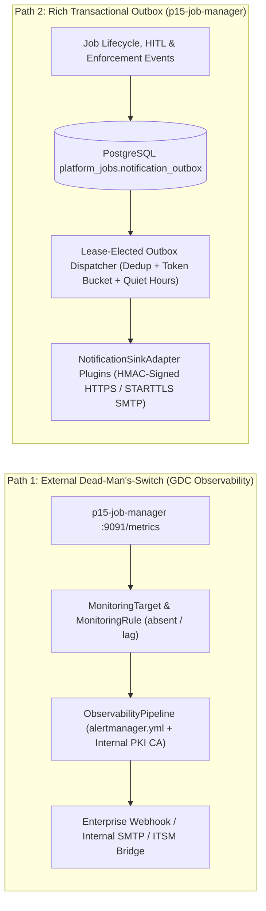

<!--
Copyright 2026 Google LLC

Licensed under the Apache License, Version 2.0 (the "License");
you may not use this file except in compliance with the License.
You may obtain a copy of the License at

    http://www.apache.org/licenses/LICENSE-2.0

Unless required by applicable law or agreed to in writing, software
distributed under the License is distributed on an "AS IS" BASIS,
WITHOUT WARRANTIES OR CONDITIONS OF ANY KIND, either express or implied.
See the License for the specific language governing permissions and
limitations under the License.
-->

Copyright 2026 Google. This software is provided as-is, without warranty or representation for any use or purpose. Your use of it is subject to your agreement with Google.

# Air-Gapped Notification & Incident Integration Guide (`p15-job-orchestrator`)

- **Requirement ID:** `REQ-NOTIF-005` (supports `REQ-NOTIF-001`–`004` and `REQ-SEC-006`)
- **Target Platform:** Google Distributed Cloud Air-Gapped (`GDC-ag` `v1.16.2+`)
- **Audience:** Platform Administrators (`PA`), Application Operators (`AO`), Infrastructure Operators (`IO`), and Platform Python Developers

---

## 1. Dual-Path Air-Gapped Notification Architecture

Disconnected sovereign environments cannot call public SaaS paging, chat, or email APIs, and relying on a single in-process alerting loop introduces a fatal blind spot: if the orchestrator pod is evicted, network-partitioned, or waiting on a database switchover, in-process alerts fail silently right when operators need them most.

**Pattern 15 (`p15-job-orchestrator`)** eliminates silent failure by combining two independent, air-gap-native notification paths:

| Dimension | Path 1: External Infrastructure Dead-Man's-Switch | Path 2: Rich Transactional Outbox Event Dispatcher |
| :--- | :--- | :--- |
| **Control Plane** | GDC Zonal `MonitoringTarget`, `MonitoringRule`, `LoggingRule`, and `ObservabilityPipeline` (`alertmanager.yml`) | `p15-job-manager` (`platform_jobs.notification_outbox` + K8s `Lease` singleton dispatcher) |
| **Primary Purpose** | Infrastructure-independent liveness (`absent()` dead-man's switch), scrape failure, SLA lag, and outbox dead-letter pages | Contextual workflow events with run metadata, watermarks, redacted failure summaries, planned KRM diffs, and HITL approval deep-links |
| **Survives `p15-job-manager` Outage?** | **Yes** — evaluated externally by GDC Cortex / Prometheus and routed by platform Alertmanager | Buffered durably in PostgreSQL `notification_outbox` (`FOR UPDATE SKIP LOCKED`) and drained automatically upon recovery |
| **Supported Receivers** | Alertmanager `webhook_configs`, internal SMTP `email_configs`, and enterprise ITSM/chat webhook bridges | `generic-webhook`, `smtp-relay`, `chat-webhook`, `itsm-webhook` (illustrative examples: ServiceNow, Jira Service Management, BMC Remedy, or custom ticket webhooks), and offline `portal-feed` |
| **Cryptographic Integrity & SSRF Guard** | GDC `ObservabilityPipeline` mounted internal PKI CA + mounted Kubernetes `Secret` credentials | `X-P15-Signature-256: sha256=<hex>` HMAC-SHA256 payload signing + PA `:8081` `ALLOWED_NOTIFICATION_HOSTS` SSRF allowlist |



---

## 2. Path 1 Guide: GDC `ObservabilityPipeline`, `alertmanager.yml` & Dead-Man's-Switch

Path 1 operates **of the platform** in the GDC Zonal Management Plane (`MANAGEMENT_KUBECONFIG`). Even if every `p15-job-manager` replica is down, Cortex evaluates `absent()` over the expected `:9091/metrics` series and triggers Alertmanager.

### 2.1 Alertmanager Configuration (`ConfigMap`)

Create the Alertmanager configuration `ConfigMap` in your project namespace on the Management API server. Notice how `route.routes` match on `severity`, `namespace`, `job_class`, and `code`, and how enterprise ITSM integration (using ServiceNow strictly as one illustrative webhook example alongside Jira Service Management, BMC Remedy, or custom ticketing bridges) is wired cleanly over internal HTTPS with your private CA bundle:

```yaml
apiVersion: v1
kind: ConfigMap
metadata:
  name: p15-alertmanager-config
  namespace: platform-jobs
data:
  alertmanager.yml: |
    global:
      resolve_timeout: 5m
      smtp_smarthost: 'smtp-relay.corp.internal:587'
      smtp_from: 'p15-orchestrator-alerts@corp.internal'
      smtp_require_tls: true

    route:
      receiver: 'default-webhook'
      group_by: ['alertname', 'namespace', 'job_class', 'code']
      group_wait: 30s
      group_interval: 5m
      repeat_interval: 4h
      routes:
        # 1. Dead-man's switch & circuit-breaker pages -> Immediate ITSM + NOC webhook
        - matchers:
            - severity = "critical"
            - code =~ "P15_DEADMAN_SWITCH|P15_CIRCUIT_BREAKER_OPEN|P15_OUTBOX_DEAD_LETTER"
          receiver: 'illustrative-itsm-webhook'
          group_wait: 10s
          repeat_interval: 1h
          continue: true

        # 2. Enforcement policy violations -> Platform governance email list
        - matchers:
            - job_class = "enforce"
            - severity =~ "warning|critical"
          receiver: 'pa-governance-smtp'

        # 3. Tenant batch & hygiene SLA warnings -> Namespace operations webhook
        - matchers:
            - namespace =~ ".+"
            - job_class =~ "batch|monitor"
          receiver: 'default-webhook'

    receivers:
      - name: 'default-webhook'
        webhook_configs:
          - url: 'https://ops-hooks.corp.internal/v1/gdc/alerts'
            send_resolved: true
            http_config:
              authorization:
                type: Bearer
                credentials_file: /etc/alertmanager/secrets/webhook-bearer-token
              tls_config:
                ca_file: /etc/alertmanager/pki/ca.crt
                insecure_skip_verify: false

      - name: 'pa-governance-smtp'
        email_configs:
          - to: 'platform-admins@corp.internal'
            send_resolved: true
            tls_config:
              ca_file: /etc/alertmanager/pki/ca.crt
              insecure_skip_verify: false

      # Illustrative ITSM webhook example (e.g., an internal ServiceNow scripted REST endpoint,
      # Jira Service Management incoming webhook, BMC Remedy gateway, or custom ITSM bridge)
      - name: 'illustrative-itsm-webhook'
        webhook_configs:
          - url: 'https://itsm.corp.internal/api/now/v1/gdc_alert_ingest'
            send_resolved: true
            http_config:
              basic_auth:
                username: 'svc_gdc_p15_alerts'
                password_file: /etc/alertmanager/secrets/itsm-webhook-password
              tls_config:
                ca_file: /etc/alertmanager/pki/ca.crt
                insecure_skip_verify: false
```

### 2.2 `ObservabilityPipeline` Mounting Internal PKI CA & Credentials

Mount both your internal root CA (`Secret/gdc-internal-ca`) and receiver credentials (`Secret/p15-alertmanager-secrets`) into the managed Alertmanager pipeline via `spec.alerting.volumes` and `spec.alerting.volumeMounts`:

```yaml
apiVersion: observability.gdc.goog/v1
kind: ObservabilityPipeline
metadata:
  name: p15-observability-pipeline
  namespace: platform-jobs
spec:
  alerting:
    alertmanagerConfig:
      name: p15-alertmanager-config
      key: alertmanager.yml
    volumes:
      - name: internal-pki-ca
        secret:
          secretName: gdc-internal-ca
      - name: receiver-credentials
        secret:
          secretName: p15-alertmanager-secrets
    volumeMounts:
      - name: internal-pki-ca
        mountPath: /etc/alertmanager/pki
        readOnly: true
      - name: receiver-credentials
        mountPath: /etc/alertmanager/secrets
        readOnly: true
```

### 2.3 Dead-Man's-Switch `MonitoringRule` (`absent()`)

Apply the companion `MonitoringRule` (`manifests/gdc/monitoring/monitoring-rules.yaml`) so Cortex fires `P15JobOrchestratorDeadManSwitch` if metrics disappear completely or if critical PA hygiene heartbeats stall:

```yaml
apiVersion: monitoring.gdc.goog/v1
kind: MonitoringRule
metadata:
  name: p15-orchestrator-health-rules
  namespace: platform-jobs
spec:
  interval: 30s
  limit: 0
  ruleGroups:
    - name: p15-deadman-and-sla
      rules:
        - alert: P15JobOrchestratorDeadManSwitch
          expr: absent(gdc_job_last_success_timestamp_seconds{namespace="platform-jobs"}) == 1
          for: 3m
          labels:
            severity: critical
            namespace: platform-jobs
            job_class: monitor
            code: P15_DEADMAN_SWITCH
          annotations:
            summary: "p15-job-manager metrics are absent in namespace platform-jobs"
            description: "No series found for gdc_job_last_success_timestamp_seconds for 3m. Verify p15-job-manager pods and MonitoringTarget."

        - alert: P15CircuitBreakerOpen
          expr: max by (namespace, job_id, job_class) (gdc_job_circuit_breaker_open) == 1
          for: 1m
          labels:
            severity: critical
            code: P15_CIRCUIT_BREAKER_OPEN
          annotations:
            summary: "Circuit breaker tripped for job {{ $labels.job_id }}"
            description: "Job {{ $labels.job_id }} in {{ $labels.namespace }} auto-suspended due to consecutive failures or GitOps tug-of-war."

        - alert: P15NotificationOutboxDeadLetter
          expr: increase(gdc_job_notification_dead_letter_total[15m]) > 0
          for: 1m
          labels:
            severity: critical
            job_class: monitor
            code: P15_OUTBOX_DEAD_LETTER
          annotations:
            summary: "Transactional notification outbox moved events to dead_letter"
            description: "One or more Path 2 notification sinks exhausted retries. Inspect platform_jobs.notification_outbox."
```

---

## 3. Path 2 Guide: 4-Step Operator Onboarding (`p15-job-manager` Outbox)

Path 2 runs **on the platform** inside `p15-job-manager` to deliver rich, signed JSON/SMTP/ITSM notifications without blocking job execution.

### Step 1: PA Allowlists Target Hosts (`:8081`), PKI CA & K8s/Vault Secrets (`REQ-SEC-006`)

To prevent Server-Side Request Forgery (`SSRF`) from tenant-configured webhooks against internal metadata or control-plane endpoints (`127.0.0.0/8`, `169.254.0.0/16`, `kubernetes.default.svc`), Application Operators **cannot** target arbitrary hostnames. A **Platform Administrator (`PA`)** must first approve outbound notification FQDNs:

1. **Permit Network Egress:** Ensure your Global `ProjectNetworkPolicy` (`manifests/gdc/network/pnp-cross-project.yaml`) and namespace `NetworkPolicy` allow TCP `443` (and TCP `587` if using internal STARTTLS SMTP) to the corporate webhook/SMTP endpoints.
2. **Mount Internal PKI Root CA & Sink Secrets:** Mount your enterprise CA bundle at `/etc/gdc-certs/ca.crt` (`GDC_CA_BUNDLE=/etc/gdc-certs/ca.crt`) and provision the shared HMAC signing secret in `Secret/p15-session-and-webhook-secrets` (`WEBHOOK_HMAC_SECRET`, rotated via Vault `p11-vault`). Webhook sinks registered via UI or API without an explicit `hmac_secret_env` automatically default to `WEBHOOK_HMAC_SECRET` when present in the pod environment, and sink configurations persist across all `p15-job-manager` HA replicas in `platform_jobs.notification_sinks` (storing only `*_env` references, never raw secrets):
   ```bash
   kubectl create secret generic p15-session-and-webhook-secrets \
     --namespace platform-jobs \
     --from-literal=USER_COOKIE_SECRET="$(openssl rand -hex 32)" \
     --from-literal=ADMIN_COOKIE_SECRET="$(openssl rand -hex 32)" \
     --from-literal=WEBHOOK_HMAC_SECRET="$(openssl rand -hex 32)"
   ```
3. **Update `ALLOWED_NOTIFICATION_HOSTS` on `:8081` (PA Only):** Either set `notifications.allowedHosts` in `chart/values.yaml` or update dynamically via the `:8081` PA Admin Console API:
   ```bash
   curl -s --cacert /etc/gdc/ca-bundle.crt -X PUT https://admin.jobs.gdc.local/admin/v1/allowed-hosts \
     -H "Authorization: Bearer ${PA_OIDC_TOKEN}" \
     -H "Content-Type: application/json" \
     -d '{
       "hosts": [
         "ops-hooks.corp.internal",
         "smtp-relay.corp.internal",
         "mattermost.corp.internal",
         "itsm.corp.internal"
       ]
     }'
   ```
   > [!IMPORTANT]
   > Every outbound Path 2 HTTP request resolves DNS prior to socket connection, rejects any hostname resolving to loopback/link-local/RFC-1918 cluster metadata CIDRs unless explicitly permitted in non-production test mode, enforces `follow_redirects=False` and `trust_env=False`, and validates TLS against `GDC_CA_BUNDLE`.

### Step 2: Register Vendor-Neutral Notification Sinks (`:8080` API/Portal or Helm `values.yaml`)

Pattern 15 ships five built-in sink types (`portal-feed` enabled automatically offline, plus four outbound adapters). In ITSM environments, `itsm-webhook` uses declarative JSON field mapping (`field_map`) so **ServiceNow** is strictly one illustrative option alongside **Jira Service Management Data Center**, **BMC Remedy**, or any custom enterprise ticketing webhook.

#### Option A: Declarative Registration via `chart/values.yaml`

```yaml
notifications:
  caBundlePath: /etc/gdc-certs/ca.crt
  allowedHosts:
    - ops-hooks.corp.internal
    - smtp-relay.corp.internal
    - mattermost.corp.internal
    - itsm.corp.internal
  sinks:
    - name: corp-generic-webhook
      type: generic-webhook
      url: https://ops-hooks.corp.internal/v1/p15-events
      hmacSecretRef:
        secretName: p15-notif-sink-secrets
        key: HMAC_SIGNING_SECRET

    - name: corp-smtp-relay
      type: smtp-relay
      host: smtp-relay.corp.internal
      port: 587
      starttls: true
      sender: p15-jobs@corp.internal
      recipients:
        - app-ops-team@corp.internal
      username: svc_p15_smtp
      passwordSecretRef:
        secretName: p15-notif-sink-secrets
        key: SMTP_PASSWORD

    - name: self-hosted-chat
      type: chat-webhook
      # Works with self-hosted Mattermost, Rocket.Chat, Element/Matrix webhook bridges, etc.
      url: https://mattermost.corp.internal/hooks/p15-ops-channel
      messageFormat: markdown

    - name: enterprise-itsm-ticket
      type: itsm-webhook
      # Illustrative ITSM webhook mapping (compatible with ServiceNow Table/Scripted REST API,
      # Jira Service Management incoming webhooks, BMC Remedy REST, or custom ticket gateways)
      url: https://itsm.corp.internal/api/v1/incidents
      authHeaderSecretRef:
        secretName: p15-notif-sink-secrets
        key: ITSM_API_TOKEN
      fieldMap:
        short_description: "{{summary}}"
        severity_code: "{{severity}}"
        correlation_id: "{{dedup_key}}"
        configuration_item: "{{namespace}}/{{job_id}}"
        work_notes: "{{details_markdown}}"
```

#### Option B: Dynamic Namespace Sink Registration via `:8080` REST API

```bash
curl -s --cacert /etc/gdc/ca-bundle.crt -X POST https://jobs.gdc.local/api/v1/notifications/sinks \
  -H "Authorization: Bearer ${AO_OR_PA_OIDC_TOKEN}" \
  -H "Content-Type: application/json" \
  -d '{
    "name": "ops-generic-webhook",
    "namespace": "platform-jobs",
    "type": "generic-webhook",
    "url": "https://ops-hooks.corp.internal/v1/p15-events",
    "hmac_secret_env": "WEBHOOK_HMAC_SECRET",
    "events": ["OnFailure", "OnSLAExceeded", "OnApprovalRequired", "OnCircuitBreakerOpen"],
    "dedup_window_seconds": 900
  }'
```

*(Omitting `hmac_secret_env` on webhook sinks automatically defaults to `"WEBHOOK_HMAC_SECRET"` when that variable is injected from `Secret/p15-session-and-webhook-secrets`.)*

### Step 3: `[Send Test Notification]` & Receiver HMAC-SHA256 Signature Verification

In the `:8080` Portal (**Notifications & Outbox $\rightarrow$ `2. Send Test Notification`**) or via CLI, trigger an end-to-end connectivity and signature check. Successful test deliveries immediately record a `delivered` `OnSinkTest` row in `platform_jobs.notification_outbox`; downstream HTTP errors or unreachable targets return `HTTP 502` with diagnostic details:

```bash
curl -s --cacert /etc/gdc/ca-bundle.crt \
  -X POST https://jobs.gdc.local/api/v1/notifications/sinks/ops-generic-webhook/test \
  -H "Authorization: Bearer ${AO_OR_PA_OIDC_TOKEN}" | jq .
```

#### Canonical `JobNotificationEvent` Payload & HTTP Headers

Every HTTP-based sink sends canonical UTF-8 JSON (`sort_keys=True`, compact separators `(",", ":")`) signed with `X-P15-Signature-256: sha256=<hex>` computed as `HMAC-SHA256(shared_secret, raw_request_body)`:

```http
POST /v1/p15-events HTTP/1.1
Host: ops-hooks.corp.internal
Content-Type: application/json
X-P15-Event-Id: evt-9c81f4b2a012
X-P15-Event-Type: OnApprovalRequired
X-P15-Signature-256: sha256=6f4e9b2d84f71c0a3a82c920d8e1a4478c62f4b10a9933c25f0081c4a912ef01
```

```json
{
  "artifact_uri": "s3://p15-jobs-ledger/jobs/platform-jobs/pa-enforce-labels/2026/11/run-20261126-120000-004/result.json",
  "details": {
    "finding_id": "fnd-0042",
    "rule_id": "POL-LABEL-REQUIRED-001"
  },
  "event_id": "evt-9c81f4b2a012",
  "event_type": "OnApprovalRequired",
  "job_name": "pa-enforce-labels",
  "namespace": "platform-jobs",
  "persona": "PA",
  "run_id": "run-20261126-120000-004",
  "runbook_url": "https://jobs.gdc.local/?tab=approvals&finding_id=fnd-0042",
  "severity": "warning",
  "summary": "HITL four-eyes approval required for ConfigMap/platform-jobs/sample-unlabelled-cfg",
  "timestamp_utc": "2026-11-26T12:00:00Z"
}
```

#### Constant-Time Signature Verification (Python Receiver Example)

```python
import hashlib
import hmac


def verify_p15_webhook(
    raw_body: bytes,
    signature_hdr: str,
    shared_secret: str,
) -> bool:
    if not (signature_hdr or "").strip().startswith("sha256="):
        return False
    expected_hex = hmac.new(
        shared_secret.encode("utf-8"), raw_body, hashlib.sha256
    ).hexdigest()
    return hmac.compare_digest(f"sha256={expected_hex}", signature_hdr.strip())
```

#### Constant-Time Signature Verification (Go Receiver Example)

```go
package webhookauth

import (
	"crypto/hmac"
	"crypto/sha256"
	"encoding/hex"
	"strings"
)

func VerifyP15Signature(rawBody []byte, sigHeader, secret string) bool {
	trimmed := strings.TrimSpace(sigHeader)
	if !strings.HasPrefix(trimmed, "sha256=") {
		return false
	}
	mac := hmac.New(sha256.New, []byte(secret))
	mac.Write(rawBody)
	expected := "sha256=" + hex.EncodeToString(mac.Sum(nil))
	return hmac.Equal([]byte(expected), []byte(trimmed))
}
```

### Step 4: Bind Sinks to Schedules, Deduplication, Rate Limits & Quiet Hours (`REQ-NOTIF-004`)

Attach registered sink names via `notification_sinks` when registering or updating a schedule on `:8080` (`POST /api/v1/schedules`), while governing deduplication, per-sink rate limits, and quiet hours via sink registration and control-plane `ConfigMap/p15-job-manager-config` (`DEDUP_WINDOW_SECONDS`, `SINK_RATE_LIMIT_PER_MINUTE`, `QUIET_HOURS_UTC`):

```bash
curl -s --cacert /etc/gdc/ca-bundle.crt -X POST https://jobs.gdc.local/api/v1/schedules \
  -H "Authorization: Bearer ${AO_OR_PA_OIDC_TOKEN}" \
  -H "Content-Type: application/json" \
  -d '{
    "job_id": "ao-rollup-15m",
    "namespace": "platform-jobs",
    "persona": "AO",
    "job_class": "batch",
    "worker_mode": "batch-watermarked-rollup",
    "worker_image": "harbor.gdc.local/blueprint-images/p15-reference-worker:v1.0.0",
    "schedule_cron": "*/15 * * * *",
    "timezone": "UTC",
    "notification_sinks": ["ops-generic-webhook", "self-hosted-chat"]
  }'
```

- **Deduplication (`dedup_window_seconds: 900`):** Suppresses identical `(namespace, job_name, event_type, error_signature)` fingerprints for 15 minutes (`status = 'deduplicated'`).
- **Token-Bucket Rate Limiting (`SINK_RATE_LIMIT_PER_MINUTE`):** Enforces per-sink sustained and burst quotas so runaway job loops cannot overwhelm internal SMTP or ITSM servers.
- **Quiet Hours (`QUIET_HOURS_UTC="22:00-06:00"`) & Dead-Letter Escalation:** Low-urgency `info`/`warning` alerts during quiet hours are marked `suppressed_quiet_hours` while remaining visible in the `:8080` offline Portal feed (`high`/`critical` always deliver immediately). Transient `5xx`/timeout failures retry with exponential backoff up to `MAX_OUTBOX_ATTEMPTS` (`4`), after which the outbox row transitions to `dead_letter` and increments `gdc_job_notification_dead_letter_total` (which Path 1 catches immediately via `P15NotificationOutboxDeadLetter`).

---

## 4. Developer Guide: Custom `NotificationSinkAdapter` Plugin (`< 50` Lines)

To integrate a bespoke sovereign protocol (for example, an internal Syslog-over-HTTPS / CEF SIEM collector), subclass `NotificationSinkAdapter` in `p15_job_manager.notifications` and register it with `register_sink_adapter()`—no core outbox, retry, deduplication, or UI code changes required:

```python
import httpx
from p15_job_manager.notifications import (
    JobNotificationEvent,
    NotificationDeliveryError,
    NotificationSinkAdapter,
    register_sink_adapter,
)
from p15_job_manager.security import SecurityValidationError, validate_notification_target


class CefSiemWebhookAdapter(NotificationSinkAdapter):
    """Forwards JobNotificationEvents formatted as ArcSight/SIEM CEF JSON."""

    def validate_config(self) -> None:
        validate_notification_target(
            str(self.sink_config.get("url", "")),
            allowed_hosts=self.cp_config.allowed_notification_hosts,
            sink_type="generic-webhook",
            allow_http_emulation=self.cp_config.allow_http_emulation_sinks,
        )
        if not self.sink_config.get("facility"):
            raise SecurityValidationError("cef-siem-webhook requires a non-empty 'facility' field")

    def send(self, event: JobNotificationEvent) -> tuple[int, str]:
        self.validate_config()
        cef_line = (
            f"CEF:0|GDCBlueprint|P15JobOrchestrator|1.3|{event.event_type}|"
            f"{event.summary}|7|ns={event.namespace} job={event.job_name} run={event.run_id}"
        )
        try:
            with httpx.Client(
                verify=self._ca_verify(), follow_redirects=False, trust_env=False, timeout=5.0
            ) as client:
                resp = client.post(
                    str(self.sink_config["url"]),
                    json={"facility": self.sink_config["facility"], "cef": cef_line},
                )
        except httpx.HTTPError as exc:
            raise NotificationDeliveryError(f"CEF SIEM delivery error: {exc}") from exc
        if resp.status_code >= 400:
            raise NotificationDeliveryError(f"CEF SIEM sink returned HTTP {resp.status_code}")
        return resp.status_code, "delivered"


register_sink_adapter("cef-siem-webhook", CefSiemWebhookAdapter)
```
