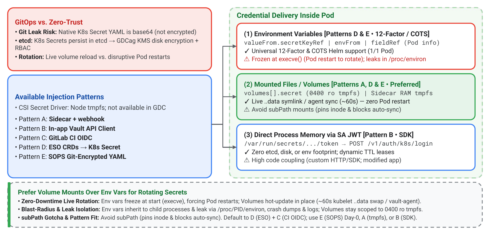
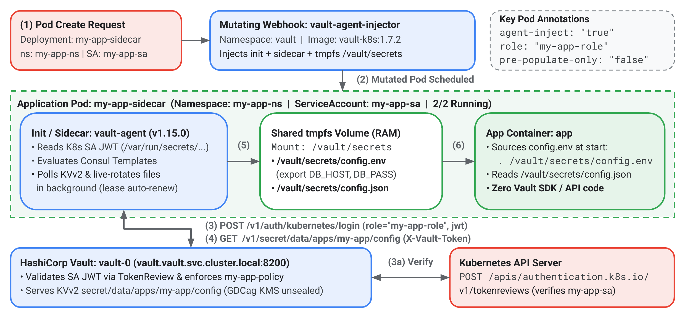
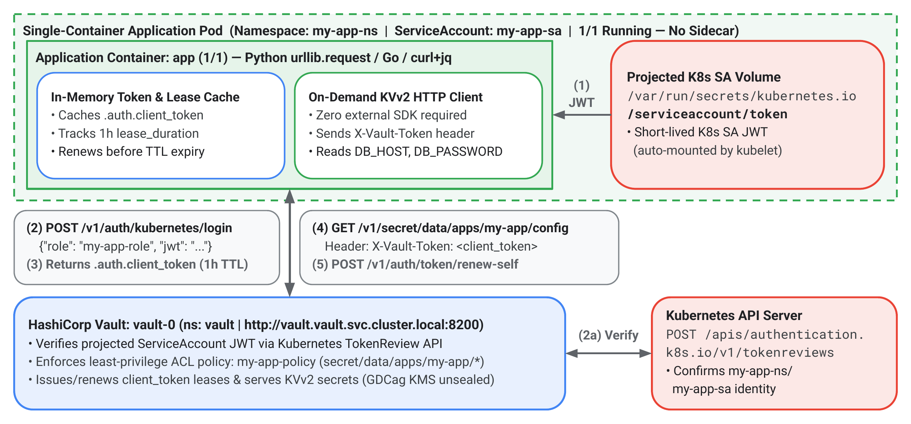
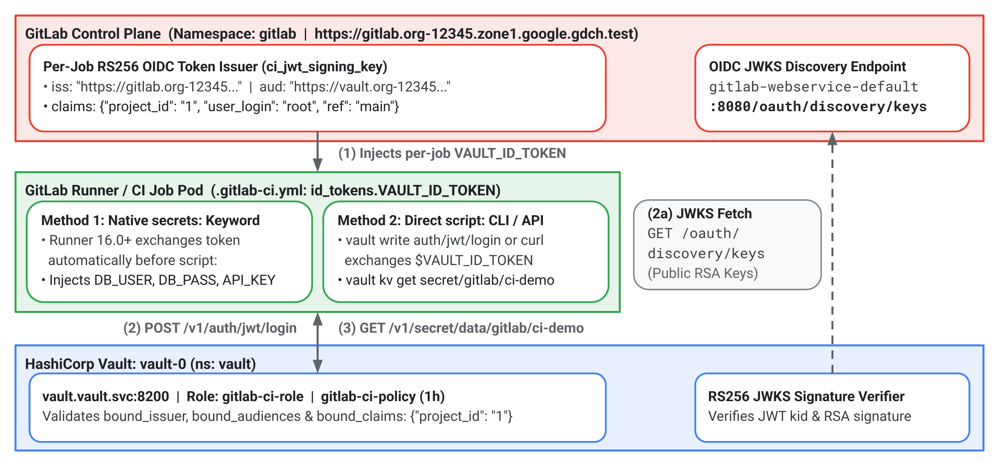
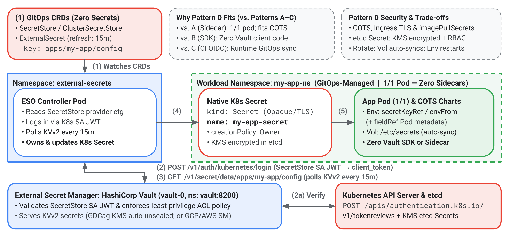
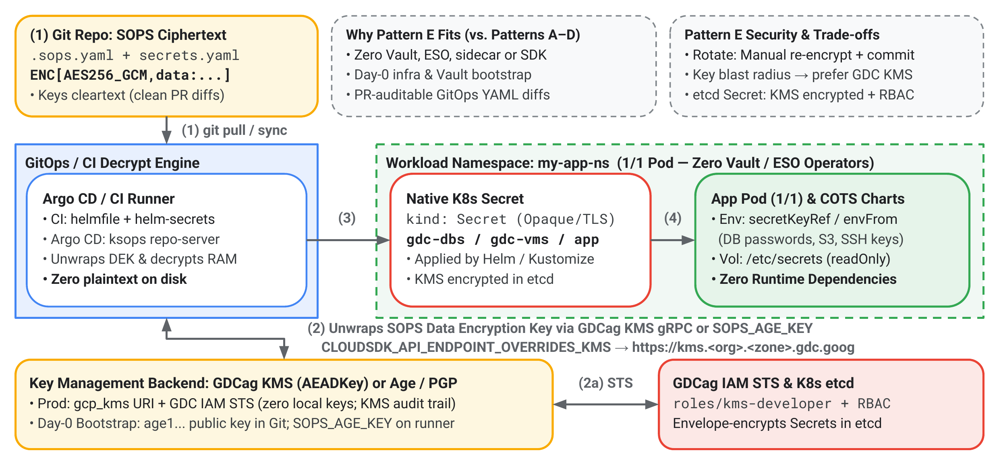
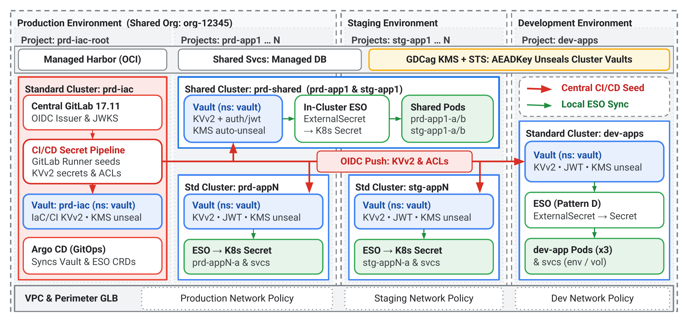

Copyright 2026 Google. This software is provided as-is, without warranty or representation for any use or purpose. Your use of it is subject to your agreement with Google.

# Kubernetes Secret Injection Patterns on GDC Air-Gapped

> **Document ID:** `ARCH-SECRET-INJECTION-PATTERNS`  
> **Version:** 1.0  
> **Target Platform:** Google Distributed Cloud air-gapped (`GDCag v1.15+` / `v1.16.2`)  
> **Related Blueprints & Foundations:** [Pattern 11 (HashiCorp Vault + KMS Auto-Unseal)](../implementation-guides/Solution-Reference-Implementation-Pattern-11-Resilient-Secret-Management-Vault.md) · [GitLab & Vault KMS Installation Guide](../operations/gitlab_vault_kms_installation_guide.md) · [Helmfile Foundations SOPS Guide](../../foundations/sops_implementation_plan.md)

This architecture guide defines the standardized patterns for delivering credentials, TLS certificates, and configuration secrets to Kubernetes workloads and CI/CD pipelines on **Google Distributed Cloud air-gapped (`GDCag`)**. It examines the underlying Linux and Kubernetes pod credential-delivery mechanics, provides an engineering comparison of various secret-management patterns and presents the production reference architecture for operating isolated per-cluster **HashiCorp Vault** instances populated from a central **CI/CD** control hub across multi-environment organizations.

---

## Table of Contents

1. [Injecting Secrets into Kubernetes Pods](#1-injecting-secrets-into-kubernetes-pods)
   - [1.1 The GitOps vs. Zero-Trust Secret Dilemma on GDCag](#11-the-gitops-vs-zero-trust-secret-dilemma-on-gdcag)
   - [1.2 Runtime Credential Delivery Surfaces Inside a Pod](#12-runtime-credential-delivery-surfaces-inside-a-pod)
   - [1.3 Why Volume Mounts vs Environment Variables for Rotating Secrets](#13-why-volume-mounts-vs-environment-variables-for-rotating-secrets)
2. [Secret Consumption Patterns Comparison](#2-secret-consumption-patterns-comparison)
   - [2.1 Architectural Comparison Matrix (Patterns A–E)](#21-architectural-comparison-matrix-patterns-ae)
   - [2.2 Pattern Selection Guide](#22-pattern-selection-guide)
3. [Secret Consumption Patterns' Details](#3-secret-consumption-patterns-details)
   - [3.1 Pattern A: Vault Agent Sidecar Injector](#31-pattern-a-vault-agent-sidecar-injector)
   - [3.2 Pattern B: Consumption via Vault HTTP API](#32-pattern-b-consumption-via-vault-http-api)
   - [3.3 Pattern C: Secretless CI/CD Pipelines](#33-pattern-c-secretless-cicd-pipelines)
   - [3.4 Pattern D: External Secrets Operator](#34-pattern-d-external-secrets-operator)
   - [3.5 Pattern E: Mozilla SOPS](#35-pattern-e-mozilla-sops)
4. [Multi-Cluster Secret Management](#4-multi-cluster-secret-management)
   - [4.1 Shared Organization Multi-Environment & Cluster Topology](#41-shared-organization-multi-environment--cluster-topology)
   - [4.2 Architectural Rationales](#42-architectural-rationales)
   - [4.3 Secret Provisioning](#43-secret-provisioning)

---

## 1. Injecting Secrets into Kubernetes Pods



### 1.1 The GitOps vs. Zero-Trust Secret Dilemma on GDCag

Delivering database passwords, API tokens, SSH keys, and TLS certificates into Kubernetes workloads under a declarative GitOps operating model introduces four architectural constraints that platform teams must reconcile simultaneously:

1. **Git Repository Exposure Risk**: Native Kubernetes `Secret` manifests encode values only as unencrypted `base64` strings. Committing raw `Secret` YAML to Git permanently exposes credentials to every principal with repository read access and persists them across Git history and clones.
2. **Control-Plane `etcd` Persistence & RBAC Scope**: Any credential materialized as a native Kubernetes `Secret` object is persisted in cluster `etcd` storage and can be read by principals holding `get`, `list`, or `watch` RBAC verbs on `secrets` within that namespace (`list` and `watch` return secret payloads across the entire namespace). On GDCag, `etcd` storage is automatically protected at rest via hardware-backed **GDCag KMS Envelope Encryption** ([`foundations/sops_implementation_plan.md` §3](../../foundations/sops_implementation_plan.md#3-transparent-etcd-secrets-encryption-at-rest-protection)), which must be paired with least-privilege namespace RBAC.
3. **Dynamic Rotation vs. Workload Continuity**: Security governance frequently requires periodic or automated credential rotation without dropping active user sessions, database pools, or long-running inference streams.
4. **COTS Helm Chart & Kubernetes Control-Plane Compatibility**: Off-the-shelf (`COTS`) Helm charts (such as PostgreSQL, Redis, GitLab, and Keycloak), Gateway/Ingress TLS termination (`kubernetes.io/tls`), and container registry pull credentials (`kubernetes.io/dockerconfigjson` `imagePullSecrets`) strictly require native Kubernetes `Secret` objects and cannot embed custom secret-fetching SDKs.

> [!NOTE]
> **GDCag Platform Availability Context (`CSI Secrets Store Driver`):** Upstream Kubernetes environments sometimes use the DaemonSet-based `secrets-store.csi.k8s.io` CSI driver to mount external secrets as node `tmpfs` volumes. Because the Secrets Store CSI Driver is **not available on GDCag user clusters**, GDCag standardizes secret delivery across **five production patterns (Patterns A–E)** backed by **HashiCorp Vault** ([Pattern 11](./patterns_def.md#pattern-11-resilient-secret-management-with-hashicorp-vault)), **External Secrets Operator (ESO)**, **GitLab OIDC**, and **Mozilla SOPS**.

### 1.2 Runtime Credential Delivery Surfaces Inside a Pod

Regardless of which upstream secret store or GitOps controller manages a secret's lifecycle, an application container running inside a Kubernetes Pod ultimately receives credentials across one of **three runtime delivery surfaces**:

1. **Surface `(1)` — Environment Variables (`valueFrom.secretKeyRef` / `envFrom` + Downward API)**:
   - **Mechanism**: Kubelet reads keys from a native Kubernetes `Secret` (populated via **Pattern D** ESO or **Pattern E** SOPS) and injects them into the container's initial environment block via `env[].valueFrom.secretKeyRef` or `envFrom[].secretRef`, often alongside non-sensitive Pod metadata exposed via the Kubernetes Downward API (`valueFrom.fieldRef` for `metadata.name`, `metadata.namespace`, `spec.serviceAccountName`, `status.podIP`, and `resourceFieldRef` for container CPU/memory limits).
   - **Characteristics**: Universally supported by [12-Factor applications](https://en.wikipedia.org/wiki/Twelve-Factor_App_methodology) ([Factor III: Config](https://12factor.net/config)) and unmodified COTS Helm charts on clean `1/1` single-container Pods, but **frozen at container startup** and exposed across process environment inspection surfaces.
2. **Surface `(2)` — Mounted Files / Volumes (`volumes[].secret` `0400 ro tmpfs` or Sidecar RAM `tmpfs`)**:
   - **Mechanism**: Credentials are projected as discrete files (`config.json`, `tls.crt`, `ca.pem`, `.env`) onto a memory-backed filesystem (`tmpfs`)—either via kubelet's native `volumes[].secret` (`readOnly: true`, `defaultMode: 0400` in **Patterns D & E**) or via an in-memory `emptyDir: {medium: Memory}` volume (`/vault/secrets/*`) rendered by the Vault Agent sidecar (**Pattern A**).
   - **Characteristics**: Scoped strictly to filesystem permissions without environment-block inheritance, and **automatically updated in place** when secrets rotate in Vault or Kubernetes without restarting the Pod.
3. **Surface `(3)` — Direct Process Memory via Projected ServiceAccount JWT (`Pattern B`)**:
   - **Mechanism**: Kubelet mounts a short-lived, audience-bound projected ServiceAccount token (`/var/run/secrets/kubernetes.io/serviceaccount/token`). The application exchanges that JWT directly against Vault (`POST /v1/auth/kubernetes/login`) over HTTP/HTTPS and stores the resulting `client_token` and fetched KVv2 or dynamic credentials exclusively in application heap memory.
   - **Characteristics**: Zero `etcd` footprint, zero secret files on `tmpfs` or disk, zero environment variable exposure, and native support for per-request dynamic leases, at the cost of explicit Vault client/renewal logic inside application code.

---

### 1.3 Why Volume Mounts vs Environment Variables for Rotating Secrets

While environment variables remain convenient for static configuration and legacy 12-Factor containers, **mounted files/volumes (Surface `(2)`) are the strongly recommended delivery mechanism whenever secrets rotate or carry high blast-radius sensitivity**. Evaluating Volume Mounts against Environment Variables requires examining **both** operational **live secret rotation mechanics** and realistic **secret exfiltration difficulty**—distinguishing passive observability/subprocess leakage from active interactive `kubectl exec` (`pods/exec`) access:

#### 1. OS Process Immutability (`execve()`)

- **Why Environment Variables Cannot Rotate Live**: On Linux, `containerd` / `runc` populates a container's environment variables once when invoking the `execve(filename, argv, envp)` system call to start PID 1 (copied onto the process's initial stack frame and exposed at `/proc/<PID>/environ`). Neither the Linux kernel nor `kubelet` provides any safe mechanism to mutate another running process's environment memory block from outside the process. Consequently, when ESO (**Pattern D**) or SOPS (**Pattern E**) updates a Kubernetes `Secret`, **existing Pods reading `secretKeyRef` continue using stale, revoked credentials indefinitely** until every Pod is terminated and recreated—dropping active TCP/gRPC connections, in-flight transactions, and warm model/cache state.
- **How Volume Mounts Hot-Update Without Pod Restarts**:
  - **Native Kubernetes `Secret` Volumes (`Patterns D & E`)**: `kubelet` mounts `volumes[].secret` onto a node RAM-backed `tmpfs` directory using timestamped versioned subdirectories (for example, `..2026_11_20_09_00_00.123456/`) pointed to by an intermediate **`..data` symbolic link**, with each secret key symlinked to `..data/<key>`. On its periodic sync loop (~`60s` kubelet sync frequency plus API watch/cache propagation), `kubelet` writes the newly rotated secret payload into a fresh timestamped directory and executes an **atomic POSIX `rename(2)` swap of the `..data` symlink**. Readers opening the mounted path immediately see the entire updated credential set atomically—never observing torn or partially written files—with **zero container restarts**.
  - **Vault Agent Sidecar `tmpfs` (`Pattern A`)**: When `vault.hashicorp.com/agent-pre-populate-only` is `"false"`, the `vault-agent` sidecar continuously polls Vault KVv2 / dynamic leases in the background and atomically re-renders Consul Templates into `/vault/secrets/*` on `emptyDir: {medium: Memory}`.

#### 2. Passive Exfiltration

When an attacker, developer, or external log sink lacks interactive `pods/exec` permissions—holding only read-only observability access (`pods/log` RBAC, centralized logging, or APM dashboards) or triggering an application error—`0400` read-only `tmpfs` Volume Mounts substantially reduce credential leakage compared to Environment Variables:

| Security Exposure Vector | Environment Variables (`secretKeyRef` / `envFrom`) | Mounted Files / Volumes (`0400 ro tmpfs`) |
| :--- | :--- | :--- |
| **Child Subprocess Inheritance** | Automatically inherited across `fork()` / `exec()` by helper scripts, CLI plugins, and third-party binaries unless explicitly scrubbed. | **Never inherited** into process environments; helper subprocesses only see files if explicitly passed a path and permitted by UID/GID. |
| **`/proc/<PID>/environ` Inspection** | Readable by any process sharing the container UID or Pod `shareProcessNamespace: true` boundary. | Absent from `/proc/<PID>/environ`; protected by explicit POSIX mode bits (`defaultMode: 0400` or `0440` with `fsGroup`). |
| **Crash Dumps, Stack Traces & APM** | Exception handlers, debug endpoints, core dumps, and APM/telemetry agents routinely serialize `os.environ` / `process.env` into centralized logs. | File contents reside outside `os.environ` and are only read by the dedicated credential-loading module. |
| **Startup Configuration Logging (`pods/log`)** | Entrypoint scripts running `env`, `printenv`, or `set -x` accidentally emit plaintext secrets to `stdout`, exposing them to anyone with `kubectl logs` (`pods/log` RBAC). | Reading from `/etc/secrets/db-password` or `/vault/secrets/config.json` avoids environment dumps entirely. |

#### 3. Interactive Secret Exfiltration 

> [!IMPORTANT]
> A standard shell-bearing container `kubectl exec` spawns a process under the **same Linux UID as the running application**. Neither environment variables (`env`, `printenv`, or `cat /proc/1/environ`) nor persistent volume mounts (`cat /etc/secrets/...` or `cat /vault/secrets/...`) offer resistance to direct exfiltration. Because the application UID must hold read permission (`0400`) on the mounted `tmpfs` file to load and hot-reload credentials, an interactive `kubectl exec` session running as that UID can read the mounted secret file just as effortlessly as running `env`.

When evaluating container compromise and `kubectl exec` threats, real exfiltration resistance depends on **container isolation, post-startup file lifetime, image hardening, and in-memory secret delivery**:

| Exfiltration / Hardening Dimension | Env Vars (`secretKeyRef` / `envFrom`) | Volume Mounts (`0400 ro tmpfs`) | Read-Once + `unlink` RAM `tmpfs` | In-Memory SDK (`Pattern B`) |
| :--- | :--- | :--- | :--- | :--- |
| **Passive Sprawl (`pods/log`, APM, `fork()`)** | **High risk**: Leaks via `os.environ`, crash dumps, startup logs, and child processes. | **Strong protection**: Stays out of `os.environ` and child subprocess environments. | **Strong protection**: Absent from `os.environ` and removed from `tmpfs` after init. | **Strongest protection**: Exists strictly in process heap memory. |
| **Direct `kubectl exec` (Shell Container, Same UID)** | **Low resistance**: Trivial via `env` or `cat /proc/1/environ`. | **Low resistance**: Trivial via `cat /etc/secrets/*` or `cat /vault/secrets/*`. | **Moderate–High resistance**: File is already `unlink`ed from `tmpfs`; absent from `/proc/1/environ`. | **High resistance**: Nothing in `/proc/1/environ` or `tmpfs`; requires heap memory scraping. |
| **Multi-Container Pod Isolation (Compromised Sidecar)** | **Exposed** if env blocks are shared or `shareProcessNamespace: true` exposes `/proc/<PID>/environ`. | **Scoped per container**: `volumeMounts` are opt-in per container (isolated unless `shareProcessNamespace: true` + root/`CAP_SYS_PTRACE` crosses `/proc/<PID>/root/...`). | **Scoped & transient**: Mounted only where needed and deleted at startup. | **Scoped to app heap**: Sidecars never receive Vault tokens or secrets. |
| **Post-Startup Scrubbing From OS Interfaces** | **Not possible externally**: `/proc/1/environ` is pinned for the lifetime of PID 1. | **Retained on `tmpfs`**: Files remain readable on `tmpfs` to support live `..data` / sidecar rotation. | **Scrubbed via `unlink(2)`**: Trades away passive file-based live rotation. | **Native heap lifecycle**: Short-TTL leases rotated and overwritten directly in memory. |
| **Distroless (`No /bin/sh`) vs. `kubectl debug`** | Distroless blocks naive `kubectl exec`, but `kubectl debug --target=<c>` reads `/proc/1/environ`. | Distroless blocks naive `kubectl exec`, but `kubectl debug --target=<c>` reads `/proc/1/root/etc/secrets/...`. | Blocks naive `kubectl exec` **and** leaves no file under `/proc/1/root/...`. | Blocks naive `kubectl exec`; `kubectl debug` needs `CAP_SYS_PTRACE` (`/proc/1/mem`) or audited SA JWT login. |

Five architectural mechanics govern secret exfiltration difficulty under active Pod inspection or compromise:

1. **Multi-Container Pod Isolation**: Kubernetes `volumeMounts` are explicitly scoped per container inside a Pod spec—a helper, proxy, or logging sidecar container cannot see `/etc/secrets/...` unless that volume is explicitly attached to it (unless `shareProcessNamespace: true` is enabled alongside root privileges or `CAP_SYS_PTRACE` to traverse `/proc/<PID>/root/...`). By contrast, broadly injected `envFrom` blocks or shared process namespaces (`/proc/<PID>/environ`) expose initial startup secrets for the entire Pod lifecycle.
2. **Post-Startup Wipe (`Read-Once & Unlink`)**: Because `/proc/1/environ` mirrors the initial `execve()` environment pages, it cannot be cleanly scrubbed from outside PID 1. Conversely, staging a secret onto a writable RAM-backed `emptyDir` (`medium: Memory`) via an init container allows the application entrypoint to load the credential into heap memory and immediately `unlink(2)` the file—so a subsequent `kubectl exec` session finds nothing on `tmpfs` (at the trade-off of losing file-watcher live rotation).
3. **Distroless / Shell-less Images vs. `kubectl debug` (`pods/ephemeralcontainers`)**: Removing `/bin/sh`, `cat`, `env`, and coreutils with Distroless base images (`gcr.io/distroless/*`) defeats naive `kubectl exec` commands for **both** Environment Variables and Volume Mounts (`exec` fails because no shell or reader binary exists in the container). However, if an attacker or insider also holds `pods/ephemeralcontainers` RBAC (`kubectl debug -it <pod> --image=... --target=<container>`), the attached debug container shares the target process namespace—making both `/proc/1/environ` (Env Vars) and `/proc/1/root/etc/secrets/...` (Volume Mounts) reachable again under matching UID/capabilities.
4. **Why In-Memory Vault SDK (`Pattern B`) & Dynamic Leases Raise the Bar Highest Against `kubectl exec`**: Fetching secrets directly into application heap memory (**Pattern B**) leaves zero plaintext artifacts in `/proc/1/environ` or on `tmpfs`. Extracting the active secret from an interactive session requires either raw process heap scraping (`/proc/1/mem` / `ptrace`, blocked when `CAP_SYS_PTRACE` is dropped) or abusing `/var/run/secrets/kubernetes.io/serviceaccount/token` to call `POST /v1/auth/kubernetes/login`—an active Vault API transaction that records an immutable **Vault audit log event** and yields only short-TTL, dynamically revocable credentials.
5. **Actionable GDCag Defense-in-Depth Controls**: Because persistent Volume Mounts solve **live secret rotation and accidental log/subprocess sprawl—not interactive `kubectl exec` exfiltration**—production GDCag workloads should pair Volume Mounts with three compensating controls:
   - **Restrict Interactive Pod RBAC in Production**: Deny `pods/exec`, `pods/attach`, and `pods/ephemeralcontainers` verbs for standard human and CI roles in Production namespaces, gating break-glass access behind time-bound, audited elevation.
   - **Enforce Distroless, Non-Root Pod Security (`restricted`)**: Run shell-less Distroless images with `runAsNonRoot: true`, `readOnlyRootFilesystem: true`, `allowPrivilegeEscalation: false`, and `capabilities.drop: ["ALL"]` (stripping `CAP_SYS_PTRACE` to block cross-process memory inspection).
   - **Short Rotation Intervals & Dynamic Leases**: Combine short ESO `refreshInterval` / Vault KV rotation cadences or short-TTL dynamic Vault credentials so any exfiltrated secret expires rapidly.

#### 4. Avoid `volumeMounts[].subPath`

> [!WARNING]
> **Never combine `volumeMounts[].subPath` with rotating `Secret` volumes.** When a container mounts a single key using `subPath` (for example, `mountPath: /app/config.json`, `subPath: config.json`), `kubelet` bind-mounts the **underlying file inode** that existed at container creation time rather than the parent directory containing the `..data` symlink. When `kubelet` later swaps `..data` to a new timestamped directory during secret rotation, the bind-mounted inode inside the container **never updates** until the Pod is restarted.

Always mount the secret as a **directory** (`mountPath: /etc/secrets/db`, `readOnly: true`) and configure the application to reload rotated credentials cleanly:

```yaml
# ANTI-PATTERN: subPath pins the initial inode and BLOCKS live secret rotation!
volumeMounts:
  - name: app-secret-vol
    mountPath: /app/db-password.txt
    subPath: db-password.txt        # <-- DO NOT USE for rotating secrets
    readOnly: true

# RECOMMENDED: Directory mount preserves kubelet atomic ..data symlink updates
volumes:
  - name: app-secret-vol
    secret:
      secretName: my-app-secret
      defaultMode: 0400             # Owner read-only on tmpfs
volumeMounts:
  - name: app-secret-vol
    mountPath: /etc/secrets/my-app  # Reads /etc/secrets/my-app/db-password.txt
    readOnly: true
```

To consume rotated files without restarting the container, applications use one of three lightweight patterns:
1. **Filesystem Watch (`fsnotify` / `inotify`)**: Watch the mounted directory (specifically `CREATE`/`MOVED_TO` events on `..data` for Kubernetes `Secret` volumes, or file write events on `/vault/secrets/*`) and swap in-memory credentials atomically.
2. **Process Signal Hook (`SIGHUP`)**: On **Pattern A**, set `vault.hashicorp.com/agent-inject-command-<file>: "kill -HUP $(pidof myapp)"` (with `shareProcessNamespace: true`) so `vault-agent` signals NGINX, Envoy, or custom daemons immediately after re-rendering a rotated certificate or key.
3. **Lazy Re-Read on Auth Failure or Connection Pool Refresh**: Database poolers and HTTP clients re-read `/etc/secrets/my-app/...` when establishing new connections or upon receiving an ` HTTP 401` / authentication error, seamlessly picking up rotated passwords without background watcher threads.

#### 5. Environment Variables Fallback

Certain third-party COTS containers only read credentials from environment variables (`POSTGRES_PASSWORD`, `REDIS_PASSWORD`) and do not support `_FILE` conventions (`POSTGRES_PASSWORD_FILE=/etc/secrets/...`) or configuration files. In those cases:
- Prefer COTS built-in `*_FILE` environment hooks whenever supported by the upstream entrypoint.
- Where raw environment variables are unavoidable under **Pattern D (ESO)**, pair the `Deployment` with a declarative rollout controller (such as **Stakater Reloader** `reloader.stakater.com/auto: "true"`) or Helm template checksum annotations (`checksum/secret`), protected by a `PodDisruptionBudget` (`minAvailable`) and graceful `preStop` drain hooks so secret-triggered rolling restarts remain non-disruptive.

---

## 2. Secret Consumption Patterns Comparison

### 2.1 Architectural Comparison Matrix (Patterns A–E)

The table below compares all five standardized secret-consumption patterns across GDCag workloads and CI/CD pipelines:

| Dimension | Pattern A: Vault Agent Sidecar (`Mutating Webhook`) | Pattern B: Direct Vault HTTP API / SDK (`In-App Auth`) | Pattern C: GitLab CI/CD OIDC (`JWT id_tokens`) | Pattern D: External Secrets Operator (`GitOps K8s Secret`) | Pattern E: Mozilla SOPS (`Git-Encrypted YAML`) |
| :--- | :--- | :--- | :--- | :--- | :--- |
| **Delivery & Authentication Model** | **Webhook + Sidecar (`2/2`)**: `vault-agent-injector` mounts RAM `tmpfs` (`/vault/secrets/*`); authenticates via K8s SA JWT + `TokenReview`. | **Direct In-App HTTP / SDK**: App posts projected K8s SA JWT to `/v1/auth/kubernetes/login` (`TokenReview`) & reads KVv2 over HTTP. | **Ephemeral CI OIDC JWT**: GitLab mints per-job RS256 `VAULT_ID_TOKEN`; Vault verifies signature against GitLab JWKS (`/oauth/discovery/keys`). | **ESO CRD Pull → K8s `Secret`**: `SecretStore` / `ClusterSecretStore` + `ExternalSecret` continuously sync Vault KVv2 into native K8s `Secret`. | **Git YAML + KMS / `Age`**: `helm-secrets` or Argo CD `ksops` unwraps DEK via GDCag KMS / `Age` and decrypts in RAM into native K8s `Secret`. |
| **Pod Footprint & Code Coupling** | **Zero Code \| `2/2` Pod Tax**: Requires zero app SDK changes, but adds per-pod init/sidecar CPU & RAM overhead and admission webhook dependency. | **`1/1` Pod \| High Code Coupling**: Zero sidecars or operators, but embeds custom Vault auth, caching, and lease-renewal logic in app code. | **CI Runner Job Only (`0` App Pods)**: Consumed inside `.gitlab-ci.yml` via native Runner `secrets:` block or `vault` CLI / `curl` in job scripts. | **Zero Code \| Clean `1/1` Pod**: Single shared cluster-level ESO controller; workload Pod specs remain 100% vendor-agnostic. | **Zero Code \| `1/1` Pod (`0` Runtime Operators)**: Requires no Vault cluster, ESO controller, or sidecar; decryption runs in CI or Argo CD plugin. |
| **Persistence & Security Boundary** | **Pod RAM `tmpfs` (Zero `etcd`)**: Plaintext secrets exist strictly in container RAM (`/vault/secrets/*`); never written to disk or `etcd`. | **Process Heap Memory Only**: Zero `etcd` objects, zero volume files, and zero env vars; supports short-lived dynamic leases in RAM. | **Masked Ephemeral Job Env**: Zero static CI tokens stored in GitLab variables; scoped via `bound_issuer`, `bound_audiences` & `project_id` `bound_claims`. | **Git-Safe CRDs + KMS `etcd`**: CRDs in Git hold zero secret values; reconciled K8s `Secret` is envelope-encrypted at rest in `etcd` via GDCag KMS + RBAC. | **Ciphertext Git + KMS `etcd`**: Scalar values AES-256-GCM encrypted in Git (`ENC[...]`) with cleartext YAML keys; K8s `Secret` in KMS-encrypted `etcd`. |
| **Secret Rotation & COTS / K8s Fit** | **Live Render \| Poor COTS/TLS Fit**: Sidecar re-renders files live on rotation, but **cannot** create K8s `Secret`s for Ingress TLS or `imagePullSecrets`. | **App Lease Renewal \| No COTS**: App calls `/v1/auth/token/renew-self`; unsuitable for unmodified third-party COTS containers. | **Per-Job Mint \| Pipeline Fit**: Mints a fresh short-lived JWT on every pipeline run; purpose-built for CI/CD deployments and Vault seeding. | **Auto-Sync \| Best COTS & K8s Fit**: `refreshInterval` reconciles updates; mounted volumes hot-sync (~60s) & natively supports Helm charts, TLS, and `imagePullSecrets`. | **Commit-Driven \| Full COTS Fit**: Rotating a secret requires `sops` re-encryption + Git commit + sync; natively supports Helm charts, TLS, and DB/VM bootstrap. |
| **Primary Use Case (When to Choose)** | **Strict Zero-`etcd` Mandate**: High-sensitivity apps requiring RAM-only secret files & Consul Template rendering with zero Vault SDK code. | **Dynamic / Per-Request Leases**: Bespoke internal microservices managing dynamic credentials or transit encryption directly in memory. | **CI/CD & Multi-Cluster Vault Seeding**: Secretless build/deploy pipelines, IaC runs, and centrally populating per-cluster Vault instances. | **Default GitOps Workload Runtime**: Standard `1/1` application pods, Argo CD GitOps repos, COTS Helm charts, Gateway/Ingress TLS, and pull secrets. | **Day-0 Bootstrap & Static GitOps**: Pre-Vault Landing Zone bootstrap (`gdc-dbs`, `gdc-vm`), disconnected edge clusters without Vault, and static keys. |

### 2.2 Pattern Selection Guide

Rather than treating Patterns A–E as mutually exclusive, production GDCag landing zones combine them across distinct phases of the platform lifecycle:

- **Default Production Trio (`Pattern E` + `Pattern C` + `Pattern D`)**:
  1. **Bootstrap (`Pattern E — Mozilla SOPS`)**: During Day-0 Landing Zone provisioning ([`foundations/`](../../foundations/README.md) Stages `0`–`3`), HashiCorp Vault and ESO do not yet exist. Operators encrypt bootstrap credentials (managed PostgreSQL/AlloyDB passwords, VM SSH keys, S3 backup keys, and initial GitLab/Vault bootstrap secrets) in Git using SOPS backed by GDCag KMS or `Age`, applying them via Helmfile + `helm-secrets`.
  2. **Centralized Seeding (`Pattern C — GitLab CI/CD OIDC`)**: Once `Standard Cluster: prd-iac` is online, Central GitLab CI/CD pipelines authenticate secretlessly via RS256 OIDC `id_tokens` (`auth/jwt`) to seed and rotate environment-scoped KVv2 secrets and Vault ACL policies across every workload cluster's local Vault instance.
  3. **Declarative Runtime Delivery (`Pattern D — External Secrets Operator`)**: Inside each workload cluster, ESO continuously reconciles secrets from the local cluster Vault into native Kubernetes `Secret` objects (protected by GDCag KMS `etcd` encryption and RBAC), mounted as `0400` read-only volumes into clean `1/1` application pods and COTS Helm releases.
- **Specialized High-Security Overrides (`Pattern A` & `Pattern B`)**:
  - Choose **Pattern A (Vault Agent Sidecar)** when compliance rules strictly prohibit materializing specific credentials in Kubernetes `etcd` even under KMS envelope encryption, and the workload can read rendered files from `/vault/secrets/*`.
  - Choose **Pattern B (Direct Vault HTTP API / SDK)** when a custom internal service requires on-demand dynamic credentials, per-request lease management, or Vault Transit cryptographic operations directly in memory without sidecar container overhead.

---

## 3. Secret Consumption Patterns' Details 

### 3.1 Pattern A: Vault Agent Sidecar Injector



#### Architectural Flow

1. **Pod Submission**: A Deployment submits a Pod carrying `vault.hashicorp.com/agent-inject: "true"` and `vault.hashicorp.com/role: "<app-role>"` annotations under a dedicated Kubernetes `ServiceAccount` (`my-app-sa`).
2. **Mutating Admission Webhook (`vault-agent-injector`)**: Running in namespace `vault` (`hashicorp/vault-k8s:1.7.2`), the webhook intercepts the `Pod` `CREATE` request and injects:
   - `vault-agent-init`: An init container that fetches and renders secrets before the main application container starts (preventing startup race conditions).
   - `vault-agent`: A background sidecar container (`vault:1.15.0`, when `agent-pre-populate-only: "false"`) that renews token leases and continuously watches KVv2 paths for rotation.
   - An in-memory `emptyDir` volume (`medium: Memory`) mounted at `/vault/secrets` in both the Vault Agent and application containers.
3. **Kubernetes Auth & `TokenReview`**: `vault-agent` reads the Pod's projected ServiceAccount JWT (`/var/run/secrets/kubernetes.io/serviceaccount/token`) and calls `POST /v1/auth/kubernetes/login`. Vault (`vault-0..2`) verifies the JWT against the cluster's Kubernetes API `TokenReview` endpoint and issues a client token bound to `my-app-policy`.
4. **Template Rendering & Zero-SDK Consumption**: `vault-agent` fetches `GET /v1/secret/data/apps/my-app/config`, evaluates any `agent-inject-template-<file>` Consul Template expressions, and writes structured `.json`, `.yaml`, or `.env` files into `/vault/secrets/*` in RAM. The application container reads those files directly with zero Vault SDK dependencies.

#### Key Pod Annotations

```yaml
metadata:
  annotations:
    vault.hashicorp.com/agent-inject: "true"
    vault.hashicorp.com/role: "my-app-role"
    vault.hashicorp.com/agent-pre-populate-only: "false" # Keep sidecar running for live rotation
    vault.hashicorp.com/agent-inject-secret-config.json: "secret/data/apps/my-app/config"
    vault.hashicorp.com/agent-inject-template-config.json: |
      {{- with secret "secret/data/apps/my-app/config" -}}
      {{ .Data.data | toJSONPretty }}
      {{- end }}
```

#### Operational Trade-Offs

- **Strengths**: Zero `etcd` secret persistence (RAM `tmpfs` only), rich Consul Template formatting into arbitrary config file layouts, live background file updates on rotation, and zero Vault API code in the application.
- **Limitations**: Doubles container count (`2/2` per Pod) with additional CPU/RAM overhead (`50m–250m` CPU, `64Mi–256Mi` RAM per Pod), introduces a scheduling dependency on the `vault-agent-injector` webhook, and **cannot** create native Kubernetes `Secret` objects required by Ingress/Gateway TLS controllers, `imagePullSecrets`, or rigid COTS Helm charts.

#### References

- **Operational Runbook**: [`docs/operations/gitlab_vault_kms_installation_guide.md` — §8.2 Pattern A: Zero-Code Consumption via Vault Agent Sidecar Injector](../operations/gitlab_vault_kms_installation_guide.md#82-pattern-a-zero-code-consumption-via-vault-agent-sidecar-injector) and [§8.1 Application Namespace & ServiceAccount Onboarding](../operations/gitlab_vault_kms_installation_guide.md#81-onboarding-an-application-namespace--serviceaccount-in-vault)
- **Pattern 11 Reference Implementation**: [`docs/implementation-guides/Solution-Reference-Implementation-Pattern-11-Resilient-Secret-Management-Vault.md`](../implementation-guides/Solution-Reference-Implementation-Pattern-11-Resilient-Secret-Management-Vault.md) & [Blueprint Pattern 11 Catalogue Entry](./patterns_def.md#pattern-11-resilient-secret-management-with-hashicorp-vault)
- **Blueprint Workload Onboarding (`P1`, `P5`, `P6`)**: [`docs/operations/vault_integration_guide.md`](../operations/vault_integration_guide.md)

---

### 3.2 Pattern B: Consumption via Vault HTTP API



#### Architectural Flow

1. **Projected ServiceAccount Token Read (`1/1` Pod)**: A single-container application Pod (`1/1 Running — No Sidecar`) reads its kubelet-mounted projected ServiceAccount JWT from `/var/run/secrets/kubernetes.io/serviceaccount/token`.
2. **Direct Kubernetes Auth Login**: The application's internal client (implemented with zero external air-gap package dependencies using Python `urllib.request`, Go `net/http`, or POSIX `curl + jq`) sends `POST http://vault.vault.svc.cluster.local:8200/v1/auth/kubernetes/login` with `{"role": "my-app-role", "jwt": "<sa-jwt>"}`.
3. **`TokenReview` Verification & Lease Issuance**: Vault validates the JWT against the Kubernetes API `TokenReview` endpoint (`POST /apis/authentication.k8s.io/v1/tokenreviews`), enforces the bound namespace/ServiceAccount ACL (`my-app-policy`), and returns `.auth.client_token` and `.auth.lease_duration` (for example, `1h` TTL).
4. **In-Memory Caching, On-Demand Fetch & Lease Renewal**: The application caches `client_token` strictly in process memory, fetches secrets on demand (`GET /v1/secret/data/apps/my-app/config` with `X-Vault-Token`), and proactively renews its token lease before TTL expiry via `POST /v1/auth/token/renew-self` (falling back to a fresh SA JWT login if a lease expires).

#### Operational Trade-Offs

- **Strengths**: Clean `1/1` Pod footprint with zero sidecar CPU/RAM tax and zero mutating admission webhooks; zero `etcd`, volume, or environment variable exposure; native control over dynamic secrets, per-request TTL leases, and Vault Transit encryption APIs.
- **Limitations**: High application code coupling—every participating service must implement and test Vault authentication, token caching, retry backoff, and lease renewal logic; incompatible with unmodified third-party COTS images.

#### References

- **Pattern 11 Reference Implementation**: [`docs/implementation-guides/Solution-Reference-Implementation-Pattern-11-Resilient-Secret-Management-Vault.md`](../implementation-guides/Solution-Reference-Implementation-Pattern-11-Resilient-Secret-Management-Vault.md) & [Blueprint Pattern 11 Catalogue Entry](./patterns_def.md#pattern-11-resilient-secret-management-with-hashicorp-vault)
- **Operational Runbook & Zero-Dependency Python / Shell Clients**: [`docs/operations/gitlab_vault_kms_installation_guide.md` — §8.3 Pattern B: Direct In-Application Consumption via Vault HTTP API / SDK (No Sidecar)](../operations/gitlab_vault_kms_installation_guide.md#83-pattern-b-direct-in-application-consumption-via-vault-http-api--sdk-no-sidecar)
- **Security Posture & KSA Least Privilege**: [`docs/operations/vault_integration_guide.md` — §4 Production Security Posture (GDC Air-Gapped)](../operations/vault_integration_guide.md#4-production-security-posture-gdc-air-gapped)

---

### 3.3 Pattern C: Secretless CI/CD Pipelines



#### Architectural Flow

1. **Per-Job RS256 OIDC Token Issuance**: When a GitLab CI/CD pipeline job declares `id_tokens`, the GitLab Control Plane (`gitlab-webservice-default`) mints a short-lived RS256 OIDC JSON Web Token (`VAULT_ID_TOKEN`) signed by `ci_jwt_signing_key`, embedding cryptographic claims including `iss`, `aud`, `project_id`, `project_path`, `user_login`, and `ref`. GitLab publishes its public RSA verification keys at `/oauth/discovery/keys`.
2. **JWKS Verification & Bound-Claim Enforcement (`auth/jwt`)**: Inside the GitLab Runner job pod, either:
   - **Method 1 (Native Runner `secrets:` Keyword)**: GitLab Runner (`16.0+`) automatically exchanges `$VAULT_ID_TOKEN` against Vault before `script:` execution and injects secrets into masked ephemeral job variables or files; or
   - **Method 2 (Direct `script:` Vault CLI / HTTP Exchange)**: The job executes `vault write -field=token auth/jwt/login role=gitlab-ci-role jwt=$VAULT_ID_TOKEN` (or `curl` to `/v1/auth/jwt/login`) to read or write multiple KVv2 paths and policies.
3. **Cryptographic Validation**: Vault fetches GitLab's public keys from the JWKS discovery endpoint (`GET /oauth/discovery/keys`), verifies the RS256 JWT signature and expiration, validates `bound_issuer`, `bound_audiences`, and project/branch `bound_claims` (for example, `{"project_id": "1", "ref": "main"}`), and returns a short-lived Vault token scoped to `gitlab-ci-policy`.

#### Example `.gitlab-ci.yml` Configuration (Native `secrets:` + Direct Seeding)

```yaml
deploy_with_oidc_vault_auth:
  stage: deploy
  image: harbor001-iac-root.org-12345.zone1.google.gdch.test/iac/vault:1.15.0
  id_tokens:
    VAULT_ID_TOKEN:
      aud: https://vault.org-12345.zone1.google.gdch.test
  variables:
    VAULT_ADDR: "http://vault.vault.svc.cluster.local:8200"
  script:
    - export VAULT_TOKEN="$(vault write -field=token auth/jwt/login role=gitlab-ci-role jwt=$VAULT_ID_TOKEN)"
    - vault kv get secret/gitlab/ci-demo
```

#### Operational Trade-Offs

- **Strengths**: Eliminates long-lived static `VAULT_TOKEN` or AppRole `secret_id` credentials stored in GitLab CI variables; cryptographically binds Vault privileges to exact GitLab projects, protected branches, and environments; serves as the **centralized secret-seeding engine** across multi-cluster Vault topologies (see [Section 4](#4-multi-cluster-secret-management)).
- **Limitations**: Scoped strictly to CI/CD job execution lifecycles rather than long-running application Pods; requires network reachability from target Vault instances to the central GitLab JWKS endpoint (`443/8080` TCP) for JWT signature verification.

#### References

- **Operational Runbook**: [`docs/operations/gitlab_vault_kms_installation_guide.md` — §7.2 Configure Vault JWT Authentication (`auth/jwt`)](../operations/gitlab_vault_kms_installation_guide.md#72-step-2-configure-vault-jwt-authentication-authjwt-for-gitlab-ci-pipelines) and [§8.4 Pattern C: Consuming Vault Secrets in GitLab CI/CD Pipelines](../operations/gitlab_vault_kms_installation_guide.md#84-pattern-c-consuming-vault-secrets-in-gitlab-cicd-pipelines)
- **Pattern 11 Reference Implementation**: [`docs/implementation-guides/Solution-Reference-Implementation-Pattern-11-Resilient-Secret-Management-Vault.md` — §5 Network Policy Hardening](../implementation-guides/Solution-Reference-Implementation-Pattern-11-Resilient-Secret-Management-Vault.md#section-5-network-policy-hardening) & [Blueprint Pattern 11 Catalogue Entry](./patterns_def.md#pattern-11-resilient-secret-management-with-hashicorp-vault)

---

### 3.4 Pattern D: External Secrets Operator



#### Architectural Flow

**External Secrets Operator (`ESO`)** bridges centralized secret stores (in GDCag: local cluster **HashiCorp Vault KVv2**) into native Kubernetes `Secret` objects through declarative, GitOps-safe Custom Resource Definitions (`CRDs`):

1. **GitOps CRD Separation of Concerns (Zero Secrets in Git)**:
   - **`SecretStore` (Namespaced) / `ClusterSecretStore` (Cluster-Wide)**: Managed by Platform / Infrastructure Operators (`IO`) to configure the upstream Vault endpoint (`http://vault.vault.svc.cluster.local:8200`, KV `v2` mount `secret`) and authentication method (Kubernetes ServiceAccount JWT `auth/kubernetes` verified via `TokenReview`). Per-namespace `SecretStore` resources isolate tenant Vault roles so Namespace A cannot reference Namespace B's Vault path.
   - **`ExternalSecret` (Namespaced)**: Committed safely to Git / Argo CD by Application Operators (`AO`). Declares *which* remote Vault keys to fetch (`remoteRef.key: apps/my-app/config`), the reconciliation cadence (`refreshInterval: 15m`), optional `target.template` transformation (`Opaque`, `kubernetes.io/tls`, or `kubernetes.io/dockerconfigjson`), and `creationPolicy: Owner`.
2. **Controller Pull & Reconciliation Loop**: Running as a lightweight cluster operator (`namespace: external-secrets`), the ESO controller authenticates to Vault via `POST /v1/auth/kubernetes/login`, polls `GET /v1/secret/data/apps/my-app/config` at each `refreshInterval`, and creates or updates the target native Kubernetes `Secret` (`my-app-secret`), protected at rest in `etcd` by GDCag KMS envelope encryption.
3. **Vendor-Agnostic Workload & COTS Consumption (`1/1` Pods)**: Standard `1/1` application Pods, unmodified COTS Helm charts, Gateway/Ingress TLS listeners, and `imagePullSecrets` consume `my-app-secret` natively—ideally via directory **Volume Mounts** (`/etc/secrets/my-app`, auto-updated ~60s by `kubelet` without restarts) or via `secretKeyRef`/`envFrom` (paired with Reloader when COTS images require environment variables).

#### Example Declarative Manifests (`SecretStore` + `ExternalSecret`)

```yaml
apiVersion: external-secrets.io/v1beta1
kind: SecretStore
metadata:
  name: vault-kv-backend
  namespace: my-app-ns
spec:
  provider:
    vault:
      server: "http://vault.vault.svc.cluster.local:8200"
      path: "secret"
      version: "v2"
      auth:
        kubernetes:
          mountPath: "kubernetes"
          role: "my-app-eso-role"
          serviceAccountRef:
            name: "my-app-eso-sa"
---
apiVersion: external-secrets.io/v1beta1
kind: ExternalSecret
metadata:
  name: my-app-config-sync
  namespace: my-app-ns
spec:
  refreshInterval: 15m
  secretStoreRef:
    name: vault-kv-backend
    kind: SecretStore
  target:
    name: my-app-secret
    creationPolicy: Owner
  dataFrom:
    - extract:
        key: apps/my-app/config
```

#### Operational Trade-Offs

- **Strengths**: 100% declarative and GitOps-safe (zero plaintext or ciphertext secret blobs in Git); eliminates per-pod sidecar CPU/RAM overhead and mutating webhook dependencies (`1/1` Pods); **only Vault-backed runtime pattern that natively satisfies COTS Helm charts, Ingress/Gateway TLS (`kubernetes.io/tls`), and `imagePullSecrets`**.
- **Limitations & Mitigations**: Materializes native Kubernetes `Secret`s in `etcd`—mitigated on GDCag by mandatory **KMS Envelope Encryption at rest in `etcd`** plus strict namespace RBAC (`get`/`list`/`watch` on `secrets` restricted to the ESO controller and authorized admin roles) and mounting secrets as `0400` read-only volumes inside Pods.

#### References

- **External Secrets Operator Architecture & Vault Provider**: [External Secrets Operator Documentation (`external-secrets.io`)](https://external-secrets.io/latest/)
- **Upstream Vault Backend & GDCag KMS Unseal**: [`docs/implementation-guides/Solution-Reference-Implementation-Pattern-11-Resilient-Secret-Management-Vault.md`](../implementation-guides/Solution-Reference-Implementation-Pattern-11-Resilient-Secret-Management-Vault.md) & [`docs/operations/gitlab_vault_kms_installation_guide.md`](../operations/gitlab_vault_kms_installation_guide.md)
- **GDCag `etcd` At-Rest KMS Encryption**: [`foundations/sops_implementation_plan.md` — §3 Transparent `etcd` Secrets Encryption](../../foundations/sops_implementation_plan.md#3-transparent-etcd-secrets-encryption-at-rest-protection)

---

### 3.5 Pattern E: Mozilla SOPS



#### Architectural Flow

**Mozilla SOPS (`Secrets OPerationS`)** provides client-side and pipeline-side authenticated file encryption in Git without requiring an already-running Vault cluster or in-cluster secret operator:

1. **Selective Scalar Encryption & Auditable Git Diffs (`.sops.yaml`)**:
   - `.sops.yaml` `creation_rules` match environment secret files (for example, `path_regex: bases/environments/.*secrets\.yaml$`, or `encrypted_regex: '^(data|stringData)$'` on Kubernetes `Secret` manifests).
   - SOPS generates a random Data Encryption Key (`DEK`), encrypts **only scalar YAML/JSON values** using `AES_256_GCM` (`ENC[AES256_GCM,data:...,iv:...,tag:...,type:str]`), leaves **all YAML keys and structure in cleartext**, and stores a cryptographic MAC over the entire key hierarchy in the top-level `sops:` metadata block. Pull requests produce clean, key-level `git diff`s while preventing key-swapping tampering.
2. **Dual Root-of-Trust Key Management Backends**:
   - **Native GDCag KMS (`gcp_kms` + Endpoint Override)**: Wraps the SOPS DEK directly against a Zonal GDCag KMS key by setting `CLOUDSDK_API_ENDPOINT_OVERRIDES_KMS="https://kms.<region>.<zone>.gdc.goog/v1/"` and authenticating via GDC IAM STS (`roles/kms-developer`)—eliminating local private keys on bastions and CI runners while providing centralized KMS audit logs.
   - **Offline Asymmetric Keys (`Age` `v1.2+` / `PGP`)**: Encrypts against public `age1...` recipients committed in `.sops.yaml`, while the `SOPS_AGE_KEY` private key is mounted solely on the deployment bastion, CI Runner, or Argo CD `repo-server`. **Solves the Day-0 bootstrap chicken-and-egg problem** during [`foundations/`](../../foundations/README.md) Stages `0`–`3` (provisioning managed AlloyDB/PostgreSQL `DBCluster` passwords, VM SSH keys, S3 backup credentials, and initial Vault/GitLab bootstrap secrets *before* user clusters or Vault exist).
3. **In-Memory GitOps / CI Decryption (`helm-secrets` & `ksops`)**:
   - **Helmfile Push Path**: `helmfile apply` invokes the `helm-secrets` (`v4.6.0`) plugin to unwrap the DEK, decrypt `bases/environments/<env>/secrets.yaml` **strictly in ephemeral RAM** (never writing plaintext files to disk), render charts (`charts/gdc-dbs`, `charts/gdc-vm`, workload `Secret`s), and apply them to the cluster.
   - **Argo CD Pull Path**: A custom Argo CD `repo-server` image/sidecar bundled with `sops` + `ksops` (Kustomize) or `helm-secrets` (Helm) decrypts manifests in memory during manifest generation and applies native Kubernetes `Secret`s to GDCag KMS-encrypted `etcd`, where `1/1` Pods and COTS charts consume them via Volume Mounts or `secretKeyRef`.

#### Example `.sops.yaml` & Helmfile Environment Integration

```yaml
# .sops.yaml — GDCag Native KMS (redirected via CLOUDSDK_API_ENDPOINT_OVERRIDES_KMS)
creation_rules:
  - path_regex: bases/environments/.*secrets\.yaml$
    gcp_kms: gcp-kms://projects/iac-root/locations/zone1/keyRings/iac-root/cryptoKeys/sops-master-key
```

```yaml
# foundations/bases/environments.yaml.gotmpl
environments:
  prd:
    values:
      - bases/environments/prd/globals.yaml
      - bases/environments/prd/tenant-1.yaml
    secrets:
      - bases/environments/prd/secrets.yaml  # Decrypted in RAM by helm-secrets
```

#### Operational Trade-Offs

- **Strengths**: Zero runtime dependency on Vault, ESO, or mutating webhooks; solves Day-0 infrastructure and Vault bootstrapping; clean PR diffs with MAC tamper protection; full compatibility with COTS Helm charts, TLS secrets, and disconnected edge clusters.
- **Limitations**:
  - **Static, Commit-Driven Rotation**: SOPS provides no background polling or dynamic TTL leases—rotating a credential requires re-encrypting the file (`sops`), committing to Git, and running a CI/Argo CD sync.
  - **Key & `repo-server` Blast Radius**: Compromising a static `SOPS_AGE_KEY` exposes historical ciphertexts in Git history (prefer **GDCag KMS** `AEADKey` access controls and `sops rotate` whenever feasible), and Argo CD `repo-server` decryption plugins require tight RBAC isolation so untrusted Application manifests cannot exfiltrate decrypted values.

#### References

- **SOPS Implementation Guide**: [`foundations/sops_implementation_plan.md`](../../foundations/sops_implementation_plan.md) — [Architecture Overview](../../foundations/sops_implementation_plan.md#architecture-overview), [Step-by-Step Integration Plan](../../foundations/sops_implementation_plan.md#step-by-step-integration-plan), [Phase 3 Database Secret Auto-Injection](../../foundations/sops_implementation_plan.md#phase-3-database-secret-auto-injection), [Phase 4 VM SSH & S3 Backup Credentials](../../foundations/sops_implementation_plan.md#phase-4-vm-ssh-key--backup-credentials-auto-injection), and [Leveraging Native GDCag KMS](../../foundations/sops_implementation_plan.md#leveraging-native-gdcag-kms)
- **Foundations Layered Orchestration & Tooling**: [`foundations/README.md`](../../foundations/README.md) & [`foundations/WORKSTATION_ONBOARDING.md`](../../foundations/WORKSTATION_ONBOARDING.md#1-tool-requirements--installation)

---

## 4. Multi-Cluster Secret Management



### 4.1 Shared Organization Multi-Environment & Cluster Topology

In enterprise GDCag deployments modeled on a **Shared Organization (`org-12345`)** with strict project-per-environment and cluster-per-environment workload separation (see [`foundations/README.md` — Environment Configuration](../../foundations/README.md#environment-configuration)), infrastructure spans three vertical environment boundaries over shared platform planes:

1. **Production Environment**:
   - **`Project: prd-iac-root` → `Standard Cluster: prd-iac` (Central CI/CD & GitOps Control Hub)**: Hosts **Central GitLab (`17.11`)**, **GitLab Runner (`CI/CD Secret Pipeline`)**, **Argo CD**, and its own local **`Vault: prd-iac`** instance holding root CI/IaC credentials.
   - **`Projects: prd-app1 … N`**: Hosts workload pods across **`Shared Cluster: prd-shared`** (serving multi-project shared workloads `prd-app1-a/b`) and dedicated tenant clusters **`Standard Cluster: prd-appN`** (`1..N`, serving `prd-appN-a` and `svcs`).
2. **Staging Environment**:
   - **`Projects: stg-app1 … N`**: Spans **`Shared Cluster: prd-shared`** (`stg-app1-a/b` namespaces) and dedicated staging clusters **`Standard Cluster: stg-appN`** (`stg-appN-a` and `svcs`).
3. **Development Environment**:
   - **`Project: dev-apps`**: Hosts **`Standard Cluster: dev-apps`** running iterative application workloads (`dev-app` pods and supporting `svcs`).
4. **Horizontal Platform & Network Layers**:
   - **Shared Services & GDCag KMS Plane**: Provides **Managed Harbor (`OCI`)** registries for mirrored container images and Helm charts, **Shared Services Managed Databases**, and the Zonal **GDCag KMS + STS Data Plane** (`kms.gdc.goog/v1` `AEADKey` resources per project).
   - **VPC & Perimeter Global Load Balancer (`GLB`) Layer**: Enforces strict **`Production Network Policy`**, **`Staging Network Policy`**, and **`Dev Network Policy`** segmentation across environments.

### 4.2 Architectural Rationales

Deploying a **dedicated, local HashiCorp Vault instance (`namespace: vault`) inside every cluster**—rather than forcing all Development, Staging, and Production pods across the organization to call a single central Vault cluster over the network—delivers four decisive security and reliability advantages:

1. **Zero Cross-Cluster & Cross-Environment Runtime Traffic**: Workload pods and local ESO controllers resolve `http://vault.vault.svc.cluster.local:8200` strictly over cluster-internal DNS and CNI networking. `Dev Network Policy` and `Staging Network Policy` never need firewall pinholes into Production (`prd-iac`) for runtime secret reads.
2. **Blast-Radius & Cryptographic Isolation**: Compromising or misconfiguring a `dev-apps` Vault policy or Kubernetes `TokenReview` auth mount affects only `Standard Cluster: dev-apps`. Production KVv2 secrets physically reside only in Production cluster Raft storage, wrapped by project-scoped GDCag KMS `AEADKey`s (`kms-developer` IAM bindings isolated per project).
3. **Decoupled Availability & Disconnected Survivability**: Each workload cluster's local Vault (`StatefulSet` on `standard-rwo` Raft storage) and local ESO controller continue serving pod startups, HorizontalPodAutoscaler scale-outs, and node drain reschedules even if the central `prd-iac` CI/CD cluster or cross-cluster network undergoes maintenance.
4. **Local Kubernetes `TokenReview` Simplicity**: Each Vault instance validates ServiceAccount JWTs (`auth/kubernetes`) directly against its own in-cluster `kubernetes.default.svc:443` API server without exposing remote cluster API server tokens across cluster boundaries.

### 4.3 Secret Provisioning

The multi-cluster architecture unifies **Patterns E, C, and D** with **Pattern 11 KMS Auto-Unseal** into an automated four-stage operational loop:

1. **Stage 1 — Day-0 Cluster & Vault Bootstrap (`Pattern E` + `Argo CD`)**:
   - Helmfile + SOPS ([`foundations/sops_implementation_plan.md`](../../foundations/sops_implementation_plan.md)) bootstraps tenant projects, Zonal `AEADKey`s, Managed Harbor, and `Standard Cluster: prd-iac`.
   - **Argo CD** in `prd-iac` reconciles the mirrored HashiCorp Vault (`0.32.0`) and External Secrets Operator Helm charts plus Git-safe `SecretStore` and `ExternalSecret` CRDs across `prd-shared`, `prd-appN`, `stg-appN`, and `dev-apps` (with zero secret values stored in Git).
2. **Stage 2 — Hardware-Backed Per-Cluster KMS Auto-Unseal (`Pattern 11`)**:
   - Inside every cluster (`prd-iac`, `prd-shared`, `prd-appN`, `stg-appN`, `dev-apps`), each Vault pod runs the zero-dependency **`gdc-kms-bridge`** native sidecar ([Pattern 11 Architecture](../implementation-guides/Solution-Reference-Implementation-Pattern-11-Resilient-Secret-Management-Vault.md#architecture)).
   - `gdc-kms-bridge` exchanges the project's `vault-kms-sa` ES256 credential at the GDCag STS endpoint for an `STS-Bearer` token and translates Vault's `seal "gcpckms"` gRPC calls into hardware-backed `/goog.gdc.kms.v1.CryptoOperationsService/{Encrypt,Decrypt}` operations against `namespaces/<project>/aeadKeys/vault-unseal-key`, ensuring automatic unsealing across restarts without manual Shamir key entry.
3. **Stage 3 — Centralized Secret & Policy Seeding via OIDC (`Pattern C`)**:
   - When secrets or policies are added or rotated, the **CI/CD Secret Pipeline** running on **GitLab Runner** in `Standard Cluster: prd-iac` receives a short-lived RS256 **`VAULT_ID_TOKEN`** minted by **Central GitLab 17.11** ([`gitlab_vault_kms_installation_guide.md` §8.4](../operations/gitlab_vault_kms_installation_guide.md#84-pattern-c-consuming-vault-secrets-in-gitlab-cicd-pipelines)).
   - Each target cluster's Vault (`auth/jwt`) verifies the OIDC JWT signature against Central GitLab's JWKS endpoint (`/oauth/discovery/keys`) and enforces environment-specific `bound_claims` (restricting `dev` pipeline branches to `dev-apps` Vault while requiring protected `main` / release approvals for `stg-appN`, `prd-shared`, and `prd-appN` Vaults).
   - Authenticated CI/CD jobs push **only the environment-scoped KVv2 secrets** (`vault kv put secret/apps/...`) and **least-privilege Vault ACL / `auth/kubernetes` role bindings** to each target cluster's Vault API.
4. **Stage 4 — Isolated In-Cluster Runtime Sync (`Pattern D`)**:
   - Inside each workload cluster, the local **In-Cluster ESO** controller authenticates to its local `Vault (ns: vault)` via `auth/kubernetes` and reconciles `ExternalSecret` CRDs into native Kubernetes `Secret`s (envelope-encrypted in local `etcd` via GDCag KMS).
   - Local application pods (`prd-app1-a/b`, `stg-app1-a/b`, `prd-appN-a & svcs`, `stg-appN-a & svcs`, `dev-app` pods & `svcs`) mount those secrets as `0400` read-only `tmpfs` volumes (or consume them via COTS Helm / TLS / `imagePullSecrets` hooks), achieving live secret rotation with zero cross-cluster runtime coupling.
