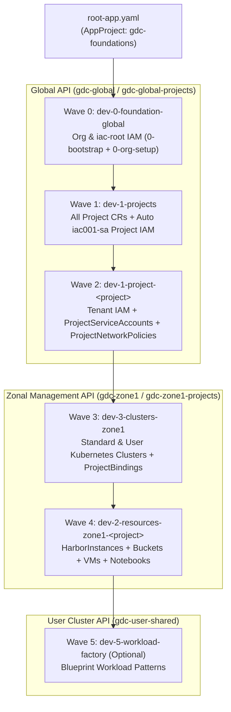
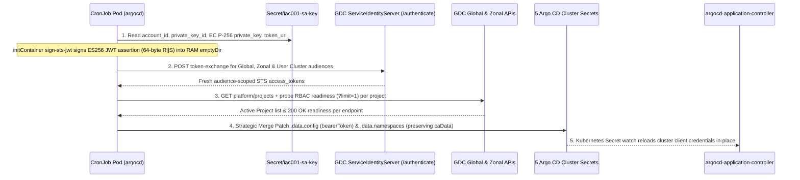

# GDC Landing Zone with Argo CD (`landing-argo.git`)

Standalone Infrastructure-as-Code GitOps repository for automating operational configurations inside a [Google Distributed Cloud air-gapped Organization](https://docs.cloud.google.com/distributed-cloud/hosted/docs/latest/gdcag/resources/resource-hierarchy#organization) utilizing **Argo CD** orchestration under service account created during bootstrap.**.

## Overview

This repository provides a declarative, multi-stage **Argo CD** GitOps landing zone for provisioning and managing Google Distributed Cloud (GDC) air-gapped organizations, tenants, projects, zonal infrastructure, clusters, and application workloads.

It implements a  **`3 + 2N` Application Architecture** (`3` shared organization/cluster `Application`s + `2` `Application`s per GDC `Project`: 1 Global config app and 1 Zonal resources app), backed by an in-cluster **`argocd-cluster-sync` `CronJob`** that automatically rotates short-lived service account STS tokens and registers newly created `Project` namespaces in Argo CD's cluster secrets.


## Architecture 

### Core Concepts

1. **Minimal `3 + 2N` Application Footprint**:
   - **3 Shared Foundation `Application`s**:
     - `dev-0-foundation-global` (Wave `0`, `gdc-global`): Organization (`platform`) and `iac-root` IAM RoleBindings (`0-bootstrap` + `0-org-setup`).
     - `dev-1-projects` (Wave `1`, `gdc-global`): Creates every `Project` CR listed in [`apps/values.yaml`](./apps/values.yaml) (`projects:`) **and** automatically binds `iac001-sa`'s baseline project admin roles inside each project namespace.
     - `dev-3-clusters-zone1` (Wave `3`, `gdc-zone1`): Shared User Clusters, Standard Clusters, and `ProjectBinding`s.
   - **2 Per-Project `Application`s (`+2` per `Project`)**:
     - `dev-1-project-<project>` (Wave `2`, `gdc-global-projects`): Consolidates tenant `IAMRoleBinding`s, `ProjectServiceAccount`s, and Global `ProjectNetworkPolicy` rules into a single Global `Application`.
     - `dev-2-resources-<zone>-<project>` (Wave `4`, `gdc-zone1-projects`): Consolidates `HarborInstance` registries, Object Storage `Bucket`s, `VirtualMachine`s/disks/SSH policies, and Workbench `Notebook`s into a single Zonal `Application`.

2. All Resources are tracked using service account (`argocd-cm.yaml`)**:
   - [`argocd-cm.yaml`](./argocd-cm.yaml) scopes `resource.inclusions` per endpoint URL (`?scope=projects` vs. root endpoints) to match `iac001-sa` `LIST` permissions across GDC `1.16+` APIs—including `ProjectServiceAccount` on `gdc-global-projects` and `Bucket` on `gdc-zone1-projects`—eliminating `ExcludedResourceWarning`s across all managed CRDs.
   - *(Note: On GDC `1.16`, `artifactregistry.gdc.goog/HarborInstanceProject` omits `list` on built-in `harbor-instance-admin` / `harbor-project-creator` roles, so `HarborInstance` is managed via GitOps while `projects:` inside `<project>-harbors.yaml` is omitted under Zero Breakglass.)*

3. **Automated Project Onboarding & STS Token Refresh (`cluster-sync-cronjob.yaml`)**:
   - [`cluster-sync-cronjob.yaml`](./cluster-sync-cronjob.yaml) runs every 15 minutes inside `argocd` using `Secret/iac001-sa-key`. It exchanges an ES256-signed `iac001-sa` assertion at GDC STS for fresh audience-scoped `bearerToken`s and queries `projects.resourcemanager.global.gdc.goog` in `platform` to automatically append RBAC-ready `Project` namespaces to the Argo CD cluster secrets.

### Sync Waves



### Application Grouping

#### Design Goals & Constraints

All architectural choices in this repository are based on the no `Infrastructure Operator` / root kubeconfigs and no manual RBAC privilege escalation concept:

1. **Goal 1 — Minimize Separate `Application`s**: Eliminate the per-chart `Application` sprawl (`10` child apps for 1 project; `22` for 3 projects).
2. **Goal 2 — Track 100% of Created Resources**: Ensure every resource rendered by Helm is actively synced and tracked in Argo CD (`0` `ExcludedResourceWarning`s and `0` silently skipped manifests).
3. **Goal 3 — Frictionless `Project` Onboarding**: Make adding a new GDC `Project` and its resources a pure Git change—without editing Helm templates, manually patching Argo CD cluster `Secret` `namespaces:`, or manually rotating 1-hour STS tokens.

#### Cache Constraints

* **`?scope=projects` Cluster Cache Split**: Project-scoped GDC roles (`project-networkpolicy-admin`, `harbor-instance-admin`, `project-vm-admin`, `workbench-notebooks-admin`) grant `list`/`watch` **only** inside project namespaces (`iac-root`, `<project>`) and return `403 Forbidden` in `platform`. Registering `?scope=projects` cluster URLs creates dedicated project-only caches in Argo CD while `client-go` strips the query parameter on wire requests so GDC's Istio `AuthorizationPolicy` `Host` check succeeds.
* **`ProjectServiceAccount` (`resourcemanager.global.gdc.goog/v1`)**: Built-in Global API roles grant `iac001-sa` `get, list, create, update, patch, delete` (`watch=false`). Because Argo CD's `gitops-engine` cache initialization (`c.sync()`) only requires `LIST`, including `ProjectServiceAccount` in [`argocd-cm.yaml`](./argocd-cm.yaml) `resource.inclusions` enables full native sync, diff, prune, and resource tracking (logging only a benign background watch warning).
* **`HarborInstanceProject` (`artifactregistry.gdc.goog/v1`)**: Built-in Zonal API roles (`harbor-instance-admin`, `harbor-project-creator`) grant `get, watch, create, update, patch` (`list=false, delete=false`), and `CustomRole` self-escalation is blocked by Kubernetes RBAC escalation prevention (`HTTP 400`). Because stock Argo CD fails the entire cluster cache when `LIST` returns `403`, `HarborInstanceProject` cannot be cached directly by stock Argo CD without a proxy or `Job` wrapper.

#### Control-Plane Architecture Options

| Option | Description | Pros | Cons |
| :--- | :--- | :--- | :--- |
| **Option 1: In-Cluster `gdc-api-adapter` Proxy** *(Pure `iac001-sa`)* | Stateless HTTPS reverse proxy in `argocd` using `iac001-sa` credentials to synthesize `LIST` for `HarborInstanceProject` (from `WATCH` + `GET`), poll `LIST` for `ProjectServiceAccount` watches, return empty `200` lists in `platform` for project-only CRDs, and inject STS tokens. | • Native CRD tracking for **all** resources (including `HarborInstanceProject`) with unmodified OCI charts.<br>• Eliminates `?scope=projects` cluster secrets (`5 → 3`).<br>• Zero controller watch warnings. | • Introduces a custom reverse-proxy `Deployment` in the Argo CD → GDC API control path.<br>• Extra component to maintain and troubleshoot in air-gapped environments. |
| **Option 2: Stock Direct Argo CD + `in-cluster` `Job` Wrapper** | Direct Argo CD → GDC API connections; tracks `ProjectServiceAccount` natively via `argocd-cm` and splits `HarborInstanceProject` into a dedicated `in-cluster` (`argocd`) `Application` running deterministic `kubectl apply` `Job`s as `iac001-sa`. | • No proxy in the GDC API path.<br>• Provisions and tracks `HarborInstanceProject` via Kubernetes `Job` health with zero `ExcludedResourceWarning`. | • Requires custom chart/template wrapper to separate `HarborInstanceProject` `Job`s from `gdc-harbors` (since an Argo CD `Application` supports a single `destination`).<br>• Indirect (`Job`-level) rather than live CRD drift tracking for Harbor projects. |
| **Option 3: Stock Direct Argo CD Config-Only Consolidation** *(Selected)* | 100% stock direct Argo CD → GDC APIs + per-endpoint `resource.inclusions` in [`argocd-cm.yaml`](./argocd-cm.yaml) + in-cluster [`cluster-sync-cronjob.yaml`](./cluster-sync-cronjob.yaml) (`iac001-sa`) for STS token & namespace sync; omits `projects:` in `<project>-harbors.yaml`. | • **Zero custom proxies and zero chart forks**—uses upstream Harbor OCI charts (`gdc-*`) unmodified.<br>• **100% of created resources are natively tracked** as first-class GDC CRDs with zero `ExcludedResourceWarning`.<br>• Simplest operational model in air-gapped GDC. | • Does not declaratively provision `HarborInstanceProject` via Argo CD until GDC's built-in Harbor roles grant `list` (Harbor projects are created in Harbor UI/API after `HarborInstance` provisioning).<br>• Retains 5 cluster secrets (automated by `CronJob`). |

#### Application Grouping Granularity Choices

Because every `gdc-*` Helm chart stamps an explicit `metadata.namespace` on rendered manifests and [`argocd-cm.yaml`](./argocd-cm.yaml) aligns `resource.inclusions` on the `?scope=projects` endpoints (`ProjectServiceAccount` + `IAMRoleBinding` + `ProjectNetworkPolicy` on Global; `HarborInstance` + `Bucket` + `VirtualMachine` + `Notebook` on Zonal), three grouping layouts were compared:

| Grouping Layout | Child `Application` Count (`N` = Projects) | Pros | Cons |
| :--- | :--- | :--- | :--- |
| **Legacy Per-Chart / Per-Stage Layout** *(Retired)* | **`4 + 6N`**<br>(`10` apps for 1 prj; `22` for 3 prj) | • Granular per-chart sync retry (`buckets` vs. `vms` vs. `notebooks`). | • Severe `Application` sprawl in Argo CD UI.<br>• Required copy-pasting multiple `Application` YAML blocks when onboarding each project. |
| **Layout A: Stage-Grouped (`O(1)` Constant Apps)** | **`4–5` constant**<br>(`4–5` apps whether `N=1` or `N=20`) | • Minimum possible `Application` count.<br>• Adding a new project creates `0` new `Application`s (only adds Helm sources inside shared stage apps). | • **Shared blast radius**: a single project's broken values file or stuck resource makes the entire `2-resources` stage `OutOfSync`/`Progressing` for all tenants.<br>• Harder per-project visibility, manual sync, and RBAC scoping in the Argo CD UI. |
| **Layout B: Per-Project Grouped (`3 + 2N` Apps)** *(Selected)* | **`3 + 2N`**<br>(`5` apps for 1 prj; `7` for 2 prj; `9` for 3 prj) | • **67% per-project reduction** (`6N → 2N`: 1 Global config app + 1 Zonal resources app per project).<br>• **Clean tenant/project isolation**: each project gets its own Global and Zonal Sync/Health cards and isolated failure domain.<br>• Maps cleanly to GDC's Global vs. Zonal API topology. | • Adds `2` child `Application`s per onboarded project (rendered automatically from `projects:` in [`apps/values.yaml`](./apps/values.yaml)). |

#### Summary of Decisions Made

| Decision Area | Selected Choice | Rationale |
| :--- | :--- | :--- |
| **Control-Plane Architecture** | **Option 3 — Stock Direct Argo CD Config-Only Consolidation** | Keeps Argo CD 100% stock with direct GDC API connections and unmodified Harbor OCI charts, avoiding custom API proxies or `Job` wrappers under Zero Breakglass. |
| **Application Grouping** | **Layout B — Per-Project Grouped (`3` Shared + `2` Per-Project Apps)** | Balances `Application` minimization (`7` child apps across `mellons-prj` and `apples-prj`, vs. `16` under the legacy layout) with clean per-project blast-radius, health reporting, and UI/RBAC boundaries (`dev-1-project-<project>` + `dev-2-resources-<zone>-<project>`). |
| **Eliminating `ExcludedResourceWarning`** | **Include `ProjectServiceAccount` in `argocd-cm`; comment out `projects:` in `<project>-harbors.yaml`** | Restores full native tracking for `ProjectServiceAccount` (`LIST` is allowed for `iac001-sa`) and ensures `gdc-harbors` only renders `HarborInstance` (which is 100% tracked), eliminating all excluded resources. |
| **Project Onboarding & STS Token Lifecycle** | **Declarative `projects:` catalog in `apps/values.yaml` + auto `iac001-sa` IAM in `1-projects.yaml` + `CronJob/argocd-cluster-sync`** | Eliminates chicken-and-egg RBAC bootstrap, removes 50+ lines of `iac001-sa` IAM boilerplate per project, prevents 1-hour STS token expiry (`SYNC: Unknown`), and auto-registers new `Project` namespaces in cluster `Secret`s. |

---

### Directory Structure

```text
landing-argo.git/
├── README.md
├── .gitignore
├── appproject.yaml                        # Argo CD AppProject (gdc-foundations)
├── argocd-cm.yaml                         # Argo CD ConfigMap (resource.inclusions & wave health)
├── cluster-sync-cronjob.yaml              # Pure iac001-sa STS token & Project namespace sync CronJob
├── root-app.yaml                          # Option A: Helm-based App-of-Apps root Application
├── applicationset.yaml                    # Option B: Single-resource List ApplicationSet
├── apps/                                  # Helm App-of-Apps chart generating 3 + 2N Applications
│   ├── Chart.yaml                         # Chart metadata (gdc-foundations-apps)
│   ├── values.yaml                        # Centralized configuration & declarative `projects:` catalog
│   └── templates/
│       ├── 0-foundation-global.yaml       # Shared App #1 (Wave 0 -> gdc-global)
│       ├── 1-projects.yaml                # Shared App #2 (Wave 1 -> gdc-global)
│       ├── 1-project-config.yaml          # Per-Project App #1 (Wave 2 -> gdc-global-projects)
│       ├── 3-clusters.yaml                # Shared App #3 (Wave 3 -> gdc-zone1)
│       ├── 2-resources.yaml               # Per-Project App #2 (Wave 4 -> gdc-zone1-projects)
│       └── 5-workload-factory.yaml        # Optional Workload App (Wave 5 -> gdc-user-shared)
└── environments/
    └── dev/
        ├── 0-bootstrap/
        │   ├── iac-iam-global.yaml
        │   └── iac-iam-project.yaml
        ├── 0-org-setup/
        │   └── tenant-1-iam.yaml
        ├── 1-project-factory/             # Global per-project values (<project>-{iam,sa,netpols}.yaml)
        │   ├── apples-prj-iam.yaml
        │   ├── apples-prj-netpols.yaml
        │   ├── apples-prj-sa.yaml
        │   ├── mellons-prj-iam.yaml
        │   ├── mellons-prj-netpols.yaml
        │   └── mellons-prj-sa.yaml
        ├── 2-resources/                   # Zonal per-project values (<project>-{harbors,buckets,vms,notebooks}.yaml)
        │   └── zone1/
        │       ├── apples-prj-buckets.yaml
        │       ├── mellons-prj-buckets.yaml
        │       ├── mellons-prj-harbors.yaml
        │       ├── mellons-prj-notebooks.yaml
        │       └── mellons-prj-vms.yaml
        ├── 3-clusters/
        │   └── zone1/
        │       └── tenant-1-clusters.yaml
        └── 5-workload-factory/
            └── zone1/
                └── mellons-p1-webapp.yaml
```

---

### Refreshing GDC Kube API Tokens & Project Namespaces

### Why Continuous Token Refresh Is Required

GDC air-gapped API servers (`global-api`, `management-kube`, and User Cluster API servers) do not use static, non-expiring Kubernetes `ServiceAccount` bearer tokens for external clients. Instead, GDC `ProjectServiceAccount` identities (`system:serviceaccount:iac-root:iac001-sa`) authenticate using short-lived **OAuth 2.0 / RFC 8693 Security Token Service (STS)** access tokens bound to a specific API server `audience`. When stored `bearerToken`s expire, Argo CD cannot list live state on target clusters and child `Application`s fall into `SYNC: Unknown` (`ComparisonError: ... Unauthorized`).

To eliminate manual token rotation and manual `namespaces:` edits while keeping Argo CD 100% stock under **Pure `iac001-sa`**, [`cluster-sync-cronjob.yaml`](./cluster-sync-cronjob.yaml) runs an in-cluster Kubernetes `CronJob` (`argocd/argocd-cluster-sync`) **every 15 minutes (`*/15 * * * *`)**.

#### End-to-End Refresh Flow (`CronJob/argocd-cluster-sync`)



#### Step-by-Step Mechanics Inside Each `CronJob` Run

Each scheduled pod uses two pre-cached air-gapped images (`iac/argocd:latest` and `iac/gitea:latest`) sharing a RAM-backed volume (`emptyDir.medium: Memory`) so no unencrypted token material is ever written to node disks:

1. **Step 1 — Offline `ES256` Subject JWT Signing (`initContainer: sign-sts-jwt`)**:
   - Reads `account_id` (`system:serviceaccount:iac-root:iac001-sa`), `private_key_id`, `private_key` (ECDSA P-256 PEM), and `token_uri` (`https://service-accounts.org-12345.gdc.test/authenticate`) from `Secret/iac001-sa-key` mounted read-only at `/var/run/secrets/iac-sa`.
   - Constructs a 1-hour JWT header (`{"alg":"ES256","typ":"JWT","kid":"<private_key_id>"}`) and claims (`iss`, `sub`, `aud: <token_uri>`, `iat: now - 10s`, `exp: now + 3590s`).
   - Signs `<header>.<claims>` with `openssl dgst -sha256 -sign`, parses the ASN.1 DER `(R, S)` integers via `openssl asn1parse`, zero-pads and concatenates them into the 64-byte raw `R || S` signature required by JWS `ES256` (RFC 7518 §3.4), and writes `/work/subject_token.jwt`.

2. **Step 2 — Audience-Scoped GDC STS Token Exchange (`container: reconcile-secrets`)**:
   - Exchanges `/work/subject_token.jwt` via `POST https://service-accounts.org-12345.gdc.test/authenticate` (`Content-Type: application/json`) using GDC `ServiceIdentityServer`'s token-exchange contract:
     - `grant_type`: `urn:ietf:params:oauth:token-type:token-exchange`
     - `subject_token_type`: `urn:k8s:params:oauth:token-type:serviceaccount`
     - `requested_token_type`: `urn:ietf:params:oauth:token-type:access_token`
   - Mints **3 distinct `access_token`s**, mapped across the **5 Argo CD cluster `Secret`s** (note that `?scope=projects` secrets share the base endpoint's token audience):

   | Argo CD Cluster `Secret` | Argo CD Cluster Name | STS Token `audience` | `namespaces` Sync Rule |
   | :--- | :--- | :--- | :--- |
   | `gdc-global-api-secret` | `gdc-global` | `https://global-api.<ORG>.<ZONE>.<DOMAIN>` | `platform,<live_and_desired_projects>` |
   | `gdc-global-projects-secret` | `gdc-global-projects` | `https://global-api.<ORG>.<ZONE>.<DOMAIN>` | `<projects>` passing `200 OK` on `ProjectNetworkPolicy` & `ProjectServiceAccount` |
   | `gdc-mgmt-api-secret` | `gdc-zone1` | `https://management-kube.apiserver.<ORG>.<ZONE>.<DOMAIN>` | `platform,<projects>` passing `200 OK` on `Cluster` |
   | `gdc-mgmt-projects-secret` | `gdc-zone1-projects` | `https://management-kube.apiserver.<ORG>.<ZONE>.<DOMAIN>` | `<projects>` passing `200 OK` on `VirtualMachine` & `Bucket` |
   | `gdc-user-shared-secret` | `gdc-user-shared` | `https://<CLUSTER>-kube.apiserver.<ORG>.<ZONE>.<DOMAIN>` | Preserved unchanged (rotates `bearerToken` only) |

3. **Step 3 — Dynamic `Project` Pre-Registration & RBAC Readiness Gate**:
   - Reads desired projects from `Application/dev-1-projects` (`releaseName: <project>-iac-iam`) alongside live `Project`s from `GET /apis/resourcemanager.global.gdc.goog/v1/namespaces/platform/projects`, and immediately pre-registers desired project namespaces in `gdc-global-api-secret` (because `IAMRoleBinding`, `CustomRole`, `RoleBinding`, and `Project` return `HTTP 200` on `gdc-global` even before a project CR exists, preventing Argo CD's `namespace not managed` pre-sync block when `dev-1-projects` creates both `Project/<prj>` and `iac001-sa`'s 13 project `IAMRoleBinding`s).
   - If a newly desired project is not yet live in `platform`, triggers a `normal` refresh on `Application/dev-1-projects` and polls up to `6 x 10s` (`?limit=1` -> `HTTP 200`) before adding `<prj>` to `gdc-global-projects-secret` and `gdc-mgmt-projects-secret`—ensuring a `403 Forbidden` during RBAC propagation never disrupts existing projects' caches.

4. **Step 4 — Least-Privilege In-Place `Secret` Patching**:
   - Authenticates to `https://kubernetes.default.svc` as `ServiceAccount/argocd-cluster-sync`, whose `Role` (`argocd/argocd-cluster-sync`) grants `get, patch, update` **solely** on the 5 named cluster `Secret`s plus `get, patch` on `Application/dev-1-projects` (it cannot read `Secret/iac001-sa-key`, repository deploy keys, or `argocd-secret` via the K8s API).
   - Reads each cluster `Secret`'s existing `tlsClientConfig.caData`, builds an updated JSON `.data.config` (`{"bearerToken":"...","tlsClientConfig":{"insecure":false,"caData":"..."}}`), and sends a `PATCH` (`application/strategic-merge-patch+json`).
   - Argo CD's `argocd-application-controller` watches cluster `Secret`s in `argocd` and hot-reloads the updated `bearerToken` and `namespaces` list automatically without pod restarts.

## Argo CD & Gitea Bootstrapping

All commands assume your default `KUBECONFIG` targets the cluster hosting **Argo CD** (`argocd` namespace) and **Gitea** (`gitea` namespace) as `iac001-sa`.

### Step 1: Push Repository to Gitea & Configure Repository Secrets

1. Port-forward Gitea SSH (`svc/gitea` in `gitea`) and push `main`:
   ```bash
   kubectl port-forward -n gitea svc/gitea 2222:22 &
   git push -u origin main
   ```

2. Register the Gitea SSH repository `Secret` (`repo-landing-argo`) and Managed Harbor OCI `Secret` (`repo-harbor-charts` + `argocd-tls-certs-cm`):
   ```bash
   kubectl create secret generic repo-landing-argo -n argocd \
     --from-literal=type=git \
     --from-literal=name=landing-argo \
     --from-literal=url=ssh://git@gitea.gitea.svc/org-12345/landing-argo.git \
     --from-literal=insecure=true \
     --from-file=sshPrivateKey="${HOME}/.ssh/argocd_gitea_ed25519" \
     --dry-run=client -o yaml | \
     kubectl label --local -f - argocd.argoproj.io/secret-type=repository -o yaml | \
     kubectl apply --server-side -f -
   ```

### Step 2: Create the 5 Initial Cluster Secrets & `argocd-cm`

1. Create the 5 GDC cluster secrets (`gdc-global-api-secret`, `gdc-global-projects-secret`, `gdc-mgmt-api-secret`, `gdc-mgmt-projects-secret`, `gdc-user-shared-secret`) with each endpoint's `caData` (see `cluster-sync-cronjob.yaml` for automatic token & namespace maintenance thereafter).
2. Apply [`argocd-cm.yaml`](./argocd-cm.yaml) and [`appproject.yaml`](./appproject.yaml):
   ```bash
   kubectl apply -f argocd-cm.yaml
   kubectl apply -f appproject.yaml
   kubectl rollout restart statefulset/argocd-application-controller -n argocd
   ```

### Step 3: Deploy the Automatic Sync `CronJob`

1. Create `Secret/iac001-sa-key` in `argocd` from your `iac001-sa` service-account credential JSON (never commit private keys to Git):
   ```bash
   IAC_SA_JSON="${HOME}/.ais/gdcloud/service_account_store.json"
   python3 - "${IAC_SA_JSON}" <<'PY' | kubectl apply -f -
   import sys, json, base64
   sa = json.load(open(sys.argv[1]))
   # Supports both downloaded key file (`privateKey`/`privateKeyId`/`tokenUri`) and gdcloud store format
   acct = sa.get("account_id") or f"system:serviceaccount:{sa['project']}:{sa['name']}"
   kid  = sa.get("private_key_id") or sa["privateKeyId"]
   key  = sa.get("private_key") or sa["privateKey"]
   turi = sa.get("token_uri") or sa["tokenUri"]
   print(json.dumps({
       "apiVersion": "v1",
       "kind": "Secret",
       "metadata": {"name": "iac001-sa-key", "namespace": "argocd"},
       "type": "Opaque",
       "data": {k: base64.b64encode(v.encode()).decode() for k, v in {
           "account_id": acct, "private_key_id": kid, "private_key": key, "token_uri": turi
       }.items()},
   }))
   PY
   ```

2. Apply [`cluster-sync-cronjob.yaml`](./cluster-sync-cronjob.yaml) and trigger an immediate sync if desired:
   ```bash
   kubectl apply -f cluster-sync-cronjob.yaml
   kubectl create job --from=cronjob/argocd-cluster-sync argocd-cluster-sync-manual -n argocd
   ```

### Step 4: Deploy Root App-of-Apps

```bash
kubectl apply -f root-app.yaml
```

Monitor all `Application`s:

```bash
kubectl get applications -n argocd \
  -o custom-columns="NAME:.metadata.name,WAVE:.metadata.annotations.argocd\.argoproj\.io/sync-wave,CLUSTER:.spec.destination.name,SYNC:.status.sync.status,HEALTH:.status.health.status"
```
## Onboarding a New GDC Project

Adding a new GDC `Project` is a declarative Git change. Below is the exact walkthrough used to onboard **`apples-prj`** alongside `mellons-prj`:

### Step 1: Register `apples-prj`
Register `apples-prj` under `projects:` in [`apps/values.yaml`](./apps/values.yaml):
   ```yaml
   projects:
     - name: mellons-prj
       # ...
     - name: apples-prj
       tenant: tenant-1
       global:
         iam: true               # environments/dev/1-project-factory/apples-prj-iam.yaml
         serviceAccounts: true   # environments/dev/1-project-factory/apples-prj-sa.yaml
         networkPolicies: true   # environments/dev/1-project-factory/apples-prj-netpols.yaml
       zones:
         zone1:
           buckets: true         # environments/dev/2-resources/zone1/apples-prj-buckets.yaml
   ```
   *(All feature flags under `global` and `zones.<zone>` are optional and default to disabled when omitted—so `apples-prj` omits `harbors`, `vms`, and `notebooks` until needed. Setting a flag to `true` resolves the conventional filename above, or you can pass an explicit relative path string.)*

### Step 2: Add the enabled environment values files:
   For `apples-prj`, only 4 lightweight values files were added:
   - [`environments/dev/1-project-factory/apples-prj-iam.yaml`](./environments/dev/1-project-factory/apples-prj-iam.yaml): Tenant `IAMRoleBinding`s (`project-iam-admin`, `namespace-admin`, `project-bucket-admin`, `project-bucket-object-admin`, `project-networkpolicy-admin`, `workload-viewer`).
   - [`environments/dev/1-project-factory/apples-prj-sa.yaml`](./environments/dev/1-project-factory/apples-prj-sa.yaml): `ProjectServiceAccount` `apples-app-sa` in namespace `apples-prj`.
   - [`environments/dev/1-project-factory/apples-prj-netpols.yaml`](./environments/dev/1-project-factory/apples-prj-netpols.yaml): Global `ProjectNetworkPolicy` `allow-mellons-traffic` allowing ingress from `mellons-prj`.
   - [`environments/dev/2-resources/zone1/apples-prj-buckets.yaml`](./environments/dev/2-resources/zone1/apples-prj-buckets.yaml): Zonal Object Storage `Bucket` `apples-bucket` (`Standard` storage class in `zone1`).

### Step 3: Commit and push to `main`:
   - `gdc-foundations-root` updates `dev-1-projects` (Wave `1`) and renders the two per-project `Application`s (`dev-1-project-apples-prj` at Wave `2` and `dev-2-resources-zone1-apples-prj` at Wave `4`).
   - `CronJob/argocd-cluster-sync` detects `apples-prj` in `Application/dev-1-projects`, pre-registers `apples-prj` in `gdc-global-api-secret` so `dev-1-projects` can create `Project/apples-prj` and `iac001-sa`'s `IAMRoleBinding`s, verifies per-project RBAC readiness (`HTTP 200`), and appends `apples-prj` to `gdc-global-projects-secret`, `gdc-mgmt-api-secret`, and `gdc-mgmt-projects-secret`.
   - *(Tip: `argocd-cluster-sync` runs automatically every 15 minutes; to onboard immediately without waiting for the next cron tick, trigger a one-shot job with `kubectl create job --from=cronjob/argocd-cluster-sync argocd-cluster-sync-manual -n argocd`.)*
   - `dev-1-project-apples-prj` and `dev-2-resources-zone1-apples-prj` should sync all Global and Zonal CRDs to `Synced` / `Healthy` with zero `ExcludedResourceWarning`s.


## Token Troubleshooting

* **Check `CronJob` status and recent refresh logs**:
  ```bash
  kubectl get cronjob,jobs -n argocd -l app.kubernetes.io/part-of=gdc-foundations
  LAST_POD=$(kubectl get pods -n argocd --sort-by=.metadata.creationTimestamp -o name | grep argocd-cluster-sync | tail -n 1)
  kubectl logs -n argocd "${LAST_POD}" -c sign-sts-jwt
  kubectl logs -n argocd "${LAST_POD}" -c reconcile-secrets
  ```

* **Trigger an immediate on-demand refresh** (e.g., right after onboarding a new `Project` if you do not want to wait up to 15 minutes, or after reconnecting a previously offline environment):
  ```bash
  kubectl delete job argocd-cluster-sync-manual -n argocd --ignore-not-found
  kubectl create job --from=cronjob/argocd-cluster-sync argocd-cluster-sync-manual -n argocd
  kubectl wait --for=condition=complete --timeout=60s job/argocd-cluster-sync-manual -n argocd
  kubectl logs job/argocd-cluster-sync-manual -n argocd -c reconcile-secrets
  ```
  *(If tokens had previously expired during a prolonged cluster/VM outage and Argo CD cached `ComparisonError`, also run `kubectl rollout restart statefulset/argocd-application-controller -n argocd` once after the job completes.)*

* **Rotate `Secret/iac001-sa-key`** (only needed if the `iac001-sa` ECDSA keypair itself is rotated in GDC IAM):
  Re-run the `Secret/iac001-sa-key` `kubectl apply` snippet in Step 3 of the Bootstrap Guidewith the new key JSON file, then trigger `argocd-cluster-sync-manual` above.
