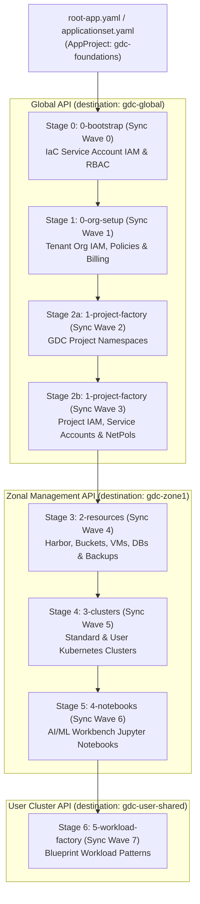

# GDC Foundations with Argo CD

Infrastructure-as-Code implementation for automating operational configurations inside [Google Distributed Cloud air gapped Organization](https://docs.cloud.google.com/distributed-cloud/hosted/docs/latest/gdcag/resources/resource-hierarchy#organization) utilizing ArgoCD orchestration. The organization is the top-level resource in the GDC resource hierarchy and defines a security boundary that encloses infrastructure resources to be administered together by this code.

## Overview

This directory provides a declarative, multi-stage **Argo CD** GitOps framework for provisioning and managing Google Distributed Cloud (GDC) air-gapped organizations, tenants, projects, zonal infrastructure, clusters, and application workloads.

It uses native Argo CD **Multi-Source `Application`** manifests (and an optional **`ApplicationSet`**) orchestrated with **`argocd.argoproj.io/sync-wave`** annotations to enforce dependency ordering across Global, Zonal Management, and User Cluster API endpoints.

---

## Foundations-argo vs Foundations (Helmfile)

Both [`foundations-argo/`](./) and [`foundations/`](../foundations/) deploy the **exact same underlying KRM Helm charts** (`charts/gdc-*` and `blueprints/patterns/*`) across the **same 7 logical stages** (`0-bootstrap` through `5-workload-factory`). They differ in how environment configurations are structured, how stages are orchestrated, and how changes are reconciled against GDC API servers.

| Dimension | `foundations-argo/` (Argo CD GitOps) | `foundations/` (Helmfile CLI / CI Pipeline) |
| :--- | :--- | :--- |
| **Reconciliation Model** | **Pull-based continuous GitOps**: Argo CD controller runs inside the cluster, continuously watches Git/OCI sources, and automatically reconciles drift (`selfHeal: true`, `prune: true`). | **Push-based CLI / CI execution**: Triggered on-demand from an operator workstation or CI runner (e.g., Gitea Actions) executing `helmfile diff` / `helmfile sync`. |
| **Stage & Dependency Ordering** | Ordered declaratively via **`argocd.argoproj.io/sync-wave`** annotations (`"0"` through `"7"`). Argo CD waits for all resources in Wave $N$ to become `Healthy` before starting Wave $N+1$. | Ordered via sequential **`helmfiles:`** includes in `foundations/helmfile.yaml`, release-level `needs:` dependencies, and Helm `wait: true` flags. |
| **Configuration & Values Structure** | **Per-release static Helm values** (`environments/<env>/<stage>/*.yaml`) matching each chart's `values.schema.json` directly—no runtime Go-templating or preprocessing required. | **Centralized tenant configurations** (`bases/environments/<env>/global/tenant-1.yaml`, `zone1/tenant-1.yaml`) dynamically looped, sliced, and serialized into chart values at runtime via `*.yaml.gotmpl`. |
| **Multi-Cluster API Routing** | Routed via Argo CD **`destination.name`** (`gdc-global`, `gdc-zone1`, `gdc-user-shared`) backed by Kubernetes Cluster Secrets (`argocd.argoproj.io/secret-type: cluster`). | Routed via **`kubeContext`** per release (`contexts.yaml`), requiring a pre-populated local `KUBECONFIG` containing tokens and CA certificates for all target API servers. |
| **Chart Source Resolution** | Configured in `Application` **`spec.sources`** using either a Git directory (`path: charts/gdc-*`) or a Managed Harbor OCI registry (`chart: gdc-*`) alongside `$values/` file references. | Configured in `bases/environments/<env>/charts.yaml`, toggling between relative local paths (`../../../charts/gdc-*`) and OCI URLs (`oci://harbor...`). |
| **Drift Detection & Visibility** | Built-in **Argo CD UI & CLI** with real-time resource health trees, live manifest diffs against cluster state, audit history, and automated self-healing. | Point-in-time inspection during CI runs (`helmfile diff` / `helm list`) or via the custom CLI wrapper (`scripts/helm_cli.py`). |
| **Adding a New Tenant or Project** | Add per-release values files under `environments/<env>/` and add the corresponding `Application` entries in `apps/` (or list elements in `applicationset.yaml`). | Add a `tenant-N.yaml` file under `bases/environments/<env>/`; Helmfile's `environments.yaml.gotmpl` and release loops automatically discover and iterate over it. |

### Key Trade-offs & When to Use Which

* **Choose `foundations-argo/` (Argo CD)** when you want:
  * **Continuous drift remediation (`selfHeal`)** and real-time visual observability across Global, Zonal, and User clusters via the Argo CD UI.
  * **Pure static YAML values** where every file in `environments/<env>/` maps 1:1 to a Helm chart's `values.yaml` schema without intermediate Go-template transformation logic.
  * **Decoupled RBAC & credential management**, storing GDC API credentials centrally inside the Argo CD control plane rather than distributing `KUBECONFIG` files to CI runners.
* **Choose `foundations/` (Helmfile)** when you want:
  * **Compact, DRY tenant definitions** where a single `tenant-1.yaml` file per zone defines all projects, IAM bindings, buckets, VMs, clusters, and workloads, and Go templates automatically fan out the Helm releases.
  * **Zero in-cluster GitOps dependencies**, such as during initial Day-0 environment bring-up before an Argo CD control plane cluster is available.

---

## Core Concepts

1. **Separation of Concerns (Charts vs. Environment Values)**:
   - **Reusable Helm Charts (`charts/gdc-*` and `blueprints/patterns/*`)**: Encapsulate GDC Kubernetes Resource Model (KRM) custom resource definitions (`Project`, `IAMRoleBinding`, `HarborInstance`, `Bucket`, `VirtualMachine`, `Cluster`, `Notebook`, etc.) with strict schema validation (`values.schema.json`).
   - **Environment Values (`foundations-argo/environments/<env>/`)**: Pure static YAML value files organized by environment (`dev`, `stg`, `prd`), deployment stage, and GDC zone (`zone1`, `zone2`).
   - **Declarative GitOps Orchestration (`foundations-argo/apps/`)**: Argo CD `Application` resources bind a chart source (from internal Git or a Managed Harbor OCI registry) with its environment-specific value files and route the rendered resources to the appropriate GDC API server.

2. **Multi-Cluster GDC API Routing**:
   GDC air-gapped infrastructure spans three distinct Kubernetes API control planes, each registered in Argo CD as a named cluster destination:
   - **`gdc-global` (Global API Server)**: Hosts organization-wide and cross-zone resources, including IAM/RBAC policies, `Project` namespaces, `ProjectServiceAccount` identities, and `ProjectNetworkPolicy` rules.
   - **`gdc-zone1` / `gdc-zone2` (Zonal Management API Servers)**: Host zone-scoped infrastructure resources, including Managed Harbor registries, Object Storage buckets, Virtual Machines, Databases, Standard/User Kubernetes clusters, and AI/ML Workbench Notebooks.
   - **`gdc-user-shared` (User Cluster API Server)**: Hosts containerized Kubernetes workloads and Blueprint Pattern deployments.

3. **Ordered Execution via Sync Waves**:
   Argo CD reconciles resources sequentially using `argocd.argoproj.io/sync-wave` annotations (`"0"` through `"7"`). A higher wave only begins syncing after all `Application` resources in the preceding wave report `Synced` and `Healthy`.

---

## Architecture & Deployment Stages



### Stage Summary Table

| Stage | Sync Wave | Target Cluster (`destination.name`) | Charts Deployed | Purpose |
| :--- | :---: | :--- | :--- | :--- |
| **`0-bootstrap`** | `"0"` | `gdc-global` | `charts/gdc-iam-role-bindings`<br>`charts/gdc-iam-roles`<br>`charts/gdc-rbac-role-bindings` | Grants organization-wide (`platform`) and root project (`iac-root`) IAM/RBAC permissions to the automation Service Account (`iac-sa`). |
| **`0-org-setup`** | `"1"` | `gdc-global` | `charts/gdc-iam-role-bindings`<br>`charts/gdc-org-policies`<br>`charts/gdc-org-network-policies`<br>`charts/gdc-billing` | Configures tenant organization-level IAM/RBAC role bindings, organization policies, and billing accounts. |
| **`1-project-factory`** (Projects) | `"2"` | `gdc-global` | `charts/gdc-projects` | Creates tenant `Project` resources (e.g., `mellons-prj`) in the `platform` namespace on the Global API. |
| **`1-project-factory`** (Config) | `"3"` | `gdc-global` | `charts/gdc-iam-role-bindings`<br>`charts/gdc-project-service-accounts`<br>`charts/gdc-project-network-policies` | Provisions project-scoped IAM bindings, `ProjectServiceAccount` identities, and `ProjectNetworkPolicy` ingress/egress rules once the project namespace exists. |
| **`2-resources`** | `"4"` | `gdc-zone1` | `charts/gdc-harbors`<br>`charts/gdc-buckets`<br>`charts/gdc-vm`<br>`charts/gdc-dbs`<br>`charts/gdc-backup-repositories`<br>`charts/gdc-backup-plans` | Provisions project-scoped zonal infrastructure: Managed Harbor instances and projects, Object Storage buckets, Virtual Machines, Databases, and Backup repositories/plans. |
| **`3-clusters`** | `"5"` | `gdc-zone1` | `charts/gdc-clusters` | Provisions Zonal Standard (`mellons-cluster`) and User (`mellons-user-cluster`) Kubernetes clusters and binds them to projects via `ProjectBinding`. |
| **`4-notebooks`** | `"6"` | `gdc-zone1` | `charts/gdc-notebooks` | Deploys GPU-enabled AI/ML Workbench Jupyter `Notebook` instances onto Zonal clusters. |
| **`5-workload-factory`** | `"7"` | `gdc-user-shared` | `blueprints/patterns/p1-resilient-3-tier-webapp/chart` | Deploys application workloads and reference architecture Blueprint Patterns onto User Shared or Standard Kubernetes clusters. |

---

## Stage Details

### Stage 0: `0-bootstrap` (Sync Wave `"0"`)
Establishes the foundational permissions required for continuous GitOps automation on the Global API (`gdc-global`):
- **`dev-0-bootstrap-iac-iam-global`**: Binds the automation Service Account (`iac-sa` in `iac-root`) to organization-level roles in the `platform` namespace (`project-creator`, `organization-iam-admin`, `bucket-admin`, `user-cluster-admin`, etc.).
- **`dev-0-bootstrap-iac-iam-project`**: Binds `iac-sa` to project-level administration roles within the `iac-root` namespace (`secret-admin`, `harbor-instance-admin`, `cluster-admin`, etc.).

### Stage 1: `0-org-setup` (Sync Wave `"1"`)
Configures baseline tenant governance on the Global API (`gdc-global`):
- **`dev-0-org-setup-tenant-1-iam`**: Assigns organization-wide viewer/admin IAM roles (such as `user-cluster-node-viewer` and `user-cluster-crd-viewer`) to tenant administrators in the `platform` namespace.
- Can be extended with `charts/gdc-org-policies`, `charts/gdc-org-network-policies`, and `charts/gdc-billing`.

### Stage 2: `1-project-factory` (Sync Waves `"2"` & `"3"`)
Automates multi-tenant project onboarding on the Global API (`gdc-global`) across two sequential sub-waves:
- **Wave `"2"` (`dev-1-project-factory-mellons-prj`)**: Deploys `charts/gdc-projects` to create the `Project` custom resource (`mellons-prj`) in the `platform` namespace.
- **Wave `"3"`**: Once the `Project` namespace is reconciled, three applications run in parallel:
  - **`dev-1-project-factory-mellons-prj-iam`**: Assigns project-scoped IAM roles (`project-iam-admin`, `project-bucket-admin`, `project-vm-admin`, `harbor-instance-admin`, etc.) in `mellons-prj`.
  - **`dev-1-project-factory-mellons-prj-sa`**: Creates `ProjectServiceAccount` resources (e.g., `mellons-frontend-sa`) in `mellons-prj`.
  - **`dev-1-project-factory-mellons-prj-netpols`**: Configures cross-project and external ingress/egress `ProjectNetworkPolicy` rules in `mellons-prj`.

### Stage 3: `2-resources` (Sync Wave `"4"`)
Provisions zonal cloud primitives on the target Zonal Management API server (`gdc-zone1`):
- **`dev-2-resources-zone1-mellons-harbors`**: Provisions a Managed Harbor container registry (`HarborInstance`) and associated `HarborInstanceProject`.
- **`dev-2-resources-zone1-mellons-buckets`**: Provisions GDC Object Storage `Bucket` resources (`mellons-bucket`, `mellons-vm-repo`).
- **`dev-2-resources-zone1-mellons-vms`**: Provisions GDC Virtual Machine instances, boot disks, and optional UI SSH access policies (`mellons-frontend-vm`).

### Stage 4: `3-clusters` (Sync Wave `"5"`)
Provisions Kubernetes clusters on the Zonal Management API server (`gdc-zone1`):
- **`dev-3-clusters-zone1-tenant-1`**: Deploys `charts/gdc-clusters` to provision Standard clusters (`mellons-cluster` in `platform` with `ProjectBinding` to `mellons-prj`) and dedicated User clusters (`mellons-user-cluster` in `mellons-prj`).

### Stage 5: `4-notebooks` (Sync Wave `"6"`)
Deploys managed AI/ML development environments on the Zonal Management API server (`gdc-zone1`):
- **`dev-4-notebooks-zone1-tenant-1`**: Deploys `charts/gdc-notebooks` to create Workbench `Notebook` instances (`mellons-notebook`) bound to the target cluster (`mellons-cluster`) and service account (`mellons-frontend-sa`).

### Stage 6: `5-workload-factory` (Sync Wave `"7"`)
Deploys containerized applications onto User Cluster APIs (`gdc-user-shared`):
- **`dev-5-workload-factory-zone1-mellons-p1-webapp`**: Deploys the `p1-resilient-3-tier-webapp` Blueprint Pattern chart into the `mellons-prj` namespace on the target User Cluster, injecting tenant/project metadata and the air-gapped Harbor container registry URL.

---

## Directory Structure

```text
foundations-argo/
├── README.md
├── appproject.yaml                        # Argo CD AppProject (gdc-foundations)
├── root-app.yaml                          # Option A: Helm-based App-of-Apps root Application
├── applicationset.yaml                    # Option B: Single-resource List ApplicationSet
├── apps/                                  # Helm App-of-Apps chart generating stage Applications
│   ├── Chart.yaml                         # Chart metadata (gdc-foundations-apps)
│   ├── values.yaml                        # Centralized configuration (repoURL, targetRevision, clusters, OCI toggle)
│   └── templates/                         # Stage-by-stage Application templates
│       ├── 0-bootstrap.yaml               # Sync Wave 0 (Global API)
│       ├── 0-org-setup.yaml               # Sync Wave 1 (Global API)
│       ├── 1-project-factory.yaml         # Sync Waves 2 & 3 (Global API)
│       ├── 2-resources.yaml               # Sync Wave 4 (Zonal Management API)
│       ├── 3-clusters.yaml                # Sync Wave 5 (Zonal Management API)
│       ├── 4-notebooks.yaml               # Sync Wave 6 (Zonal Management API)
│       └── 5-workload-factory.yaml        # Sync Wave 7 (User Cluster API)
└── environments/
    └── dev/                               # Per-release Helm values matching charts/gdc-* schemas
        ├── 0-bootstrap/
        │   ├── iac-iam-global.yaml
        │   └── iac-iam-project.yaml
        ├── 0-org-setup/
        │   └── tenant-1-iam.yaml
        ├── 1-project-factory/
        │   ├── mellons-prj-project.yaml
        │   ├── mellons-prj-iam.yaml
        │   ├── mellons-prj-sa.yaml
        │   └── mellons-prj-netpols.yaml
        ├── 2-resources/
        │   └── zone1/
        │       ├── mellons-prj-harbors.yaml
        │       ├── mellons-prj-buckets.yaml
        │       └── mellons-prj-vms.yaml
        ├── 3-clusters/
        │   └── zone1/
        │       └── tenant-1-clusters.yaml
        ├── 4-notebooks/
        │   └── zone1/
        │       └── tenant-1-notebooks.yaml
        └── 5-workload-factory/
            └── zone1/
                └── mellons-p1-webapp.yaml
```

---

## Centralized Configuration (`apps/values.yaml`)

All shared orchestration settings—such as the internal Git `repoURL`, branch/tag `targetRevision`, target environment name (`dev`, `stg`, `prd`), registered Argo CD cluster names, and Managed Harbor OCI chart toggle—are centralized in [`foundations-argo/apps/values.yaml`](./apps/values.yaml):

```yaml
environment: dev
argocdNamespace: argocd
project: gdc-foundations

git:
  repoURL: http://gitea.gitea.svc:80/org-12345/gdc-iac-org.git
  targetRevision: main

oci:
  enabled: false
  repoURL: harbor001-iac-root.org-12345.zone1-a.gdch.test/iac/charts

clusters:
  global: gdc-global
  zone1: gdc-zone1
  zone2: gdc-zone2
  userShared: gdc-user-shared
```

---

## Prerequisites

1. **Cluster Secrets Registered in `argocd` Namespace**:
   Ensure the GDC API endpoints are registered as Argo CD cluster secrets (see [tools/argocd/README.md](../tools/argocd/README.md#configure-connection-to-gdc)) with matching `stringData.name` fields:
   - `gdc-global` (Global API endpoint)
   - `gdc-zone1` (Zone 1 Management API endpoint)
   - `gdc-user-shared` (User Cluster API endpoint)

2. **Internal Git / OCI Harbor Repository Registered**:
   Register your internal Gitea repository (and optional Managed Harbor OCI Helm registry) in the `argocd` namespace:
   ```yaml
   apiVersion: v1
   kind: Secret
   metadata:
     name: gitea-repo-secret
     namespace: argocd
     labels:
       argocd.argoproj.io/secret-type: repository
   stringData:
     type: git
     url: http://gitea.gitea.svc:80/org-12345/gdc-iac-org.git
     username: <GITEA_USERNAME>
     password: <GITEA_TOKEN>
   ```

---

## Deployment Options

First, create the `gdc-foundations` `AppProject`:

```bash
kubectl apply -f foundations-argo/appproject.yaml
```

### Option A: Helm-Based App-of-Apps Pattern (`root-app.yaml`)

Deploy the root `Application` to render all stage templates in `foundations-argo/apps/templates/` using [`foundations-argo/apps/values.yaml`](./apps/values.yaml) and sync them in Sync Wave order (`0` through `7`):

```bash
kubectl apply -f foundations-argo/root-app.yaml
```

To preview or apply a single stage directly from the workstation:

```bash
# Preview all generated Argo CD Application manifests
helm template gdc-foundations-root foundations-argo/apps

# Render and apply a single stage (e.g., 0-bootstrap)
helm template gdc-foundations-root foundations-argo/apps -s templates/0-bootstrap.yaml | kubectl apply -f -
```

### Option B: ApplicationSet Pattern (`applicationset.yaml`)

Deploy all Foundations stages from a single `ApplicationSet` resource using the `list` generator:

```bash
kubectl apply -f foundations-argo/applicationset.yaml
```

---

## Using OCI Helm Charts from Managed Harbor

By default (`oci.enabled: false` in [`apps/values.yaml`](./apps/values.yaml)), the stage `Application` manifests pull charts from `path: charts/gdc-*` in the internal Git repository. To pull versioned OCI Helm charts from your air-gapped Managed Harbor instance instead:

1. Register the Harbor OCI registry in Argo CD:
   ```yaml
   apiVersion: v1
   kind: Secret
   metadata:
     name: harbor-oci-charts
     namespace: argocd
     labels:
       argocd.argoproj.io/secret-type: repository
   stringData:
     type: helm
     name: harbor-iac-charts
     enableOCI: "true"
     url: harbor001-iac-root.org-12345.zone1-a.gdch.test/iac/charts
     username: <HARBOR_ROBOT_USER>
     password: <HARBOR_ROBOT_SECRET>
   ```
2. Set `oci.enabled: true` in [`foundations-argo/apps/values.yaml`](./apps/values.yaml):
   ```yaml
   oci:
     enabled: true
     repoURL: harbor001-iac-root.org-12345.zone1-a.gdch.test/iac/charts
   ```

