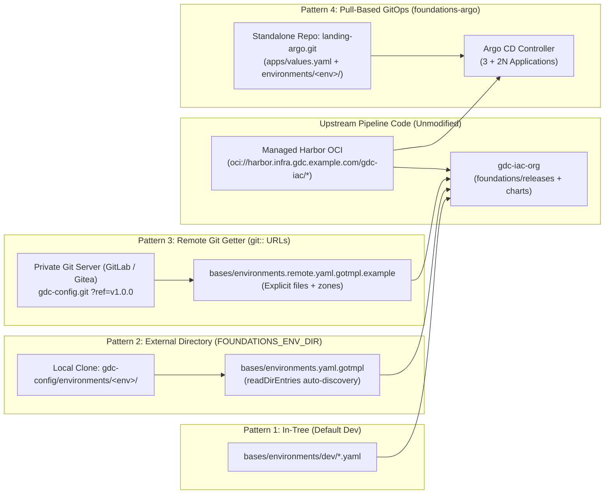
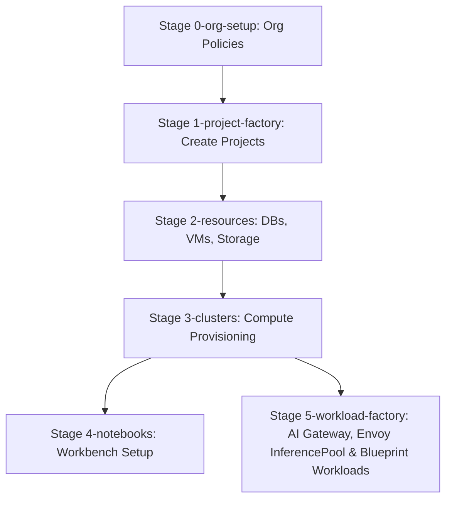
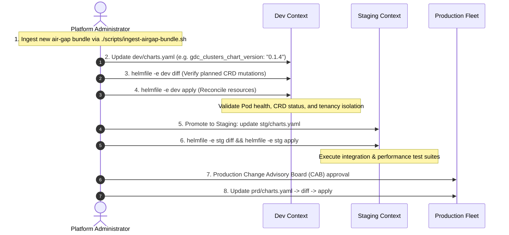

# GDC Foundations: Step-by-Step IaC Deployment Manual

This operational playbook guides GDC Hosted administrators through manual execution, state verification, and rollback procedures for all 5 foundational stages.

---

## Prerequisites & Pre-Flight Checklist

Before deploying the foundational stages, complete the following initial bootstrapping and environment setup:

### 1. RBAC Bootstrapping (First Run Only)
The user running Helmfile (e.g., `fop-iac@example.com`) requires `secret-admin` and `project-iam-admin` privileges on the `iac-root` project to manage Helm state files (release secrets).

Run these commands once to bootstrap permissions:

> [!NOTE]
> Ensure the `fop-platform-admin@example.com` user has the roles **IAM Org Admin**, **Organization Grafana Viewer**, and **Project Creator** assigned before executing these commands.

```bash
# Export environment variables 
export ORG_NAME="org-1"
export IAC_PROJECT="iac-root"
export IAC_USER="fop-iac@example.com"

### Create a project to host IaC resources
gdcloud auth login # (as platform-admin)
gdcloud projects create $IAC_PROJECT

### Grant IAC_USER required Org roles:
for role in \
  organization-iam-admin \
  project-creator \
  project-editor \
  user-cluster-admin \
; do \
   gdcloud organizations add-iam-policy-binding "$ORG_NAME" \
   --member="user:$IAC_USER" \
   --role="$role";\
done

### Grant IAC_USER required IAM permissions on IAC_PROJECT:
for role in \
  secret-admin \
; do \
  gdcloud projects add-iam-policy-binding $IAC_PROJECT \
  --member=user:$IAC_USER \
  --role=$role;\
done
```

### 2. Authenticate as IaC User
```bash
gdcloud auth login # (as fop-iac@example.com)
```

### 3. Configure Kubernetes Contexts
Set the correct Kubernetes cluster contexts in `foundations/bases/environments/dev/globals.yaml`:
```yaml
gdc_context_global: "global-api-gdch_console-org-1-zone1-google-gdch-test_global-api"
gdc_context_zone: "org-1-admin-zone1-gdch_console-org-1-zone1-google-gdch-test_zone1_org-1-admin"
```

### 4. Chart Resolution Mode Configuration (Dual-Mode)
Helmfile supports two operational modes configured in `foundations/bases/environments/<env>/charts.yaml`:
- **Mode 1: Local Filesystem Resolution (Default / Dev)**:
  Uses relative paths (`../../../charts/<chart>`). Ideal for rapid development and testing directly within the cloned repository.
- **Mode 2: Air-Gapped OCI Registry Resolution (Enterprise / Prod)**:
  Pulls packaged, immutable charts from your local Harbor registry (seeded via `./scripts/ingest-airgap-bundle.sh` as detailed in [`AIRGAP_MIRRORING.md`](AIRGAP_MIRRORING.md)). Charts are pinned to exact versions:
  ```yaml
  gdc_clusters_chart_path: "oci://harbor.infra.gdc.example.com/gdc-iac/gdc-clusters"
  gdc_clusters_chart_version: "0.1.3"
  ```

### 5. Workstation & Pipeline Validation
1. Verify your local workstation is prepared as detailed in [`WORKSTATION_ONBOARDING.md`](WORKSTATION_ONBOARDING.md).
2. Ensure all required container images and Helm charts are mirrored to local registries as detailed in [`AIRGAP_MIRRORING.md`](AIRGAP_MIRRORING.md).
3. Decide how your organization separates pipeline code from environment configuration (see [Separating Code from Environment Configuration](#separating-code-from-environment-configuration) below).
4. Execute the validation script to ensure there are no syntax or schema violations:
   ```bash
   ./foundations/scripts/validate.sh dev
   ```
5. Proceed with deploying the stages below.

---

## Separating Code from Environment Configuration

By default, `foundations/` includes a sample `dev` environment inside `bases/environments/dev/`. In enterprise and air-gapped deployments, platform teams should **avoid committing organization-specific tenant definitions, Kubecontexts, or Harbor endpoints into a fork of `gdc-iac-org`**. Decoupling pipeline code (`foundations/releases/` and `charts/`) from environment values (`environments/<env>/`) lets you upgrade `gdc-iac-org` cleanly while keeping sensitive environment configurations in a dedicated, access-controlled Git repository.

### Architecture Comparison



| Pattern | Configuration Source | File & Zone Discovery | Best Suited For |
| :--- | :--- | :--- | :--- |
| **1. In-Tree (`bases/environments/`)** | Inside `gdc-iac-org/foundations/bases/environments/<env>/` | Automatic (`readDirEntries`) | Local chart authoring, CI linting, and disposable sandbox testing. |
| **2. External Config Directory (`FOUNDATIONS_ENV_DIR`)** | Separate `gdc-config` repo cloned alongside an unmodified `gdc-iac-org` checkout or air-gap bundle | Automatic (`readDirEntries`, ignores hidden `.git` dirs) | Air-gapped bastions, operator workstations, and CI jobs mounting two checkouts. |
| **3. Remote Git Values (`git::` Getter)** | Ref-pinned `git::https://...@path?ref=v1.0.0` URLs via [`bases/environments.remote.yaml.gotmpl.example`](bases/environments.remote.yaml.gotmpl.example) | Explicit list of YAML URLs and `zones` | Stateless CI/CD runners pulling pinned configs directly from GitLab or Gitea. |
| **4. Pull-Based Argo CD (`foundations-argo/`)** | Standalone [`landing-argo.git`](../foundations-argo/README.md) repository + Harbor OCI charts | Declarative `projects:` catalog in `apps/values.yaml` | Continuous pull-based GitOps reconciliation without CLI-driven Helmfile runs. |

---

### Pattern 2: External Configuration Repository via `FOUNDATIONS_ENV_DIR`

`foundations/bases/environments.yaml.gotmpl` checks the `FOUNDATIONS_ENV_DIR` environment variable before falling back to `$PWD/bases/environments`. Both absolute paths and paths relative to the working directory are resolved cleanly.

1. **Create a separate private configuration repository** (for example `gdc-config.git`) with the standard per-environment directory structure:
   ```text
   gdc-config/
   └── environments/
       ├── stg/
       │   ├── charts.yaml
       │   ├── contexts.yaml
       │   ├── globals.yaml
       │   ├── overrides.yaml
       │   ├── global/
       │   │   ├── iac.yaml
       │   │   └── tenant-1.yaml
       │   └── zone1/
       │       └── tenant-1.yaml
       └── prod/
           ├── charts.yaml
           ├── contexts.yaml
           ├── globals.yaml
           ├── overrides.yaml
           ├── global/
           │   ├── iac.yaml
           │   └── tenant-1.yaml
           └── zone1/
               └── tenant-1.yaml
   ```
   > [!IMPORTANT]
   > In `global/iac.yaml`, `global/tenant-*.yaml`, and `<zone>/tenant-*.yaml`, ensure the top-level YAML key matches the environment directory name (for example `prod:` under `environments/prod/`). When defining environments outside `bases/environments/`, set `gdc_dashboards_env_path: ""` in `charts.yaml` (or supply a `../` relative path) unless custom dashboard JSON files exist under `bases/environments/<env>/`.

2. **Validate and deploy from an unmodified `gdc-iac-org` checkout**:
   ```bash
   # Validate external 'prod' environment (via CLI flag or environment variable)
   ./foundations/scripts/validate.sh prod --env-dir /path/to/gdc-config/environments

   # Run Helmfile diff / apply from foundations/ against the external config directory
   cd foundations
   export FOUNDATIONS_ENV_DIR="/path/to/gdc-config/environments"
   helmfile -e prod -l stage=0-org-setup diff
   helmfile -e prod -l stage=0-org-setup apply
   ```

---

### Pattern 3: Stateless Remote Git Values via `git::` URLs

Helmfile natively supports fetching remote environment values files via [`go-getter` URLs](https://helmfile.readthedocs.io/en/latest/environments/#loading-remote-environment-values-files). See [`bases/environments.remote.yaml.gotmpl.example`](bases/environments.remote.yaml.gotmpl.example) for a complete, ready-to-adapt template:

```yaml
environments:
  prod:
    values:
      - git::https://git.infra.gdc.example.com/platform/gdc-config.git@environments/prod/charts.yaml?ref=v1.0.0
      - git::https://git.infra.gdc.example.com/platform/gdc-config.git@environments/prod/contexts.yaml?ref=v1.0.0
      - git::https://git.infra.gdc.example.com/platform/gdc-config.git@environments/prod/globals.yaml?ref=v1.0.0
      - git::https://git.infra.gdc.example.com/platform/gdc-config.git@environments/prod/overrides.yaml?ref=v1.0.0
      - git::https://git.infra.gdc.example.com/platform/gdc-config.git@environments/prod/global/iac.yaml?ref=v1.0.0
      - git::https://git.infra.gdc.example.com/platform/gdc-config.git@environments/prod/global/tenant-1.yaml?ref=v1.0.0
      - git::https://git.infra.gdc.example.com/platform/gdc-config.git@environments/prod/zone1/tenant-1.yaml?ref=v1.0.0
      - zones: ["zone1"]
      - environment_name: "prod"
```

* **Why explicit files and `zones` are required with `git::` URLs**: Go template functions (`readDirEntries`) execute before Helmfile's `go-getter` downloads remote values files, so `readDirEntries` cannot scan directories inside an uncloned remote Git URL. Listing each values file URL alongside explicit `zones: ["zone1"]` and `environment_name: "prod"` entries provides deterministic, tag/SHA-pinned (`?ref=v1.0.0`) execution without pre-cloning the config repo.
* **Private Git authentication**: Use SSH deploy keys (`git::ssh://git@git.infra.gdc.example.com/platform/gdc-config.git@...`) or inject CI job tokens via environment variables (`git::https://oauth2:{{ env "GIT_TOKEN" }}@git.infra.gdc.example.com/platform/gdc-config.git@...`).

---

### Pattern 4: Pull-Based GitOps with Argo CD (`foundations-argo/`)

Teams operating an in-cluster Argo CD control plane can adopt the [`foundations-argo/` (`landing-argo.git`)](../foundations-argo/README.md) model, where `landing-argo.git` serves as the dedicated environment configuration repository (`apps/values.yaml` + `environments/<env>/`) and pulls packaged `gdc-*` Helm charts directly from Managed Harbor (`oci://`). See [`../foundations-argo/README.md`](../foundations-argo/README.md) for architecture details and sync-wave design.

---

## Stage Execution Runbook



---

### 🏁 Stage 0: Bootstrap & Organization Setup

Provisions root platform settings, billing configurations, organizational policies, and baseline operator role bindings.

```bash
# 1. Perform dry-run diff validation
helmfile -e dev -l stage=0-bootstrap diff
helmfile -e dev -l stage=0-org-setup diff

# 2. Apply the stage releases
helmfile -e dev -l stage=0-bootstrap apply
helmfile -e dev -l stage=0-org-setup apply
```

* **Verification**:
  * Verify that the target administrative namespace exists: `kubectl get ns iac-root`
  * Verify root OrgPolicy resources are active: `kubectl get orgpolicies -n platform`
* **Rollback Plan**:
  * Revert change and rollback using helmfile: `helmfile -e dev -l stage=0-org-setup rollback`

---

### 🏗️ Stage 1: Project Factory

Dynamically provisions target GDC Hosted tenant namespaces, maps project-level custom roles, establishes project service accounts, and applies cross-project networking isolation policies.

```bash
# 1. Perform dry-run diff validation
helmfile -e dev -l stage=1-project-factory diff

# 2. Apply the stage releases
helmfile -e dev -l stage=1-project-factory apply
```

* **Verification**:
  * Verify that tenant namespaces are active: `kubectl get projects -n platform` (checks custom resources) and `kubectl get ns` (checks physical namespaces).
  * Verify that service accounts are provisioned: `kubectl get sa -n mellons-prj`
* **Rollback Plan**:
  * In case of failures, execute: `helmfile -e dev -l stage=1-project-factory rollback`

---

### 💾 Stage 2: Zonal Application Resources

Deploys foundational customer services inside tenant projects: databases, virtual machine templates, storage buckets, and custom dashboards.

```bash
# 1. Perform dry-run diff validation
helmfile -e dev -l stage=2-resources diff

# 2. Apply the stage releases
helmfile -e dev -l stage=2-resources apply
```

* **Verification**:
  * Verify that object storage buckets are active: `kubectl get buckets -n mellons-prj`
  * Verify virtual machine instances: `kubectl get virtualmachines -n mellons-prj`
* **Rollback Plan**:
  * Execute rollback command: `helmfile -e dev -l stage=2-resources rollback`

---

### 🖥️ Stage 3: Compute Clusters (Standard & User Clusters)

Provisions dedicated Kubernetes workloads compute pools (Standard and User clusters) and configures ProjectBindings.

```bash
# 1. Perform dry-run diff validation
helmfile -e dev -l stage=3-clusters diff

# 2. Apply the stage releases
helmfile -e dev -l stage=3-clusters apply
```

* **Verification**:
  * Verify physical cluster creation progress: `kubectl get clusters -n platform`
  * Verify user project access bindings: `kubectl get projectbindings -n platform`
* **Rollback Plan**:
  * Execute rollback command: `helmfile -e dev -l stage=3-clusters rollback`

---

### 🧠 Stage 4: Jupyter Notebook Workbenches

Configures dedicated AI/ML workbench notebooks mapping GPUs, service accounts, environment variables, and custom dataset storage volumes inside tenant user namespaces.

```bash
# 1. Perform dry-run diff validation
helmfile -e dev -l stage=4-notebooks diff

# 2. Apply the stage releases
helmfile -e dev -l stage=4-notebooks apply
```

* **Verification**:
  * Verify that Notebook workbench custom resources exist: `kubectl get notebooks -n mellons-prj`
  * Verify that the workbench server pods are successfully scheduled and active.
* **Rollback Plan**:
  * Execute rollback command: `helmfile -e dev -l stage=4-notebooks rollback`

---

### 🚀 Stage 5: Workload Factory (AI Gateway, Envoy InferencePool & Blueprint Patterns)

Deploys User/Standard Cluster application workloads (`apps.enabled: true`, `gdc.enabled: false`) including `vllm-gke`, `envoy-inference-pool` (`InferencePool` + `epp` + `AIGatewayRoute` + `BackendTrafficPolicy`), `gemma-gateway` (`standalone/chart`), `gemma-client`, and GDC Blueprint Patterns (`p1-resilient-3-tier-webapp` through `p14-antigravity-dev`).

```bash
# 1. Perform dry-run diff validation
helmfile -e dev -l stage=5-workload-factory diff

# 2. Apply the stage releases
helmfile -e dev -l stage=5-workload-factory apply
```

* **Verification**:
  * Verify User Cluster workloads and Gateway API / InferencePool resources:
    `kubectl get deploy,svc,gateway,httproute,inferencepool -n gemma-inference`
    `kubectl get deploy,svc,gateway,httproute -n gdc-dev`
* **Rollback Plan**:
  * Execute rollback command: `helmfile -e dev -l stage=5-workload-factory rollback`

---

## Pipeline Rollback Strategy

If an entire pipeline run encounters errors and you must restore the environment to a previously known stable revision:
```bash
# Rollback all stages sequentially in reverse order
helmfile -e dev -l stage=5-workload-factory rollback
helmfile -e dev -l stage=4-notebooks rollback
helmfile -e dev -l stage=3-clusters rollback
helmfile -e dev -l stage=2-resources rollback
helmfile -e dev -l stage=1-project-factory rollback
helmfile -e dev -l stage=0-org-setup rollback
```

---

## Day-2 Operations: Chart Upgrades & Environment Promotion

When new chart versions or air-gap releases are published, follow this phased progression to promote changes safely across environments:



### Promotion Commands:
```bash
# 1. Update charts.yaml in the target environment:
# foundations/bases/environments/dev/charts.yaml
# gdc_clusters_chart_version: "0.1.4"

# 2. Inspect differences before applying:
helmfile -e dev diff

# 3. Apply changes declaratively:
helmfile -e dev apply
```

