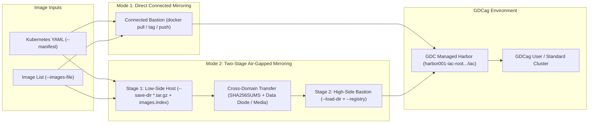

# Container Image Mirroring (`tools/mirror-images`)

This guide explains how to mirror container images from Kubernetes manifests or plain-text image lists into a private OCI registry (such as **GDC Managed Harbor** or an organization-level Harbor instance) for **Google Distributed Cloud air-gapped (GDCag)** environments using [`mirror_images.py`](mirror_images.py). For platform workload deployment background, refer to [Deploy container workloads](https://docs.cloud.google.com/distributed-cloud/hosted/docs/latest/gdcag/platform-application/deploy-container-workloads).

---

## Architecture & Operating Modes

`mirror_images.py` supports two primary operating modes (plus a combined archive-and-push mode) depending on whether a single bastion can reach both source and destination registries or an air-gap boundary separates them:

* **Mode 1 - Direct Connected Mirroring:** Run from a connected bastion with network access to both upstream registries and GDCag Managed Harbor (`--manifest` or `--images-file` paired with `--registry`).
* **Mode 2 - Two-Stage Air-Gapped Mirroring (Pull/Save -> Transfer -> Load/Push):** Designed for strict disconnected environments where no host bridges the internet and the GDCag partition:
  1. **Stage 1 (Low-Side / Internet-Connected Host):** Pulls upstream images and streams compressed `.tar.gz` archives plus an `images.index` manifest into `--save-dir`.
  2. **Cross-Domain Transfer:** Generates SHA-256 checksums, transfers the offline directory across removable media or a one-way data diode, and verifies archive integrity on the high side.
  3. **Stage 2 (High-Side / Air-Gapped Bastion):** Loads `.tar.gz` (or `.tar`) archives from `--load-dir`, strips upstream registry paths to `<image_base>:<tag>`, and pushes to `--registry`.



---

## Managed Harbor Setup

### 1. Set Environment Variables

```bash
export PROJECT="iac-root"         # GDC project where Managed Harbor is deployed
export HARBOR_PROJECT="iac"       # Harbor project where images will be mirrored
export HARBOR_INSTANCE="harbor001" # Managed Harbor instance name
```

### 2. Create Harbor Instance and Project

```bash
gdcloud harbor instances create "${HARBOR_INSTANCE:?}" \
    --project="${PROJECT:?}"

gdcloud harbor harbor-projects create "${HARBOR_PROJECT:?}" \
    --project="${PROJECT:?}" \
    --instance="${HARBOR_INSTANCE:?}"
```

### 3. Get Harbor Registry URL

```bash
gdcloud harbor instances describe "${HARBOR_INSTANCE:?}" \
    --project="${PROJECT:?}"
```

The output contains the Managed Harbor URL, for example: `https://harbor001-iac-root.org-12345.zone1-a.gdch.test`.

### 4. Authenticate Docker with a Harbor Robot Account

Follow [Create an image pull secret](https://docs.cloud.google.com/distributed-cloud/hosted/docs/latest/gdcag/platform-application/deploy-container-workloads#create-image-pull-secret) to create a Harbor project robot account:

1. From the Harbor console, select your Harbor project (`iac`).
2. Select **Robot Accounts** -> **New Robot Account**.
3. Enter a robot account name, configure permissions, and click **Add**. Keep the displayed robot account name and secret for the next step (see [Harbor's robot account documentation](https://goharbor.io/docs/2.8.0/working-with-projects/project-configuration/create-robot-accounts/#add-a-robot-account)).
4. Log in on the host pushing to Harbor:

```bash
export REGISTRY="harbor001-iac-root.org-12345.zone1-a.gdch.test"
docker login "${REGISTRY:?}"
# Provide the robot account name and secret when prompted
```

> **Note:** You can also authenticate non-interactively using a Harbor CLI secret or robot token:
> ```bash
> docker login -u "${HARBOR_USER:?}" -p "${HARBOR_SECRET:?}" "${REGISTRY:?}"
> ```

---

## Mirroring Images with `mirror_images.py`

### Prerequisites

* **Python 3** (`python3` standard library only; no third-party pip packages required).
* **Docker CLI** installed and running:
  * **Mode 1 (Direct):** Outbound access to upstream registries and `docker login` against target Managed Harbor on the same workstation.
  * **Mode 2 Stage 1 (Low-Side):** Outbound internet/upstream registry access only (no Harbor access required).
  * **Mode 2 Stage 2 (High-Side):** Air-gapped network access and `docker login` against target Managed Harbor only (no internet access required).

### CLI Reference

| Argument | Required | Default | Description |
| :--- | :--- | :--- | :--- |
| `--manifest` | No | `manifest.yaml` | Path to a Kubernetes YAML manifest containing `image: <repo>/<name>:<tag>` references. Used when `--images-file` is not set, and as a secondary tag-lookup fallback during `--load-dir`. |
| `--images-file` | No | `None` | Path to a plain-text file listing one image reference per line (`#` comments and blank lines are ignored). Takes precedence over `--manifest`. |
| `--registry` | Conditional | `None` | Target Harbor registry and project prefix (for example, `harbor001-iac-root.org-12345.zone1-a.gdch.test/iac`). Required for Mode 1 and `--load-dir`; optional with `--save-dir`. |
| `--save-dir` | Conditional | `None` | Output directory to export pulled images as `.tar.gz` archives plus `images.index` (Stage 1 low-side export). Required when `--registry` is omitted. |
| `--load-dir` | No | `None` | Input directory containing `.tar.gz` or `.tar` archives (and optional `images.index`) to load into Docker, re-tag, and push to `--registry` (Stage 2 high-side import). |

#### Supported Flag Combinations

| Operating Mode | Required / Optional Flags | Behavior |
| :--- | :--- | :--- |
| **Mode 1: Direct Connected** | `--registry <url>` + (`--manifest <yaml>` or `--images-file <txt>`) | Pulls each upstream image, re-tags to `<registry>/<image_base>:<tag>`, and pushes directly to Harbor. |
| **Mode 2 (Stage 1): Low-Side Pull & Save** | `--save-dir <dir>` + (`--manifest <yaml>` or `--images-file <txt>`) | Pulls each image, writes `<sanitized_name>.tar.gz` archives and `images.index` into `<dir>` without pushing. |
| **Mode 2 (Stage 2): High-Side Load & Push** | `--load-dir <dir>` + `--registry <url>` (+ optional `--images-file` / `--manifest`) | Loads archives from `<dir>`, resolves original tags via `images.index` (or `docker load` / fallback file), re-tags, and pushes to Harbor. |
| **Combined Save + Push** | `--save-dir <dir>` + `--registry <url>` + (`--manifest <yaml>` or `--images-file <txt>`) | Saves `.tar.gz` archives and `images.index` to `<dir>`, then immediately loads and pushes them to `--registry` in one run. |

---

### Mode 1 Walkthrough: Direct Connected Mirroring

Use Mode 1 when running on a connected bastion that can pull from upstream registries and push directly to Managed Harbor:

```bash
export REGISTRY="harbor001-iac-root.org-12345.zone1-a.gdch.test"
export HARBOR_PROJECT="iac"
export HARBOR_USER="<robot-account-or-user>"
export HARBOR_SECRET="<harbor-cli-secret>"

docker login -u "${HARBOR_USER:?}" -p "${HARBOR_SECRET:?}" "${REGISTRY:?}"

# Option A: Extract image: references from a Kubernetes manifest
./mirror_images.py \
  --manifest "<path_to_manifest.yaml>" \
  --registry "${REGISTRY}/${HARBOR_PROJECT}"

# Option B: Read explicit image references from a plain-text list
./mirror_images.py \
  --images-file external_images.txt \
  --registry "${REGISTRY}/${HARBOR_PROJECT}"
```

---

### Mode 2 Walkthrough: Two-Stage Air-Gapped Mirroring

Use Mode 2 when the GDCag partition is physically or logically isolated from upstream container registries.

#### Stage 1 (Low-Side / Internet-Connected Host): Pull and Save Archives

```bash
# Export images referenced in a Kubernetes manifest (or pass --images-file external_images.txt)
./mirror_images.py \
  --manifest "<path_to_manifest.yaml>" \
  --save-dir ./offline-images

# Generate SHA-256 checksums for cross-domain transfer verification
(cd ./offline-images && sha256sum *.tar.gz images.index > SHA256SUMS)
```

Stage 1 creates `./offline-images/` containing one `<sanitized_image>.tar.gz` per unique image alongside `images.index` (mapping each archive filename to its original `<registry>/<repo>/<image>:<tag>` reference).

#### Cross-Domain Transfer

Transfer `./offline-images/` (plus `mirror_images.py`, and optionally your manifest or `external_images.txt`) across your organization's approved data diode or removable media to the high-side GDCag bastion, then verify archive integrity:

```bash
(cd ./offline-images && sha256sum -c SHA256SUMS)
```

#### Stage 2 (High-Side / Air-Gapped Bastion): Load and Push to Harbor

```bash
export REGISTRY="harbor001-iac-root.org-12345.zone1-a.gdch.test"
export HARBOR_PROJECT="iac"
export HARBOR_USER="<robot-account-or-user>"
export HARBOR_SECRET="<harbor-cli-secret>"

docker login -u "${HARBOR_USER:?}" -p "${HARBOR_SECRET:?}" "${REGISTRY:?}"

./mirror_images.py \
  --load-dir ./offline-images \
  --registry "${REGISTRY}/${HARBOR_PROJECT}"
```

> **Tag Resolution Fallback (`mirror_images.py` `--load-dir`):** When `images.index` is present inside `--load-dir` (created automatically by Stage 1 `--save-dir`), Stage 2 requires only `--load-dir` and `--registry`. If importing `.tar` or `.tar.gz` archives generated externally without `images.index` and `docker load` outputs only an image digest/ID rather than `Loaded image: <repo>:<tag>`, pass `--images-file external_images.txt` or `--manifest <path_to_manifest.yaml>` alongside `--load-dir` so `mirror_images.py` can match sanitized archive filenames back to their expected image tags.

---

## Using Mirrored Images in Kubernetes

When deploying workloads against mirrored images, update your manifests to point to Managed Harbor and attach an `imagePullSecret` in the target namespace:

1. **Rewrite manifest image prefixes to reference Managed Harbor:**
   ```bash
   sed -i -E "s@(image:[[:space:]]+).*/@\1${REGISTRY:?}/${HARBOR_PROJECT:?}/@g" "<path_to_manifest>"
   ```

2. **Create a Kubernetes `docker-registry` pull secret in the workload namespace:**
   ```bash
   kubectl create secret docker-registry "${HARBOR_INSTANCE:?}-creds" \
       --from-file=.dockerconfigjson="${HOME}/.docker/config.json" \
       -n "<namespace>"
   ```

3. **Attach `imagePullSecrets` to the Pod or ServiceAccount spec:**
   ```yaml
   imagePullSecrets:
     - name: harbor001-creds
   ```

---

## How It Works

1. **Input Discovery (`--images-file` / `--manifest`):**
   * When `--images-file` is supplied, `extract_images_from_list()` reads one image reference per line, strips `#` comments and blank lines, and deduplicates references in order.
   * Otherwise, `extract_images_from_manifest()` scans `--manifest` (default `manifest.yaml`) and extracts unique `image: <name>:<tag>` values.
2. **Path Flattening (`<image_base>:<tag>`):** Regardless of the source registry depth (for example, `registry.k8s.io/ingress-nginx/controller:v1.10.0` or `hashicorp/vault:1.15.0`), the script retains the final path segment (`image_name.split("/")[-1]`) and pushes to `<registry>/<image_base>:<tag>` (for example, `harbor001-iac-root.org-12345.zone1-a.gdch.test/iac/controller:v1.10.0`).
3. **Direct Workflow (`direct_mirror_images`):** Runs `docker pull <image>`, `docker tag <image> <registry>/<image_base>:<tag>`, and `docker push <registry>/<image_base>:<tag>` sequentially.
4. **Two-Stage Offline Workflow (`save_images_offline` & `load_and_push_images`):**
   * **Stage 1 (`--save-dir`):** Sanitizes each image reference via `re.sub(r"[^A-Za-z0-9._-]+", "_", image_name) + ".tar.gz"`, pulls the image via `docker pull`, streams `docker save` output through `gzip` to `<save-dir>/<archive>.tar.gz`, and writes tab-separated `<archive_name>\t<image_name>` entries to `<save-dir>/images.index`.
   * **Stage 2 (`--load-dir`):** Reads `images.index` (or enumerates sorted `*.tar.gz` and `*.tar` files if `images.index` is absent), runs `docker load -i <archive>`, resolves the source tag from `images.index` -> `docker load` stdout -> optional `--images-file`/`--manifest` filename match, and runs `docker tag` + `docker push` to `--registry`.
   * **Combined Save + Push (`--save-dir` + `--registry`):** Executes `save_images_offline()` followed immediately by `load_and_push_images()` so a staging host can populate Harbor while retaining a local `.tar.gz` bundle.
5. **Verification & Exit Codes:** Tracks every processed image or archive and exits with status `1` (listing all failed items) if any pull, save, load, or push operation fails.

---

## Troubleshooting

### Manual Image Push

```bash
export IMAGE="<image_name>:<tag>"
export SOURCE_REGISTRY="<source_registry_and_repo>"

docker pull "${SOURCE_REGISTRY:?}/${IMAGE:?}"
docker tag "${SOURCE_REGISTRY:?}/${IMAGE:?}" "${REGISTRY:?}/${HARBOR_PROJECT:?}/${IMAGE:?}"
docker push "${REGISTRY:?}/${HARBOR_PROJECT:?}/${IMAGE:?}"
```

### Authentication Issue (`docker-credential-mhs` Audience Annotation)

```text
E0926 08:57:00.988701 3971516 get.go:37] cred helper failed: can not find harbor credential: failed to get audience of the Harbor instance registry harbor001-iac-root.org-12345.zone1-a.gdch.test: HarborInstance iac-root/harbor001 does not contain audience annotation
```

This error occurs because the `docker-credential-mhs` credential helper relies on the `harborinstance.artifactregistry.gdc.goog/auth-audience` annotation on the `HarborInstance` resource to mint tokens. When `harbor001` has empty annotations (`annotations: {}`), the credential helper fails.

To unblock image pushes immediately, bypass the `mhs` credential helper and log in with a Harbor CLI secret or robot account:

```bash
export HARBOR_USER="admin"
export HARBOR_SECRET="********"
docker login -u "${HARBOR_USER}" -p "${HARBOR_SECRET}" "${REGISTRY:?}"
```

To fix the missing `HarborInstance` annotation on the Zone Management API server:

```bash
export HARBOR_AUDIENCE="<ORG_ADMIN_CLUSTER_NAME>" # e.g., org-12345-admin
kubectl patch harborinstance harbor001 -n iac-root --type=merge \
  -p "{\"metadata\": {\"annotations\": {\"harborinstance.artifactregistry.gdc.goog/auth-audience\": \"${HARBOR_AUDIENCE}\"}}}"
```

### TLS Certificate Trust (`Standard` Cluster `registryMirrors`)

If cluster nodes fail to pull from a project-scoped Managed Harbor instance with an unknown certificate authority error:

```text
Failed to pull image "harbor001-iac-root.org-12345.zone1-a.gdch.test/iac/argocd:latest": failed to pull and unpack image "harbor001-iac-root.org-12345.zone1-a.gdch.test/iac/argocd:latest": failed to resolve reference "harbor001-iac-root.org-12345.zone1-a.gdch.test/iac/argocd:latest": failed to do request: Head "https://harbor001-iac-root.org-12345.zone1-a.gdch.test/v2/iac/argocd/manifests/latest": tls: failed to verify certificate: x509: certificate signed by unknown authority
```

The Managed Harbor TLS trust chain is:
* `CN = GDC Managed ORG TLS CA`
  * `CN = harbor001-iac-root.org-12345.zone1-a.gdch.test`

Export `GDC Managed ORG TLS CA` to `harbor-ca.crt` to trust the registry on your workstation, and ensure your `Standard` User Cluster spec includes a `registryMirrors` trust entry referencing `trust-store-root-ext` for the project-scoped Managed Harbor endpoint:

```yaml
    registryMirrors:
    - caCertSecretRef:
        name: trust-store-root-ext
        namespace: anthos-creds
      endpoint: https://harbor.org-12345.zone1-a.gdch.test/v2/library
    - caCertSecretRef:
        name: trust-store-root-ext
        namespace: anthos-creds
      endpoint: https://harbor.org-12345.zone1-a.gdch.test/v2/gpc-system-container-images
    - caCertSecretRef:
        name: trust-store-root-ext
        namespace: anthos-creds
      endpoint: https://harbor.org-12345.zone1-a.gdch.test/v2/
    # Add trust entry for project-scoped Managed Harbor instance:
    - caCertSecretRef:
        name: trust-store-root-ext
        namespace: anthos-creds
      endpoint: https://harbor001-iac-root.org-12345.zone1-a.gdch.test/iac
```
